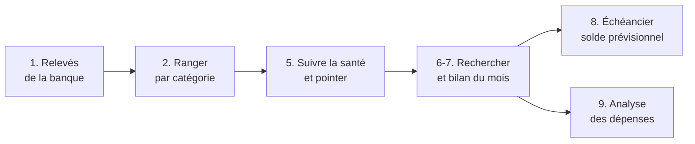

# Suivi Financier – Manuel utilisateur

Oct 18, 2026 · @Alexandre

Ce manuel s'adresse à la personne qui **utilise** le classeur au quotidien : importer ses relevés, ranger ses opérations, suivre ses remboursements de santé, anticiper les opérations à venir et analyser ses dépenses. Il explique **quoi faire et dans quel ordre**, sans entrer dans le fonctionnement interne. Pour l'installation, la maintenance ou le détail technique, voir le guide du développeur (`README.md` / `README.html`).

Ce document existe en deux formats identiques : `MANUEL_UTILISATEUR.md` et `MANUEL_UTILISATEUR.html` (un seul fichier, qui s'ouvre dans n'importe quel navigateur, sans connexion internet).

## Sommaire

- [Pour commencer](#pour-commencer)
- [Le travail du mois, pas à pas](#le-travail-du-mois-pas-à-pas)
- [1. Importer ses relevés](#1-importer-ses-relevés)
- [2. Ranger les opérations dans les catégories](#2-ranger-les-opérations-dans-les-catégories)
- [3. Découper une opération (ventilation)](#3-découper-une-opération-ventilation)
- [4. Compter une opération sur un autre mois](#4-compter-une-opération-sur-un-autre-mois)
- [5. Suivre ses remboursements de santé](#5-suivre-ses-remboursements-de-santé)
- [6. Rechercher, consulter et corriger](#6-rechercher-consulter-et-corriger)
- [7. Le bilan du mois](#7-le-bilan-du-mois)
- [8. Anticiper : l'échéancier et le solde prévisionnel](#8-anticiper--léchéancier-et-le-solde-prévisionnel)
- [9. Analyser ses dépenses](#9-analyser-ses-dépenses)
- [10. Suivre ses consommations (eau, électricité, gaz)](#10-suivre-ses-consommations-eau-électricité-gaz)
- [11. Pointer les opérations déjà analysées](#11-pointer-les-opérations-déjà-analysées)
- [12. Sauvegarde et travail à plusieurs](#12-sauvegarde-et-travail-à-plusieurs)
- [13. Corriger un import douteux (remédiation)](#13-corriger-un-import-douteux-remédiation)
- [Questions fréquentes](#questions-fréquentes)
- [Petit lexique](#petit-lexique)

## Pour commencer

### À quoi sert le classeur ?

Il rassemble toutes les opérations de votre compte. Vous récupérez vos relevés auprès de la banque (via Linxo), le classeur les lit, vous vérifiez leur rangement, et vous disposez ensuite d'écrans pour **consulter**, **corriger** et **analyser**.

### Les deux écrans de départ

- **Accueil** : un rappel de la marche à suivre pour récupérer vos données.
- **Synthese** : votre **tableau de bord**. Tout part d'ici : en haut à gauche les boutons Importer, Définir fichier Central et Synchroniser ; au centre les recherches et le bilan ; à droite la santé, l'analyse et les consommations ; en dessous, la gestion prévisionnelle.

Sur la feuille Synthese, vous réglez aussi :

| Réglage | À quoi il sert |
| --- | --- |
| **Année** et **Mois** | La période consultée (bilan, opérations du mois, analyse) |
| **Nombre de lignes** | Combien de plus grosses dépenses sont mises en évidence |
| **Montant minimum** | N'afficher que les opérations au-dessus de ce seuil (le signe est ignoré : -300 compte comme 300) |
| **Solde de référence** et sa **date** | Le point de départ du solde prévisionnel (voir section 8) |

### Comment fonctionnent les « fenêtres » ?

Les écrans de saisie (contrôle des catégories, ventilation, échéance…) s'ouvrent comme des **feuilles** et non comme des fenêtres classiques. Conséquences à connaître :

- tant qu'un écran est ouvert, **vous ne pouvez pas changer d'onglet** : c'est voulu. On en sort par ses boutons (Terminer, Valider, Annuler, Sortir…) ;
- la feuille Synthese disparaît pendant ce temps et revient d'elle-même à la fermeture ;
- **cellule grise = non modifiable**, **cellule jaune pâle = à remplir ou modifiable** ;
- dans les cadres « Instructions » des écrans, les noms de boutons sont en rouge et les noms de champs en vert.

> **Astuce :** n'essayez pas de « fermer » un écran avec la croix d'Excel ou en cliquant sur un autre onglet. Utilisez toujours le bouton prévu (Sortir, Terminer, Annuler…).

## Le travail du mois, pas à pas

À chaque récupération de relevé, dans cet ordre :

1. **Exporter** les opérations depuis Linxo (fichier **OFX** ; le CSV est facultatif) et l'enregistrer.
2. Sur Synthese, cliquer sur **Importer** et suivre les écrans (section 1).
3. **Contrôler le rangement** des opérations qui le demandent (section 2).
4. Confirmer les **rapprochements avec l'échéancier** si le classeur en propose (section 8).
5. Répondre aux **questions santé** de fin d'import (section 5).
6. Parcourir les opérations importées : **pointer** celles que vous avez analysées (section 11).
7. Contrôler le **solde** avec celui de votre banque (section 8).
8. Consulter le **bilan du mois** et, de temps en temps, l'**analyse** (sections 7 et 9).

## 1. Importer ses relevés

### Avant d'importer : préparer le fichier dans Linxo

Les informations de rangement (catégorie, notes) viennent de Linxo. Avant l'export, il est **impératif** de vérifier dans Linxo les opérations de santé :

- toutes les opérations de la catégorie **« Santé, prévoyance »** ;
- celles en **« Frais, remb santé »** doivent être celles qui feront l'objet d'un remboursement (Sécurité sociale et/ou mutuelle) ;
- celles en **« Autres : Santé, prévoyance »** sont les dépenses de santé qui ne seront pas remboursées.

Une fois importées, les modifications faites dans Linxo **ne sont plus reprises** : les corrections se font ensuite dans ce classeur.

### Lancer l'import

1. Cliquez sur **Importer** (feuille Synthese, ou bouton de l'Accueil).
2. Choisissez le fichier **OFX**. Si vous annulez, rien n'est modifié.
3. Le classeur demande si vous souhaitez joindre aussi le fichier **CSV**. Réponse par défaut : **Non**. Le CSV ne sert que de secours pour retrouver la catégorie des opérations que le classeur n'a pas su ranger tout seul.
4. Le classeur lit les opérations et **ignore celles déjà enregistrées**. Vous pouvez donc réimporter un relevé qui chevauche le précédent sans crainte de doublons.
5. Si certaines opérations ont plusieurs catégories possibles (cas du CSV), un écran vous demande de choisir pour chacune dans une liste, puis **Terminer et appliquer**.
6. Vient ensuite le **contrôle des catégories** (section 2).
7. Si une opération correspond à une échéance prévue, le classeur vous demande de **confirmer le rapprochement** (section 8).
8. Les opérations sont écrites. Un message de bilan indique combien d'opérations ont été lues, ajoutées, ou étaient déjà présentes.
9. Trois questions facultatives terminent l'import :
    - *Traiter/revoir les catégories des opérations affectées à Santé ?*
    - *Réaliser le rapprochement des opérations de santé ?*
    - *Afficher les opérations importées ?*

Répondre « Non » aux questions santé n'est pas grave : tout peut être relancé plus tard (section 5).

### Si vous changez d'avis

Dans le contrôle des catégories, le bouton **Annuler l'import** abandonne tout : **rien n'est écrit**, le classeur reste exactement comme avant. Vous pouvez recommencer avec les mêmes fichiers.

### Le fichier de la banque est effacé

Une fois l'import écrit, les fichiers OFX et CSV sont **supprimés définitivement** (sans passer par la corbeille), pour ne pas laisser de données bancaires en clair sur l'ordinateur. Si l'import s'arrête avant l'écriture, ils sont conservés. Si un fichier ne peut pas être supprimé, le message de fin vous donne son emplacement : supprimez-le vous-même.

## 2. Ranger les opérations dans les catégories

Chaque opération est rangée sur **deux niveaux** : une **Catégorie** (ex. « Santé, prévoyance ») et une **Sous-catégorie** (ex. « Frais, remb santé »). Le classeur propose automatiquement le rangement à partir de la catégorie envoyée par la banque ; vous le contrôlez et le corrigez au besoin.

### La question de départ

À l'ouverture du contrôle, une question : **« Les catégories ont-elles été correctement renseignées dans la source ? »**

- **Oui** : les propositions sont acceptées telles quelles. On ne vous présente que les opérations **sans** catégorie.
- **Non** : toutes les opérations vous sont présentées, une par une.
- **Annuler** : l'import s'arrête, rien n'est écrit.

### Le formulaire de contrôle

Pour chaque opération, vous voyez la date, le montant, le Tiers, les notes et la catégorie d'origine. Vous pouvez :

| Action | Comment |
| --- | --- |
| Choisir la **Catégorie** puis la **Sous-catégorie** | Listes déroulantes (la seconde dépend de la première) |
| Corriger le **Tiers** ou les **Notes** | Pour rendre lisible un libellé bancaire obscur. *Grisés pour les opérations « Frais, remb santé »* : leurs notes contiennent la clé de suivi santé (section 5) |
| Marquer l'opération **Pointé** | Liste Oui / vide, à côté de la date (section 11) |
| Passer à l'opération voisine | Boutons **< Précédent** et **Suivant >** |
| Créer une catégorie qui manque | Bouton **+ Nouvelle catégorie** |
| Découper l'opération | Bouton **Ventiler...** (section 3) |
| Valider tout | **Terminer et continuer** |
| Tout abandonner | **Annuler l'import** |

Vos choix ne comptent qu'au clic sur **Terminer et continuer**. À ce moment :

- s'il reste des opérations **sans catégorie**, le classeur refuse de terminer. Le bouton **OK** vous amène à la première opération à corriger ;
- si certaines opérations n'ont **jamais été affichées**, il demande confirmation : elles garderont la catégorie proposée.

### Créer une catégorie

Le bouton **+ Nouvelle catégorie** ouvre un petit formulaire : choisissez une catégorie existante ou tapez-en une nouvelle, puis la sous-catégorie, et validez. Vous revenez à l'écran précédent avec la nouvelle valeur déjà sélectionnée.

> **Garde-fou :** si ce que vous tapez ressemble beaucoup à une catégorie existante (« Alimentaton » pour « Alimentation »), le classeur vous le signale avant de créer un quasi-doublon. Les accents, majuscules et espaces superflus sont ignorés dans la comparaison.

### Corriger plus tard

Dans l'écran de recherche (section 6), **double-cliquez sur la catégorie ou la sous-catégorie** d'une opération : le même formulaire s'ouvre pour cette seule opération. Après validation, l'écran se recharge avec le même filtre. Pour une opération ventilée, ce double-clic ne fonctionne pas : passez par la colonne **Ventile**.

## 3. Découper une opération (ventilation)

**Ventiler**, c'est répartir **une** opération bancaire en plusieurs **parts**, chacune avec sa catégorie. Exemple : un ticket de pharmacie de 45 € dont 30 € de médicaments remboursés et 15 € d'hygiène.

### Où la déclencher

- pendant l'import : bouton **Ventiler...** du contrôle des catégories ;
- plus tard : **double-clic sur la colonne Ventile** de l'écran de recherche (cellule vide = nouvelle ventilation ; « Oui » = revoir une ventilation existante).

### Utiliser le formulaire

Le formulaire est découpé en deux zones : **en haut**, l'opération (date, Tiers, montant à répartir) et la liste des parts déjà saisies (10 au maximum) ; **en bas**, la zone de saisie d'une part.

1. Choisissez la **Catégorie** et la **Sous-catégorie** de la part (le bouton « + » permet d'en créer).
2. Saisissez son **Montant** (toujours en **positif** : le classeur reprend le signe de l'opération).
3. Ajoutez des **Notes** si besoin, puis cliquez sur **Ajouter la ligne**. **Effacer la saisie** vide la zone sans rien ajouter.
4. Répétez pour chaque part.
5. Cliquez sur **Terminer** : c'est accepté seulement si la **somme des parts est exactement égale** au montant de l'opération. Sinon un message indique l'écart.

Autres boutons :

- **Éditer** (en face d'une part) : la part repasse dans la zone de saisie pour être modifiée. Attention : elle est **retirée de la liste immédiatement** ; si vous ne cliquez pas ensuite sur **Ajouter la ligne**, elle reste supprimée. C'est aussi le seul moyen de supprimer une part isolée ;
- **Annuler** : abandonne la saisie en cours ;
- **Supprimer cette ventilation** (visible si elle existait déjà) : efface toutes les parts et rend à l'opération son ancien rangement.

> **À savoir :** rouvrir une ventilation et cliquer sur Terminer réécrit toutes ses parts. Si l'une d'elles était déjà rapprochée dans le suivi santé, ce rapprochement est perdu et sera à refaire (un avertissement s'affiche avant la suppression).

### Dans les chiffres

Une opération ventilée apparaît dans le **bilan du mois** une seule fois, pour son montant total ; dans l'**analyse**, elle est remplacée par ses parts, chacune dans sa catégorie.

## 4. Compter une opération sur un autre mois

Chaque opération est comptée dans un **mois de budget**, par défaut celui de sa date. Certaines doivent compter ailleurs : par exemple, un salaire versé le 28 septembre qui sert à vivre en octobre se décale de **+1 mois**.

### Pour toutes les opérations de ce type (règle)

Dans l'écran de recherche, sélectionnez une opération du type concerné, puis cliquez sur **Ajouter un décalage**. Le classeur reprend le Tiers, la catégorie et la sous-catégorie de la ligne et demande le nombre de mois (1, -1, 2…).

Il s'applique aux **prochains imports**. Les opérations déjà enregistrées ne sont pas recalculées : pour celles-là, utilisez le décalage individuel.

La règle peut aussi se modifier à la main dans la feuille de réglages (Param, tableau des décalages) : une case laissée vide veut dire « n'importe quelle valeur », et c'est la première règle qui correspond qui s'applique.

### Pour une seule opération

Dans l'écran de recherche, sélectionnez la ligne puis cliquez sur **Décaler cette opération** : indiquez un nombre de mois entre -24 et +24. Ce choix manuel l'emporte toujours sur les règles générales.

## 5. Suivre ses remboursements de santé

Le suivi santé vérifie que la Sécurité sociale et la mutuelle ont bien remboursé ce qu'elles devaient pour chaque consultation payée. Il concerne les opérations de sous-catégorie **« Frais, remb santé »**.

### Le principe : la clé de consultation

Pour relier une dépense à ses remboursements, ces opérations portent **le même texte** dans leurs Notes, appelé la **clé** :

`aaaammjj;spécialité;bénéficiaire;montant`

Exemple : `20260915;Généraliste;Alexandre;30` pour une consultation chez le généraliste le 15 septembre 2026, pour Alexandre, de 30 €. Vous saisissez normalement cette clé dans Linxo, avant l'export.

Le classeur regroupe ainsi la dépense (-30 €) et ses remboursements (+20 € Sécu, +9 € mutuelle) : le groupe est **OK** si tout est remboursé (en tenant compte de la franchise éventuelle), **KO** sinon.

### Les trois étapes

Elles se lancent après l'import (questions finales) ou à tout moment avec le bouton **Traitement des données de santé** de Synthese.

**Étape 1 – Réparer les clés manquantes ou illisibles.** Chaque opération dont la clé n'est pas exploitable s'affiche avec des listes en cascade pour retrouver la bonne clé parmi celles connues (Date → Spécialité → Bénéficiaire → Montant). Trois choix :

- **Valider** : la clé est enregistrée, l'opération ne sera plus proposée ;
- **Pas de correspondance** : permet de **créer une clé neuve** (date, spécialité, bénéficiaire, montant), puis Générer et Valider ;
- **Passer** : rien n'est modifié, la ligne reviendra au prochain lancement.

**Étape 2 – Calcul automatique.** Pour chaque groupe, le classeur calcule le solde (dépenses − remboursements − franchise) et affiche OK ou KO. Un groupe déjà OK, ou KO avec un dépassement d'honoraires déclaré, n'est plus reposé.

**Étape 3 – Compléter les cas non soldés.** Chaque dépense KO s'affiche avec ses remboursements et son solde actuel. Vous renseignez :

- le **Bénéficiaire** (obligatoire) ;
- le **Tiers corrigé**, obligatoire seulement si le Tiers importé n'est pas dans la liste des praticiens (le champ est alors jaune) ;
- la **Franchise** retenue (0 si aucune) : le solde se recalcule sous vos yeux ;
- **Dépassement d'honoraires ?** Oui/Non (Oui = vous acceptez le reste à charge, le cas n'est plus reproposé) ;
- un **Commentaire** libre.

**Valider ce cas** enregistre et passe au suivant ; **Cas suivant** passe sans rien changer.

### Consulter la situation : le bouton « Suivi Santé »

Le bouton **Suivi Santé** de Synthese ouvre l'écran de recherche avec toutes les lignes de santé. Une ligne au-dessus du tableau résume la situation, par exemple : « 7 lignes dont 1 part ventilée : 3 OK, 2 KO – écart cumulé des dépenses KO : 45,00 € ».

- Les montants des lignes KO sont en **gras** (rouge pour une dépense, vert pour un remboursement).
- Les lignes « Santé, prévoyance » d'une autre sous-catégorie n'ont pas de statut : elles servent à repérer une dépense de santé mal rangée.
- **Pour corriger un mauvais rangement** : double-cliquez sur la catégorie ou sous-catégorie, choisissez la bonne, validez ; puis lancez **Traitement des données de santé** pour rapprocher la ligne.
- Le bouton **Erreur Import Santé** liste les opérations dont la clé n'a pas pu être lue (à réparer par l'étape 1).

## 6. Rechercher, consulter et corriger

L'**écran de recherche** est l'outil central : il affiche en un seul tableau toutes les opérations (et les parts de ventilation), et permet de les corriger sans ouvrir la feuille de données.

### Les façons de l'ouvrir

| Bouton (Synthese) | Ce que vous voyez |
| --- | --- |
| **Recherche Générale** | Toutes les opérations |
| **Dernier Import** | Les opérations ajoutées par le dernier import |
| **Opérations du mois sélectionné** | Le mois choisi sur Synthese, au-dessus du montant minimum |
| **Suivi Santé** | Les lignes de santé avec leur statut (section 5) |
| **Erreur Import Santé** | Les opérations dont la clé santé est illisible |
| *Voir le détail* (depuis le bilan) | Les entrées ou les dépenses du mois |
| *Voir les opérations* (depuis l'analyse) | Ce qui compose un chiffre de l'analyse |

Au-dessus du tableau, une ligne rappelle le filtre actif et le nombre de lignes.

### Lire le tableau

- Les montants sont **verts** pour une entrée d'argent, **noirs** pour une dépense ; une ligne « en alerte » est en **gras** (rouge pour une dépense).
- Les **flèches de filtre** des en-têtes permettent de restreindre l'affichage (par Tiers, catégorie, date…). Votre filtre est conservé quand l'écran se recharge.
- Modifier la date, le Tiers ou le montant directement dans l'écran **ne change rien** : c'est un affichage. Les modifications se font par les actions ci-dessous.

### Ce que l'on peut faire

| Je veux… | Comment |
| --- | --- |
| Changer la catégorie ou sous-catégorie | **Double-clic** sur la cellule Categorie ou SousCategorie |
| Découper une opération | **Double-clic** sur la colonne Ventile |
| Corriger plusieurs notes d'un coup | Modifier les cellules Notes, écrire **Oui** dans la colonne Valider des lignes concernées, puis **Appliquer les lignes marquées** |
| Décaler le mois de budget | **Ajouter un décalage** (règle) ou **Décaler cette opération** (une seule) |
| Marquer une opération comme analysée | Choisir **Oui** dans la colonne **Pointe** (section 11) |
| Déclarer une opération récurrente | Sélectionner la ligne puis **Rendre récurrente** (section 8) |
| Noter une opération à venir | **Ajouter à l'échéancier** (section 8) |
| Revenir | **Sortir** (retour sur Synthese, ou sur l'analyse si vous en veniez) |

> **Astuce :** après un import, répondre « Oui » à *Afficher les opérations importées ?* ouvre directement cet écran sur les nouveautés. C'est le bon moment pour pointer, corriger et déclarer les opérations récurrentes.

## 7. Le bilan du mois

Sur Synthese, choisissez l'**année** et le **mois**, puis cliquez sur **Bilan mensuel**. L'écran affiche le **total des entrées**, le **total des dépenses** et la **différence**. Les boutons *Voir le détail des entrées* et *Voir le détail des dépenses* ouvrent l'écran de recherche sur les opérations concernées.

Une opération ventilée est comptée ici une seule fois, pour son montant total.

Le bouton **Opérations du mois sélectionné** donne la liste de ces opérations, filtrée sur le montant minimum que vous avez réglé.

## 8. Anticiper : l'échéancier et le solde prévisionnel

L'échéancier garde la liste de ce qui **va** arriver sur votre compte (loyer, abonnements, prêt, facture ou chèque attendu…) et en déduit votre **solde dans 15 et 30 jours**. Cette fonction est facultative.

### Les idées à retenir

- Une **opération ponctuelle** (un chèque émis, une facture attendue) est une échéance unique.
- Une **opération récurrente** (loyer, abonnement) est déclarée **une seule fois** par une *règle* : le classeur crée tout seul les échéances suivantes.
- Quand une opération importée correspond à une échéance, vous confirmez le rapprochement : l'échéance **disparaît** (seule l'opération réelle reste).
- Une échéance non rapprochée **reste dans la liste** et reste comptée dans le solde, jusqu'à ce que vous la supprimiez.

### Déclarer une échéance

Bouton **Saisir une échéance** (Synthese), ou **Ajouter une échéance** dans les listes. Les champs :

| Champ | À renseigner |
| --- | --- |
| **Libellé** | Un nom pour la liste (facultatif ; à défaut, le Tiers ou la catégorie) |
| **Tiers** | Le commerçant ou organisme. Un simple mot-clé suffit (ex. EDF) : il est cherché dans le Tiers de l'opération importée, sans tenir compte des majuscules |
| **Catégorie / Sous-catégorie** | Facultatif si le Tiers est connu. Peut suffire à reconnaître l'opération quand on ignore le commerçant |
| **Montant** | **Négatif** pour une dépense, **positif** pour une entrée. Obligatoire |
| **Numéro de chèque** | Pour un chèque émis, échéance ponctuelle uniquement : chiffres seuls, 10 au plus |
| **Périodicité** | Vide ou *Ponctuelle* = une seule fois. *Hebdomadaire, Mensuelle, Trimestrielle, Annuelle* = crée une règle |
| **Date prévue** | La date, ou celle de la première occurrence pour une règle |
| **Date de fin** | Facultatif, pour une règle. Vide = ne s'arrête jamais |
| **Précision de la date** | **Jour** (à quelques jours près) ou **Mois** (n'importe quel jour du mois) |
| **Tolérance** | Écart de montant accepté, en % (10 par défaut ; 0 = montant exact) |

À la validation, le classeur vérifie que la saisie est complète et cohérente (Tiers, catégorie **ou** numéro de chèque au minimum). En cas de problème, un message s'affiche sous le formulaire et rien n'est enregistré.

**Anti-doublon :** si une échéance quasi identique existe déjà, une boîte de dialogue la décrit et vous demande si vous voulez quand même ajouter. La réponse par défaut est **Non**.

**Chèque :** le numéro est refusé s'il est déjà passé en banque ou déjà dans l'échéancier (les zéros en tête sont ignorés : 0001234 et 1234 sont le même chèque). À l'import, le numéro suffit à reconnaître l'opération, sans tenir compte de la date ni du Tiers.

### Déclarer récurrente une opération existante

Dans l'écran de recherche (y compris juste après un import), sélectionnez l'opération puis cliquez sur **Rendre récurrente** : le formulaire s'ouvre prérempli (périodicité mensuelle, prochaine date au même jour du mois suivant). Ajustez si besoin et validez.

### Le rapprochement à l'import

Pendant l'import, après le contrôle des catégories et avant l'écriture, le classeur compare les nouvelles opérations à l'échéancier. Pour chaque opération qui correspond à une échéance, un message **« Échéancier »** affiche l'opération et les valeurs de l'échéance :

- **Oui** : l'opération est rapprochée, l'échéance disparaîtra de la liste ;
- **Non** : l'échéance suivante qui pourrait convenir est proposée ;
- **Annuler** : pas de rapprochement pour cette opération, l'échéance reste à venir.

Si vous annulez tout l'import, aucune échéance n'est supprimée.

Une échéance est candidate quand le montant est de même signe et dans la tolérance, la date est dans la fenêtre attendue (de 5 jours avant à 10 jours après pour une précision Jour), le Tiers contient celui de l'échéance et la catégorie correspond (si ces éléments sont renseignés).

### Les deux listes

Bouton **Voir l'échéancier** (Synthese) :

- **La liste des échéances à venir** : vous pouvez corriger les cellules directement, filtrer avec les flèches d'en-tête, ajouter ou supprimer. Supprimer une échéance issue d'une règle pose la question :
    - **Oui** : supprimer seulement cette échéance (la règle continue) ;
    - **Non** : **arrêter la récurrence** à partir de cette échéance (par exemple après un remboursement anticipé) ;
    - **Annuler** : ne rien faire.
- **La liste des règles** (bouton *Voir les règles*) : on peut y mettre une règle en pause (Actif = Non), la supprimer, ou la faire repartir avec *Actualiser les occurrences*.

> **Attention :** *Actualiser les occurrences* supprime les échéances actuelles de la règle et les recrée. Une règle mise en pause perd donc ses échéances.

Dans la colonne des numéros de chèque de la liste, une cellule **rouge** signale un numéro invalide ou déjà passé en banque (à vérifier : chèque non rapproché ?), **orange** un numéro en double dans l'échéancier. Rien n'est bloqué : c'est un signal.

### Le solde prévisionnel (feuille Synthese)

Le bloc **Prévisionnel de trésorerie** se calcule seul après chaque import ou saisie :

| Ligne | Signification |
| --- | --- |
| **Solde de réf.** et **Date du solde** | Le solde que votre banque affiche, et sa date (vous les saisissez avec le bouton ci-dessous) |
| **Solde actuel** | Solde de référence + toutes les opérations **postérieures** à cette date |
| **Solde à J+15 / J+30** | Solde actuel + les échéances prévues d'ici 15 ou 30 jours |
| **Éch. en retard** | Nombre d'échéances dont la date est passée et non rapprochées : à supprimer ou à rapprocher |
| **Écart du solde** | L'écart constaté lors de la dernière saisie du solde |

**Saisir / contrôler le solde :** cliquez sur ce bouton, saisissez le solde affiché par la banque puis sa date. À partir du deuxième solde saisi, le classeur calcule le solde qu'il **attendait** et affiche l'**écart**. Un écart non nul signale une opération manquante ou en double, ou une date de solde mal choisie. Vous décidez alors d'enregistrer ou non le nouveau solde.

> **À savoir :** utilisez toujours ce bouton plutôt que de taper directement dans les cases du solde, car la saisie directe contourne le contrôle. Saisissez la date **du solde tel que la banque l'affiche**, pas la date de votre import ; une date trop ancienne compte deux fois des opérations. Importer des opérations plus récentes met le solde à jour sans rien ressaisir.

## 9. Analyser ses dépenses

Le bouton **Analyse budgétaire** de Synthese ouvre l'écran d'analyse. Il répond à : *où va mon argent ? comment cela évolue-t-il ? quelles opérations composent ce chiffre ?*

> Cette fonction est récente : si un chiffre vous semble étrange, comparez-le avec le bilan mensuel et signalez-le.

### Régler l'analyse

| Réglage | Choix |
| --- | --- |
| **Période** | *Mois*, *Année* ou *12 derniers mois* |
| **Année de budget / Mois de budget** | La période de référence |
| **Catégorie à détailler** | *(toutes)* ou une catégorie (vue par sous-catégories) |
| **Graphique de répartition** | Barres ou Anneau |
| **Graphique d'évolution** | Barres empilées ou Courbes |
| **Catégories exclues** | Jusqu'à 6 catégories jamais comptées (par défaut : *Virements internes* et *Revenus*) |

Après chaque changement de réglage, cliquez sur **Actualiser**.

### Ce que vous voyez

- **La répartition** : un tableau (catégorie, dépenses en €, % du total, nombre d'opérations) trié de la plus grosse à la plus petite, avec un graphique. Seules les **dépenses** apparaissent, affichées en positif.
- **L'évolution** : les plus grosses catégories mois par mois sur 12 mois, avec un graphique.

### Les boutons

| Bouton | Effet |
| --- | --- |
| **Actualiser** | Recalcule tout |
| **Détailler la sélection** | Cliquez d'abord sur une ligne du tableau : l'analyse passe à ses sous-catégories (impossible sur « Autres » ou « (sans catégorie) ») |
| **Toutes les catégories** | Revient à la vue générale |
| **Voir les opérations** | Ouvre l'écran de recherche sur les opérations de la ligne sélectionnée (ou de tout ce qui est affiché si rien n'est sélectionné) |
| **Sortir** | Revient à Synthese |

Depuis l'écran de recherche ouvert par l'analyse, vous pouvez recatégoriser, ventiler ou décaler : en cliquant sur **Sortir**, vous revenez à l'analyse, qui **se recalcule**.

### Pourquoi l'analyse et le bilan mensuel diffèrent parfois

Le bilan compte une opération ventilée une seule fois ; l'analyse la remplace par ses parts, exclut des catégories et ne retient que les catégories qui sont globalement des dépenses. Un léger écart est donc normal.

## 10. Suivre ses consommations (eau, électricité, gaz)

Cette partie est **indépendante des opérations bancaires** : vous saisissez vos factures à la main, et le classeur montre combien vous consommez, à quel prix, et comment cela évolue. Elle est facultative et récente.

Bouton **Consommations** de Synthese.

### Étape 1 – Déclarer un contrat

Un contrat = un type de consommation chez un opérateur. Bouton **Contrats**, puis **Ajouter un contrat** :

| Champ | À renseigner |
| --- | --- |
| **Type de consommation** | Adduction eau, Recyclage eau, Fourniture élec, Fourniture gaz |
| **Opérateur** | Le fournisseur (il sert de légende au graphique) |
| **Unité de mesure** | Proposée selon le type (m³, kWh), modifiable |
| **Début du contrat** | Date de début |
| **Fin du contrat** | Vide = contrat en cours |
| **Abonnement mensuel** | Valeur proposée dans les relevés |
| **Référence / N° de compteur** | Facultatif |

**Changer d'opérateur :** créez simplement le nouveau contrat avec sa date de début. Le classeur propose de clôturer l'ancien **la veille**. Vos relevés passés gardent leur ancien opérateur.

### Étape 2 – Saisir un relevé (une facture ou une période)

Bouton **Saisir un relevé**. Dès que vous choisissez le type, l'opérateur et l'unité s'affichent, ainsi que la date de début (le lendemain du dernier relevé) et le dernier prix et abonnement connus.

| Champ | À renseigner |
| --- | --- |
| **Début / Fin de la période** | Dates incluses |
| **Quantité consommée** | Dans l'unité du contrat |
| **Prix de l'unité** | Hors abonnement ; 0 accepté (eau recyclée par exemple) |
| **Abonnement mensuel** | Modifiable à chaque relevé |
| **N° de facture, Commentaire** | Facultatifs |

Trois montants se calculent en direct : consommation, abonnement de la période et total. Le formulaire refuse une période qui chevauche un autre relevé du même type ou qui sort de son contrat.

**Si le prix change en cours de facture :** saisissez un premier relevé jusqu'à la date du changement, puis cliquez sur **Valider + suivant** : le formulaire se rouvre sur la période suivante avec le même numéro de facture, prêt pour la seconde quantité et le nouveau prix.

### Consulter

L'écran principal présente un tableau mensuel avec un graphique. Réglages :

| Réglage | Choix |
| --- | --- |
| **Type** | *(tous)* ou un type (une courbe par opérateur) |
| **Indicateur** | Quantité, prix unitaire, abonnement ou montant total |
| **Période** | 12, 36, 60 ou 120 derniers mois, ou une année |
| **Année, Mois** | La fin de la période |
| **Forme du graphique** | Barres, courbes, ou barres + courbe du prix |
| **Répartition des relevés** | *Au prorata des jours* (conseillé : étale chaque facture sur les mois couverts) ou *Mois de fin du relevé* (les factures « telles que reçues ») |

Cliquez sur **Actualiser** après un changement. La forme « Barres + courbe du prix » permet de distinguer *« je consomme plus »* de *« le tarif a augmenté »*.

> **Attention :** une correction faite directement dans les listes de relevés ou de contrats n'est **pas contrôlée** (chevauchements, contrat). Préférez les formulaires.

## 11. Pointer les opérations déjà analysées

**Pointer** une opération, c'est indiquer que vous l'avez **déjà analysée**. Cela permet de voir en un coup d'œil ce qui reste à examiner. Le pointage est une liste à deux valeurs : **Oui** ou vide.

### Où pointer

| Écran | Où | Enregistré |
| --- | --- | --- |
| Contrôle des catégories (import) | Champ **Pointé**, à droite de la date | En cliquant sur *Terminer et continuer* |
| Écran de recherche | Colonne **Pointe** (la plus à droite) | Immédiatement |
| Ventilation, rapprochement et génération de clé santé, suivi santé | Champ **Pointé** | Immédiatement |

### Règles

- Le pointage appartient à l'**opération**. Une part de ventilation affiche celui de son opération d'origine.
- **Retirer** un pointage (Oui → vide) demande toujours confirmation (réponse par défaut : Non). Pointer ne demande rien.
- Dans l'écran de recherche, la flèche de filtre de la colonne **Pointe** permet de ne garder que les opérations **à analyser** (cocher « (Vides) ») ou déjà pointées. La ligne au-dessus du tableau indique « Pointées : x/y ».

## 12. Sauvegarde et travail à plusieurs

Pour éviter les blocages de sécurité de Windows sur les fichiers placés sur un réseau, chacun travaille sur une **copie locale** du classeur. Une copie **centrale** est conservée sur le réseau et le classeur garde les deux à jour.

### Ce qui se passe tout seul

- **À l'ouverture** : si le fichier central est plus récent, vos données sont mises à jour et un résumé s'affiche (lignes nouvelles, modifiées, retirées).
- **À la fermeture** : si vous avez modifié des données, le fichier central est remplacé par votre version, puis votre classeur est enregistré. Avant tout remplacement, une sauvegarde est faite (les 10 dernières sont conservées dans le dossier *Sauvegardes_Synchro*, à côté du central).

### Les boutons de Synthese

- **Synchroniser** : lance la synchronisation tout de suite, sans attendre la fermeture.
- **Définir fichier Central** : choisit l'emplacement du fichier central (existant ou à créer). À la toute première fermeture, il vous est aussi demandé. Ce choix vaut pour tout le poste.

### Si deux personnes ont modifié le même fichier

Le classeur affiche un **conflit** et vous demande quelle version garder. Prenez le temps de lire le résumé avant de choisir. L'autre version est sauvegardée.

### Le mot de passe d'ouverture (passphrase)

Si votre classeur est protégé par un mot de passe d'ouverture, il faut utiliser **le même** sur le fichier central et sur toutes les copies. À l'ouverture, **deux saisies** sont normales : une pour Excel, une pour que le classeur puisse lire le fichier central (cette seconde est masquée). Gardez ce mot de passe dans un gestionnaire : il ne peut pas être récupéré.

## 13. Corriger un import douteux (remédiation)

Si vous constatez qu'une ligne contient les informations d'une autre opération (Tiers et Notes qui ne correspondent pas), le bouton **Remédiation OFX** (Synthese) permet de comparer un fichier OFX récent aux opérations enregistrées, **avant toute correction**.

1. Cliquez sur **Analyser un OFX** et choisissez le fichier : un tableau liste les écarts. **Rien n'est modifié à ce stade.**
2. Contrôlez chaque ligne. La colonne **Corriger** est préremplie : « Oui » pour les données qui viennent de la banque (dates, type, montant, chèque), « Non » pour Tiers, Notes et Catégorie (vous avez pu les corriger volontairement), sauf si la ligne est manifestement mélangée. Modifiez les choix si besoin.
3. Cliquez sur **Appliquer** : seules les lignes à « Oui » sont corrigées, et le budget est recalculé.
4. **Annuler les corrections** remet les valeurs d'avant pour les lignes déjà appliquées.

Les opérations de l'OFX absentes du classeur sont seulement signalées : relancez l'import avec le même fichier pour les ajouter. Comme à l'import, l'OFX peut ensuite être effacé.

## Questions fréquentes

**Je ne peux pas changer d'onglet.**
Un écran de saisie est resté ouvert. Terminez-le avec son bouton (Terminer, Valider, Annuler ou Sortir).

**La feuille Synthese a disparu.**
Elle est masquée pendant l'usage d'un écran. Sortez de l'écran avec son bouton. Si une erreur l'a laissée masquée, signalez-le à votre administrateur, qui peut la réafficher.

**J'ai importé deux fois le même relevé.**
Aucun risque : les opérations déjà présentes sont reconnues et ignorées.

**Une opération n'est pas dans la bonne catégorie.**
Écran de recherche, double-clic sur sa catégorie ou sous-catégorie, choisir la bonne, valider (section 2).

**Le montant d'une catégorie dans l'analyse ne correspond pas au bilan.**
Normal à ventilations et catégories exclues près (section 9).

**Mon solde « actuel » ne correspond pas à celui de ma banque.**
Ressaisissez-le avec **Saisir / contrôler le solde** : l'écart affiché oriente la recherche (opération manquante ou en double, date mal choisie).

**Une échéance passée est toujours dans la liste.**
Si l'opération est arrivée, vérifiez qu'elle a bien été rapprochée à l'import ; sinon supprimez l'échéance. Tant qu'elle reste, elle compte dans le solde prévisionnel.

**Une opération de santé reste KO.**
Complétez-la dans l'étape 3 du suivi santé (franchise, dépassement d'honoraires) ou vérifiez que sa clé est identique sur la dépense et ses remboursements (section 5).

**J'ai fait une erreur dans un formulaire.**
Utilisez **Annuler**, rien n'est enregistré tant que vous n'avez pas validé. Pour une donnée déjà enregistrée, corrigez-la depuis l'écran de recherche.

## Petit lexique

| Terme | Signification |
| --- | --- |
| **OFX / CSV** | Les deux formats d'export de la banque (Linxo). L'OFX suffit ; le CSV est un secours facultatif |
| **Tiers** | Le commerçant, organisme ou personne concerné par l'opération |
| **Catégorie / Sous-catégorie** | Le rangement des opérations sur deux niveaux |
| **Ventilation / part** | Découpage d'une opération en plusieurs montants de catégories différentes |
| **Mois de budget** | Le mois dans lequel une opération est comptée (souvent celui de sa date, parfois décalé) |
| **Clé (santé)** | Le texte `aaaammjj;spécialité;bénéficiaire;montant` commun à une dépense de santé et à ses remboursements |
| **OK / KO (santé)** | OK : consultation entièrement remboursée. KO : il reste un solde à comprendre |
| **Franchise** | Somme restant légitimement à votre charge, que vous saisissez |
| **Dépassement d'honoraires** | Reste à charge accepté : le cas n'est plus reproposé |
| **Pointer** | Marquer « Oui » une opération déjà analysée |
| **Échéance** | Une opération à venir |
| **Règle de récurrence** | Modèle qui crée seul les échéances d'une opération qui se répète |
| **Rapprochement** | Association d'une opération importée à une échéance prévue |
| **Solde de référence** | Le solde réel de votre compte à une date, saisi par vous |
| **Écart du solde** | Différence entre le solde saisi et celui que le classeur attendait |
| **Préfiltre** | Le critère avec lequel l'écran de recherche s'ouvre (dernier import, mois, santé…) |
