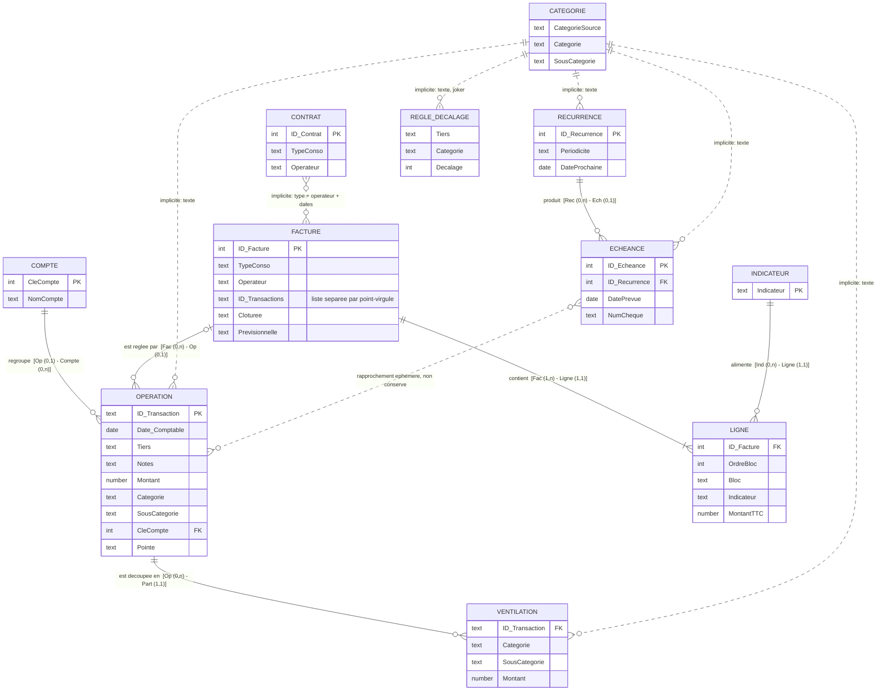
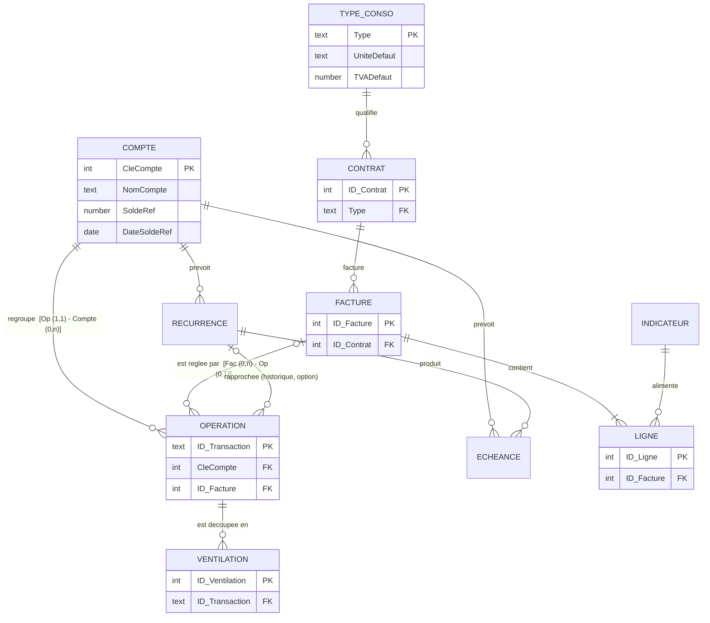

# Suivi Financier – Modèle de données (méthode Merise)

Nov 1, 2026 · @Alexandre

Ce document décrit la base du classeur `Suivi_Financier_V2.xlsm` selon la méthode **Merise** (règles de gestion, dictionnaire, MCD, MLD, MPD) puis l'**étudie** pour proposer des optimisations. Il a été établi le 01/11/2026 **à partir du code VBA** (constantes de `mod_VarGlobales`, macros d'installation `mod_Install*`, modules de logique) et des exports `…_structure.txt` : le classeur est chiffré et n'a donc pas été ouvert. Les exports `Import_data_structure.txt` et `Param_structure.txt` datent du 11/10/2026 ; les colonnes ajoutées depuis (`CleCompte`, `Cloturee`, `NbOperations`, `TblComptes`) sont déduites du code.

> **Lecture rapide.** La partie 4 (MCD) et la partie 7 (optimisations) sont les deux parties à lire. Les diagrammes sont en Mermaid (affichés par GitHub) ; ils ne sont **pas** générés dans `README.html`, dont le moteur ne dessine que les organigrammes.

## Sommaire

1. [Périmètre et vocabulaire](#1-périmètre-et-vocabulaire)
2. [Règles de gestion](#2-règles-de-gestion)
3. [Dictionnaire de données](#3-dictionnaire-de-données)
4. [Modèle conceptuel des données (MCD)](#4-modèle-conceptuel-des-données-mcd)
5. [Modèle logique (MLD)](#5-modèle-logique-mld-relationnel)
6. [Modèle physique (MPD) : les tableaux Excel](#6-modèle-physique-mpd--les-tableaux-excel)
7. [Étude et optimisations](#7-étude-et-optimisations)
8. [MCD cible proposé](#8-mcd-cible-proposé)
9. [Plan de migration conseillé](#9-plan-de-migration-conseillé)

## 1. Périmètre et vocabulaire

La « base » est un ensemble de **tableaux Excel** (*ListObjects*) répartis sur des feuilles de données. Les colonnes sont toujours retrouvées par leur **nom d'en-tête** : renommer une colonne casse le code, et l'ajouter ne casse rien. Il n'existe ni clé étrangère déclarée, ni contrainte d'intégrité, ni index : tout est garanti par le code VBA et par quelques listes de validation Excel.

| Terme Merise | Équivalent dans le classeur |
| --- | --- |
| Entité / relation | Un tableau Excel (`TblXxx`) |
| Occurrence | Une ligne du tableau |
| Identifiant | Une colonne (`ID_Xxx`) ou, à défaut, une combinaison de colonnes |
| Association | Une colonne contenant l'identifiant d'un autre tableau, **ou une simple égalité de texte** (voir partie 7) |

Les tableaux se répartissent en cinq domaines :

| Domaine | Tableaux | Feuille |
| --- | --- | --- |
| Opérations bancaires | `TblOperations`, `TblVentilations`, `TblComptes` | Import\_data, Ventilations, Param |
| Référentiels de rangement | `TblCategories`, `TblDecalagesBudget` | Param |
| Prévisionnel | `TblEcheances`, `TblRecurrences` | frm\_Echeancier, frm\_Recurrences |
| Consommations | `TblContrats`, `TblFactures`, `TblLignes`, `TblIndicateurs` | Conso\_Contrats, Conso\_Factures, Conso\_Lignes, Conso\_Indicateurs |
| Technique | `TechDernierImport`, cellules `soldeRefMontant`, `soldeRefDate`, `soldeEcart`, tableaux d'affichage `TblRechercheOperations`, `TblFacturesAff`, `TblContratsAff` | TechDernierImport, Synthese, écrans |

Les tableaux d'affichage (`Tbl…Aff`, `TblRechercheOperations`) sont des **vues recalculées** à chaque ouverture d'écran : ils ne font pas partie du modèle de données.

## 2. Règles de gestion

**Opérations**

- RG1. Une opération bancaire est identifiée par le **FITID** de la banque (`ID_Transaction`). Une opération déjà présente n'est jamais réimportée ni réécrite.
- RG2. Une opération a **au plus une** catégorie et une sous-catégorie. Le couple (catégorie, sous-catégorie) vient de la correspondance `TblCategories` appliquée à la *catégorie source* de la banque, puis contrôlée par l'opérateur.
- RG3. Une opération peut être **ventilée** en plusieurs parts. Elle prend alors la catégorie « Ventilé » et conserve sa catégorie d'origine (`CategorieAvantVentilation`, `SousCategorieAvantVentilation`). Chaque part porte une catégorie, un montant (du signe de l'opération) et, pour la santé, ses propres colonnes de suivi.
- RG4. Le **mois de budget** d'une opération est celui de sa date comptable, décalé par la première règle de `TblDecalagesBudget` qui correspond (Tiers, catégorie, sous-catégorie ; un champ vide est un joker), sauf décalage manuel (`DecalageManuel` non vide) qui prime. Une règle n'est pas rétroactive.
- RG5. Une opération est **pointée** (`Pointe` = « Oui ») quand l'opérateur l'a analysée. Le pointage appartient à l'opération ; une part reprend celui de son opération.
- RG6. Une opération appartient à un **compte** (`CleCompte`), déduit du nom du compte lu dans le CSV de la banque (un seul compte par import).

**Santé**

- RG7. Les dépenses et remboursements de santé d'un même acte partagent une **clé Notes** `aaaammjj;spécialité;bénéficiaire;montant`. L'ensemble des lignes de même clé est un *groupe santé*.
- RG8. `StatutSante` d'un groupe vaut OK si le groupe est soldé, KO sinon. `SoldeSante` = dépenses − remboursements − franchise, porté par la ligne de dépense. Un dépassement d'honoraires accepté (`DepassementHoraires` = Oui) sort le groupe du suivi.

**Prévisionnel**

- RG9. Une **récurrence** (règle) produit des **échéances** (occurrences) jusqu'à 60 jours dans le futur, avec toujours au moins une. `DateProchaine` mémorise la prochaine occurrence à créer.
- RG10. Une échéance se **rapproche** d'une opération importée (même signe de montant, date dans la fenêtre, Tiers contenu, catégorie, tolérance de montant ; un numéro de chèque suffit). Après validation, l'échéance est **supprimée** : il n'y a **aucun historique** du rapprochement.
- RG11. Un numéro de chèque d'échéance est unique dans l'échéancier et ne doit pas déjà figurer dans `TblOperations`.
- RG12. Le **solde de référence** et sa date sont saisis à la main (une seule paire pour tout le classeur) ; le solde actuel s'en déduit.

**Consommations**

- RG13. Un **contrat** lie un type de consommation (Adduction eau, Recyclage eau, Fourniture élec, Fourniture gaz) à un opérateur entre deux dates. En ouvrir un nouveau clôture le précédent du même type.
- RG14. Une **facture** a un en-tête et des **lignes** groupées en **blocs** ordonnés. Chaque ligne alimente un **indicateur** (Abonnement, Consommation, Taxes, Autre ou un indicateur créé). Montant HT = ROUND(quantité × prix HT ; 2), TTC = ROUND(HT × (1 + TVA) ; 2). Le total saisi est comparé au total calculé, sans blocage.
- RG15. Une facture peut être réglée par **plusieurs** opérations, mais une opération ne règle qu'**une seule** facture (une opération déjà liée est refusée). Une facture est *clôturée* quand toutes ses opérations sont liées.
- RG16. Une facture a un **sens** : *Achat* (par défaut ; les opérations liées sont des paiements, montants négatifs) ou *Vente* (revente d'électricité ; les opérations liées sont des encaissements, montants positifs). Le sens est proposé d'après le **type de consommation**, qui porte lui-même un sens (choisi à la création du type), puis mémorisé dans la facture. Le « payé » comparé au total TTC est la somme des opérations liées, de signe inversé pour un achat. Un signe d'opération inattendu donne un avertissement, jamais un blocage (remboursement, avoir).

**Synchronisation**

- RG16. Chaque poste travaille sur une copie locale ; les tableaux de la liste `ListeTables` de `mod_Synchro`, les cellules de Param hors tableaux, `TechDernierImport` et les noms `soldeRefMontant` et `soldeRefDate` sont comparés à un fichier central par empreinte, avec comparaison à trois voies.

## 3. Dictionnaire de données

Légende : **PK** identifiant, **FK** référence vers un autre tableau, *(txt)* association par égalité de texte (pas de clé), *(calc)* valeur calculée par le code, *(opt)* facultatif.

### OPERATION — `TblOperations` (Import\_data)

| Colonne | Type | Rôle |
| --- | --- | --- |
| ID\_Transaction | texte, **PK** | FITID bancaire (forcé en texte : les longs numéros seraient arrondis) |
| Date\_Comptable | date | Date de valeur sur le relevé |
| Date\_Operation | date | Date de l'opération |
| Type\_Operation | texte | Type OFX (CARTE, PRLV…) |
| Tiers | texte | Nom de la contrepartie (balise NAME) |
| Notes | texte | MEMO bancaire sans la catégorie ; porte aussi la **clé santé** |
| Montant | nombre | Négatif = dépense |
| Num\_Cheque | texte | Numéro de chèque |
| Categorie, SousCategorie | texte *(txt)* | Rangement à deux niveaux |
| Budget, MoisBudget, AnneeBudget | date, entier, entier *(calc)* | Mois de budget, écrit trois fois |
| Date\_consult, Spe\_Consult | date, texte *(calc)* | Lus dans la clé santé |
| StatutSante, SoldeSante | texte, nombre *(calc)* | Résultat du suivi santé |
| DepassementHoraires, CommentaireSante, Franchise, Beneficiaire | texte, texte, nombre, texte | Saisis par l'opérateur |
| CategorieAvantVentilation, SousCategorieAvantVentilation | texte | Rangement d'origine d'une opération ventilée |
| DecalageManuel | entier *(opt)* | Décalage de budget forcé |
| Pointe | « Oui » ou vide | Opération déjà analysée |
| CleCompte | entier **FK** → COMPTE *(opt)* | Compte bancaire |

### VENTILATION — `TblVentilations` (Ventilations)

| Colonne | Type | Rôle |
| --- | --- | --- |
| ID\_Transaction | texte **FK** → OPERATION | Opération découpée (**pas d'identifiant propre** : une part se retrouve par sa position) |
| Categorie, SousCategorie | texte *(txt)* | Rangement de la part |
| Montant | nombre | Montant de la part, du signe de l'opération |
| DateVentilation | date | Date de la ventilation |
| Notes | texte | Notes de la part (clé santé éventuelle) |
| Date\_consult, Spe\_Consult, StatutSante, SoldeSante, DepassementHoraires, CommentaireSante, Franchise, Beneficiaire | idem opération | Les huit colonnes de suivi santé, **recopiées** de TblOperations |

### CATEGORIE — `TblCategories` (Param K:N)

| Colonne | Type | Rôle |
| --- | --- | --- |
| CategorieSource | texte | Catégorie telle que la banque l'envoie (préfixe du MEMO) |
| Categorie | texte | Catégorie du classeur |
| SousCategorie | texte | Sous-catégorie du classeur |
| Verifie | « Oui » ou vide | Correspondance validée par l'opérateur |

Ce tableau joue **deux rôles à la fois** : correspondance *source → (catégorie, sous-catégorie)* et référentiel *des catégories et sous-catégories existantes* (listes déroulantes).

### REGLE\_DECALAGE — `TblDecalagesBudget` (Param S:V)

Tiers, Categorie, SousCategorie (joker si vide), Decalage (entier, en mois).

### COMPTE — `TblComptes` (Param Y:Z)

CleCompte (entier, **PK**, max + 1), NomCompte (texte, lu dans le CSV).

### RECURRENCE — `TblRecurrences`

| Colonne | Type | Rôle |
| --- | --- | --- |
| ID\_Recurrence | entier, **PK** | |
| Libelle, Tiers, Categorie, SousCategorie, Montant | | Modèle de l'opération attendue |
| Periodicite | texte | Hebdomadaire, Mensuelle, Trimestrielle, Annuelle |
| DateProchaine, DateFin | date, date *(opt)* | Prochaine occurrence à créer, fin éventuelle |
| PrecisionDate | « Jour » ou « Mois » | |
| JourAncre | entier | Jour du mois conservé pour une règle mensuelle |
| TolerancePct | nombre | Écart de montant accepté |
| Actif | « Oui » ou vide | Une règle inactive ne produit plus d'occurrence |

### ECHEANCE — `TblEcheances`

| Colonne | Type | Rôle |
| --- | --- | --- |
| ID\_Echeance | entier, **PK** | |
| ID\_Recurrence | entier **FK** → RECURRENCE *(opt)* | Vide pour une échéance ponctuelle |
| Libelle, Tiers, Categorie, SousCategorie, Montant | | Copie des valeurs de la règle, modifiables |
| NumCheque | texte *(opt)* | Ponctuelle uniquement |
| DatePrevue | date | |
| PrecisionDate, Periodicite, TolerancePct | | Recopiés de la règle |

### CONTRAT — `TblContrats` (Conso\_Contrats)

ID\_Contrat (**PK**), TypeConso, Operateur, Unite, DateDebut, DateFin *(opt)*, AbonnementMensuel, Reference.

### FACTURE — `TblFactures` (Conso\_Factures)

| Colonne | Type | Rôle |
| --- | --- | --- |
| ID\_Facture | entier, **PK** | |
| TypeConso, Operateur *(txt)* | texte | Recopiés du contrat |
| NumeroFacture, DateFacture, DebutPeriode, FinPeriode | | En-tête de la facture papier |
| TotalFactureTTC, Commentaire | | Total saisi, commentaire |
| **ID\_Transactions** | texte | **Liste** d'ID\_Transaction séparés par « ; » : les opérations qui ont réglé la facture |
| Cloturee | « Oui » ou vide | Toutes les opérations sont liées |
| Sens | « Vente » ou vide (= Achat) | Facture de revente : les opérations liées sont des encaissements (RG16). Colonne créée au premier besoin ; le type de consommation (`TblTypesConso.Sens`, Achat / Vente) en propose la valeur |
| Previsionnelle | « Oui » ou vide | Facture saisie à l'avance (total estimé) pour recevoir des mensualités ; repasse à vide à la clôture. Colonne créée au premier besoin |
| NbOperations | entier *(calc)* | Nombre d'éléments de la liste ci-dessus |

### LIGNE — `TblLignes` (Conso\_Lignes)

ID\_Facture (**FK** → FACTURE), OrdreBloc, Bloc (nom du bloc), Indicateur *(txt → INDICATEUR)*, Libelle, DateDebut, DateFin, Quantite, Unite, PrixUnitaireHT, TauxTVA, MontantHT, MontantTTC. **Pas d'identifiant propre.**

### INDICATEUR — `TblIndicateurs` (Conso\_Indicateurs)

Indicateur (texte, **PK**) : Abonnement, Consommation, Taxes, Autre, puis ceux créés par l'opérateur.

### Éléments techniques

| Élément | Contenu |
| --- | --- |
| TechDernierImport | A1 DateImport / B1 date-heure ; A2 NbOperations / B2 nombre ; A4… liste des ID\_Transaction du dernier import |
| soldeRefMontant, soldeRefDate | Solde saisi et sa date (feuille Synthese), **uniques pour tout le classeur** |
| soldeEcart | Écart constaté à la dernière saisie du solde (calculé) |
| Types de consommation | Tableau `TblTypesConso` (Conso\_Types : TypeConso, Unite), semé avec les quatre types de base ; le bouton + de frm\_Contrat en ajoute (10 au plus) |

## 4. Modèle conceptuel des données (MCD)

Les cardinalités sont notées Merise **(min,max) côté entité**. « Implicite » signale une association qui n'existe que par égalité de texte ou de valeur, sans colonne de clé.



### Tableau des associations

| Association | Entités et cardinalités | Réalisée par | Remarque |
| --- | --- | --- | --- |
| APPARTENIR | OPERATION (0,1) — COMPTE (0,n) | `TblOperations.CleCompte` | (0,1) et non (1,1) : les opérations antérieures au 31/10/2026 n'ont pas de clé |
| VENTILER | OPERATION (0,n) — VENTILATION (1,1) | `TblVentilations.ID_Transaction` | Une opération ventilée a au moins deux parts |
| REGLER | FACTURE (0,n) — OPERATION (0,1) | **Liste** `TblFactures.ID_Transactions` | La cardinalité (0,1) côté opération est une règle de gestion (RG15) : la clé étrangère devrait être côté opération |
| CONTENIR | FACTURE (1,n) — LIGNE (1,1) | `TblLignes.ID_Facture` | |
| ALIMENTER | LIGNE (1,1) — INDICATEUR (0,n) | `TblLignes.Indicateur` (texte) | |
| PRODUIRE | RECURRENCE (0,n) — ECHEANCE (0,1) | `TblEcheances.ID_Recurrence` | Une règle a toujours au moins une échéance tant qu'elle est active |
| CLASSER | OPERATION, VENTILATION, ECHEANCE, RECURRENCE (0,1) — CATEGORIE (0,n) | Égalité de texte | Aucune clé : renommer une catégorie ne propage rien |
| DÉCALER | REGLE\_DECALAGE (0,n) — OPERATION (0,n) | Correspondance à jokers au calcul du budget | Association calculée, jamais stockée |
| CONCERNER | FACTURE (0,1) — CONTRAT (0,n) | Type + opérateur + intervalle de dates | Le contrat ne fait que proposer opérateur et unité à la saisie |
| RAPPROCHER | ECHEANCE (0,1) — OPERATION (0,1) | Aucune : l'échéance est supprimée | Choix assumé (« aucun historique ») |

### Les groupes santé (entité absente)

Le « groupe santé » (RG7) est une entité du domaine, mais elle n'a **ni tableau ni identifiant** : elle n'existe que par l'égalité de la clé Notes entre une dépense et ses remboursements, et par les huit colonnes de suivi recopiées sur les opérations et sur les parts. C'est la zone du modèle la moins normalisée (voir partie 7).

## 5. Modèle logique (MLD) relationnel

Notation : <u>souligné</u> = clé primaire, `#` = clé étrangère.

```
COMPTE        (CleCompte, NomCompte)
OPERATION     (ID_Transaction, #CleCompte, Date_Comptable, Date_Operation, Type_Operation, Tiers, Notes, Montant,
               Num_Cheque, Categorie, SousCategorie, Budget, MoisBudget, AnneeBudget, DecalageManuel, Pointe,
               CategorieAvantVentilation, SousCategorieAvantVentilation,
               Date_consult, Spe_Consult, StatutSante, SoldeSante, DepassementHoraires, CommentaireSante,
               Franchise, Beneficiaire)
VENTILATION   (#ID_Transaction, Categorie, SousCategorie, Montant, DateVentilation, Notes,
               Date_consult, Spe_Consult, StatutSante, SoldeSante, DepassementHoraires, CommentaireSante,
               Franchise, Beneficiaire)                         -- sans clé primaire
CATEGORIE     (CategorieSource, Categorie, SousCategorie, Verifie)
REGLE_DECALAGE(Tiers, Categorie, SousCategorie, Decalage)       -- sans clé primaire
RECURRENCE    (ID_Recurrence, Libelle, Tiers, Categorie, SousCategorie, Montant, Periodicite, DateProchaine,
               DateFin, PrecisionDate, JourAncre, TolerancePct, Actif)
ECHEANCE      (ID_Echeance, #ID_Recurrence, Libelle, Tiers, Categorie, SousCategorie, Montant, NumCheque,
               DatePrevue, PrecisionDate, Periodicite, TolerancePct)
CONTRAT       (ID_Contrat, TypeConso, Operateur, Unite, DateDebut, DateFin, AbonnementMensuel, Reference)
FACTURE       (ID_Facture, TypeConso, Operateur, NumeroFacture, DateFacture, DebutPeriode, FinPeriode,
               TotalFactureTTC, Commentaire, ID_Transactions, Cloturee, Previsionnelle, NbOperations)
LIGNE         (#ID_Facture, OrdreBloc, Bloc, #Indicateur, Libelle, DateDebut, DateFin, Quantite, Unite,
               PrixUnitaireHT, TauxTVA, MontantHT, MontantTTC)  -- sans clé primaire
INDICATEUR    (Indicateur)
```

**Écarts avec un modèle relationnel propre** : quatre tableaux n'ont pas de clé primaire (VENTILATION, LIGNE, REGLE\_DECALAGE, CATEGORIE) ; `FACTURE.ID_Transactions` n'est pas atomique (1re forme normale violée) ; `CleCompte` n'est pas obligatoire.

## 6. Modèle physique (MPD) : les tableaux Excel

| Tableau | Feuille (plage) | Colonnes | Visibilité | Synchronisé (`ListeTables`) | Écran qui l'affiche |
| --- | --- | --- | --- | --- | --- |
| TblOperations | Import\_data (A1:Z) | 26 | Visible | Oui | frm\_RechercheOperations (vue) |
| TblVentilations | Ventilations | 14 | Visible | Oui | frm\_RechercheOperations |
| TblCategories | Param (K:N) | 4 | Masquée | Oui | — |
| TblDecalagesBudget | Param (S:V) | 4 | Masquée | Oui | — |
| TblComptes | Param (Y:Z) | 2 | Masquée | **Non** (voir 7.4) | — |
| TblEcheances | frm\_Echeancier | 12 | Très masquée | Oui | frm\_Echeancier |
| TblRecurrences | frm\_Recurrences | 13 | Très masquée | Oui | frm\_Recurrences |
| TblContrats | Conso\_Contrats | 8 | Masquée | Oui | frm\_Contrats (copie `TblContratsAff`) |
| TblFactures | Conso\_Factures | 12 | Masquée | Oui | frm\_Factures (copie `TblFacturesAff`) |
| TblLignes | Conso\_Lignes | 13 | Masquée | Oui | frm\_Facture |
| TblIndicateurs | Conso\_Indicateurs | 1 | Masquée | Oui | frm\_Facture (liste) |
| TblTypesConso | Conso\_Types | 2 | Masquée | Oui | frm\_Contrat (liste et bouton +) |
| TechDernierImport | feuille entière | cellules | Très masquée | Oui (feuille) | frm\_RechercheOperations |

**Volumétrie** (export du 11/10/2026) : 218 opérations, 88 correspondances de catégories. Le modèle est dimensionné pour quelques milliers de lignes : toutes les lectures se font par tableau en mémoire, et l'empreinte de synchronisation recalcule l'ensemble des tableaux.

**Identifiants.** `ID_Transaction` vient de la banque. Les autres (`ID_Echeance`, `ID_Recurrence`, `ID_Contrat`, `ID_Facture`, `CleCompte`) sont des entiers calculés par le code (maximum + 1).

## 7. Étude et optimisations

Les points sont classés par **intérêt décroissant** pour le fonctionnement et la robustesse. Chacun indique le constat (vérifié dans le code), le risque et la proposition.

### 7.1 Facture ↔ opération : une liste dans une cellule (priorité haute)

- **Constat.** `TblFactures.ID_Transactions` contient les ID séparés par « ; » (`FAC_SEP_LIENS`). Comme une opération ne règle qu'une seule facture, la relation est en réalité **1-N** (RG15), mais la clé est stockée du côté « 1 ».
- **Conséquences.** `NbOperations` doit être tenu à jour à la main (`LierFacture`, `EnregistrerFacture`, `DelierFacture`) ; trouver la facture d'une opération exige de balayer toutes les factures (`FactureDeOperation`, `ChargerLiensFactures`) ; la synchronisation compare une cellule entière, donc deux liens ajoutés sur deux postes en même temps sont un conflit sur toute la facture ; la longueur d'une cellule est limitée.
- **Proposition.** Ajouter la colonne **`ID_Facture` dans `TblOperations`** (vide = non liée). `NbOperations` devient un `NB.SI`, « Factures non liées » un simple filtre sur une colonne vide, et la liste « Opérations d'une facture » un filtre sur la valeur. Migration : éclater la liste existante une seule fois, puis supprimer `ID_Transactions`.

### 7.2 Catégories : du texte recopié partout, et un tableau à deux rôles

- **Constat.** `Categorie` et `SousCategorie` sont recopiées en texte dans cinq tableaux (opérations, ventilations, échéances, récurrences, règles de décalage). `TblCategories` mélange la correspondance banque → classeur et le référentiel. Un renommage ne se propage nulle part ; `mod_Categories` a besoin d'une distance de Levenshtein pour retrouver une forme approchée.
- **Proposition.** Séparer en deux tableaux : **`TblRefCategories`** (`ID_Categorie`, Categorie, SousCategorie, Actif) et **`TblCorrespondanceSource`** (CategorieSource, `#ID_Categorie`, Verifie). Les autres tableaux stockent `ID_Categorie`. Les listes déroulantes lisent le référentiel. Gain : renommer ou fusionner une catégorie devient une opération en une ligne. Coût : le plus lourd de toute la liste (tous les écrans et l'import lisent le texte) : à faire en dernier, ou à limiter au référentiel.
- **Variante légère.** Garder le texte mais ajouter une macro `RenommerCategorie(ancien, nouveau)` qui met à jour les cinq tableaux d'un coup.

### 7.3 Le suivi santé : huit colonnes recopiées et une clé dans un texte libre

- **Constat.** Les colonnes `Date_consult`, `Spe_Consult`, `StatutSante`, `SoldeSante`, `DepassementHoraires`, `CommentaireSante`, `Franchise`, `Beneficiaire` existent dans **les deux** tableaux (opérations et parts). Elles ne sont renseignées que pour une petite minorité des lignes. Le groupe santé n'existe que par l'égalité d'un texte `aaaammjj;spécialité;bénéficiaire;montant` dans `Notes`, qui mélange donc le libellé bancaire et une clé.
- **Risques.** Une faute de frappe dans `Notes` sépare deux lignes d'un même groupe ; la sentinelle 02/01/1900 sert de drapeau d'erreur ; `Notes` ne peut plus être modifiée librement.
- **Proposition.** Une entité **`TblGroupesSante`** (`ID_Groupe`, Date\_consult, Spe\_Consult, Beneficiaire, Franchise, DepassementHoraires, CommentaireSante) et une colonne **`ID_Groupe`** dans `TblOperations` et `TblVentilations`. `StatutSante` et `SoldeSante` deviennent des valeurs **calculées** (par groupe) plutôt que stockées. Les 8 colonnes disparaissent des deux tableaux principaux. La clé Notes reste utile à l'import pour retrouver le groupe, puis n'est plus la source de vérité.

### 7.4 Multi-comptes : préparé à moitié

- **Constat.** `CleCompte` est écrit à l'import, mais : (a) `TblComptes` **n'est pas dans `ListeTables`** de `mod_Synchro` : deux postes pourraient créer deux comptes différents avec la même clé 1 ; (b) `TblEcheances` et `TblRecurrences` n'ont pas de compte, donc le solde prévisionnel mélangerait les comptes ; (c) le solde de référence est unique (`soldeRefMontant`, `soldeRefDate`) ; (d) rien ne garantit que le FITID d'un compte ne se retrouve pas chez un autre ; (e) la clé est facultative.
- **Proposition.** Ajouter `TblComptes` à `ListeTables` (correctif immédiat, une ligne) ; ajouter `SoldeRef` et `DateSoldeRef` dans `TblComptes` ; ajouter `CleCompte` aux échéances et aux récurrences ; envisager la clé primaire `(CleCompte, ID_Transaction)` pour `TblOperations`, ou au minimum un contrôle de doublon par compte.

### 7.5 Colonnes redondantes ou dérivées de TblOperations

| Colonnes | Problème | Proposition |
| --- | --- | --- |
| `Budget`, `MoisBudget`, `AnneeBudget` | Une seule information (le mois de budget) stockée trois fois ; incohérence possible si l'une est éditée à la main | Garder `Budget` (date du 1er du mois), calculer le reste par formule, ou l'inverse |
| `StatutSante`, `SoldeSante` | Valeurs dérivées stockées | Voir 7.3 |
| `CategorieAvantVentilation`, `SousCategorieAvantVentilation` | Renseignées pour les seules opérations ventilées ; utiles pour défaire une ventilation | Les conserver, mais les regrouper avec la ventilation (une ligne de « ventilation maître ») ou les nommer `Ventil_*` |
| `Pointe` | Texte « Oui »/vide pour un booléen | Acceptable ; la liste de validation limite les valeurs |
| `Date_Comptable`, `Date_Operation` | Les deux sont lues de l'OFX ; `Date_Operation` n'est utilisée que par l'affichage | Aucune action, à surveiller |

### 7.6 Tableaux sans identifiant

- **VENTILATION** : une part n'a pas d'identifiant, elle est repérée par son numéro de ligne (colonne technique de l'écran de recherche). Tout tri ou suppression dans la feuille décale les références en cours. Proposition : colonne `ID_Ventilation` (entier).
- **LIGNE** : idem. Une ligne est repérée par `ID_Facture` + `OrdreBloc` + sa position. Proposition : `ID_Ligne`.
- **REGLE\_DECALAGE** : l'ordre des lignes sert de priorité implicite (« première correspondance »). Proposition : `ID_Regle` et une colonne `Priorite` explicite.
- **CATEGORIE** : identifiant naturel (`CategorieSource`) non garanti unique ; voir 7.2.

### 7.7 Facture et contrat : des liens par texte

- **Constat.** `TblFactures` recopie `TypeConso` et `Operateur` ; le contrat n'est pas référencé (`ID_Contrat` absent). Les quatre types de consommation sont codés en dur dans le code.
- **Proposition.** Ajouter `ID_Contrat` à `TblFactures` (le contrat en vigueur à la date de facture) et un petit tableau **`TblTypesConso`** (Type, Unité par défaut, TVA par défaut) qui remplace les constantes. Les règles de TVA par défaut, aujourd'hui dans `mod_Factures`, deviendraient des données modifiables.
- **Bloc de facture.** `Bloc`, `OrdreBloc` et `Indicateur` sont répétés sur chaque ligne alors qu'ils décrivent le bloc. Une entité `BLOC_FACTURE` (`ID_Facture`, `OrdreBloc`, `NomBloc`, `Indicateur`) supprimerait cette répétition ; gain faible, à considérer seulement si on touche aux lignes.

### 7.8 Échéances et récurrences : duplication voulue, historique absent

- La duplication des champs (libellé, tiers, catégorie, montant, périodicité, précision, tolérance) entre règle et occurrence est **voulue** : une occurrence peut être modifiée seule. À conserver. `Periodicite` d'une échéance issue d'une règle est redondant avec la règle ; à documenter seulement.
- **L'absence d'historique** (RG10) empêche de répondre à « mes prévisions étaient-elles justes ? » (écart prévu / réel par poste). Si ce besoin apparaît, ajouter dans `TblOperations` une colonne `ID_Recurrence_Rapprochee` (ou `ID_Echeance_Rapprochee`) à l'écriture du rapprochement : coût faible, aucune ligne supplémentaire d'échéancier.

### 7.9 Intégrité et cohérence

- **Aucune contrainte d'intégrité** : on peut avoir une part sans opération, une ligne sans facture, une échéance dont la règle a disparu, une facture liée à un ID inexistant. Proposition : une macro **`VerifierIntegrite`** (lecture seule) qui liste ces orphelins, appelée par l'état de synchronisation et avant l'envoi au central.
- **Identifiants « maximum + 1 »** : deux postes qui créent une facture avant de se synchroniser obtiennent le même `ID_Facture` ; la comparaison à trois voies détecte le conflit mais ne sait pas renuméroter. Pour un usage multi-postes réel, préfixer par poste ou utiliser un identifiant horodaté.
- **Cohérence des noms** : `Num_Cheque` (opérations) / `NumCheque` (échéances) ; `Date_Comptable`, `DateFacture`, `DatePrevue` ; `Date_consult` minuscule ; feuille `Import_data` mais constante `Import_Data`. Aucun correctif conseillé : renommer une colonne casse le code ; à uniformiser seulement pour les **nouveaux** champs.
- **Sécurité des données** : le dépôt est public ; les exports de structure ne contiennent jamais de lignes, et le classeur est chiffré. Aucun changement de modèle n'est nécessaire.

### 7.10 Performances

Aucun problème à ce volume. Trois points à surveiller si la base grossit (plusieurs milliers d'opérations) : l'**empreinte de synchronisation** relit chaque tableau en entier à l'ouverture et à la fermeture ; les **recherches d'opérations** reconstruisent tout `TblRechercheOperations` à chaque filtre ; les **balayages de `ID_Transactions`** (7.1) sont quadratiques. Les remèdes sont déjà dans les propositions ci-dessus (colonne `ID_Facture`, identifiants numériques).

### Synthèse des priorités

| N° | Optimisation | Gain | Coût | Risque |
| --- | --- | --- | --- | --- |
| 7.4 (a) | Ajouter `TblComptes` à `ListeTables` | Évite un conflit de clés entre postes | Une ligne de code | Nul |
| 7.1 | `ID_Facture` dans TblOperations | Supprime la liste et le compteur | Moyen (facture, synthèse, recherche, synchro) | Moyen |
| 7.6 | Identifiants de ventilation et de ligne | Références stables | Faible à moyen | Faible |
| 7.9 | Macro `VerifierIntegrite` | Détection d'orphelins | Faible | Nul (lecture seule) |
| 7.5 | Un seul champ pour le mois de budget | Supprime 2 colonnes | Moyen | Moyen (nombreux modules lisent les trois) |
| 7.3 | Entité groupe santé | Supprime 8 colonnes en double | Élevé | Élevé |
| 7.2 | Référentiel de catégories à identifiants | Renommage propre | Très élevé | Élevé |
| 7.4 (b-e) | Multi-comptes complet | Prévisionnel par compte | Élevé | Moyen |

## 8. MCD cible proposé

Cible **réaliste** : on applique 7.1, 7.4, 7.6 et 7.7, et on garde le texte des catégories (7.2 variante légère) et la structure santé actuelle (7.3 repoussé).



## 9. Plan de migration conseillé

Les étapes sont ordonnées pour qu'**à chaque étape le classeur reste utilisable** (mêmes principes que `AjouterColonnePointage` : colonne ajoutée, remplie par une macro, ancien champ supprimé en dernier) et pour que le fichier central soit mis à jour en une seule fois, car un changement de structure empêche la récupération (section 12 du README).

1. **Correctif immédiat** : ajouter `NOM_TABLE_COMPTES` à `ListeTables` (mod\_Synchro). Aucune migration.
2. **Intégrité** : écrire `VerifierIntegrite` (lecture seule) et l'exécuter sur la base actuelle pour mesurer les orphelins avant de toucher à la structure.
3. **Identifiants stables** : ajouter `ID_Ventilation` et `ID_Ligne`, remplis par une macro de migration, sans changer la logique existante.
4. **Facture ↔ opération** : ajouter `ID_Facture` à TblOperations, éclater `ID_Transactions`, adapter `LierFacture`, `DelierFacture`, `OperationsDeFacture`, `FactureDeOperation`, `ChargerLiensFactures` et le préfiltre `FacturesNonLiees`, puis retirer `ID_Transactions` et `NbOperations`. Une seule mise à jour du central.
5. **Types de consommation et contrat** : créer `TblTypesConso`, ajouter `ID_Contrat` aux factures.
6. **Comptes** : soldes par compte, `CleCompte` sur les échéances.
7. **Plus tard, si le besoin le justifie** : mois de budget unique (7.5), groupes santé (7.3), référentiel de catégories (7.2).

Avant chaque étape : sauvegarde du classeur, export `…_structure.txt` à jour (`ExporterToutesLesFeuilles`) et mise à jour de ce document et du README.
