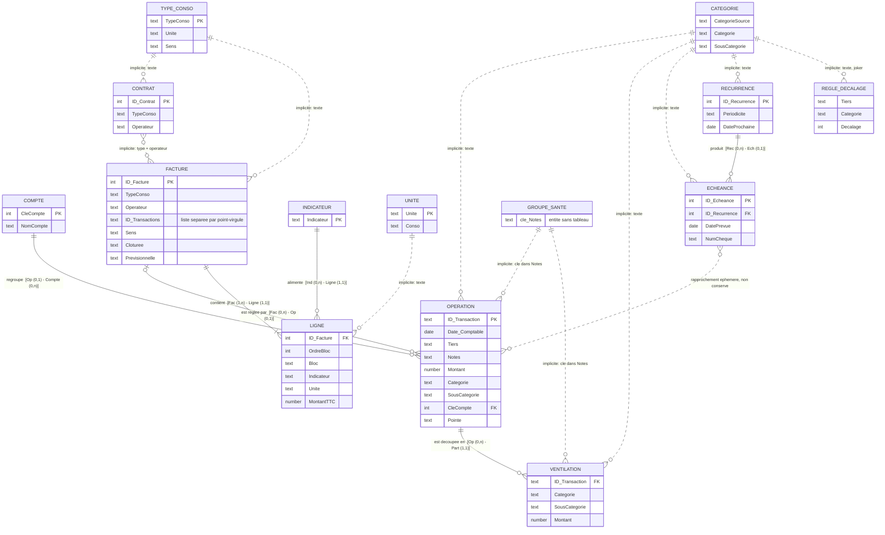
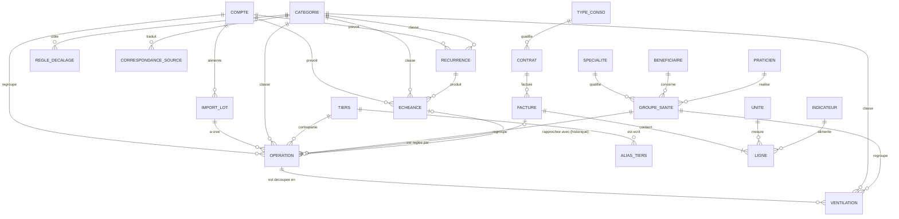

# Suivi Financier – Modèle de données (méthode Merise)

Nov 14, 2026 · @Alexandre

Ce document décrit la base du classeur selon la méthode **Merise** (règles de gestion, dictionnaire, MCD, MLD, MPD), **recense toutes les incohérences** constatées, puis propose les corrections à appliquer **avant** une bascule vers un SGBD centralisé, et le **modèle cible** de cette bascule.

**Méthode de cette révision (14/11/2026).** Le classeur `Suivi_Financier_Claude.xlsm` (copie du 14/11/2026) a été **ouvert en lecture seule** (il n'est pas chiffré) : structure des 17 tableaux, noms définis et **contenu réel** (9 318 lignes d'opérations, 57 factures, 386 lignes de facture…) ont été croisés avec le code VBA du dépôt (`mod_VarGlobales`, `mod_Synchro`, `mod_Comptes`, `mod_Factures`, `mod_ImportOFX`, `mod_Unites`…). Toutes les valeurs chiffrées de la partie 7 sont **mesurées sur les données**, pas déduites du code. La version précédente (01/11/2026) était déduite du code seul.

> **Lecture rapide.** Partie 7 (incohérences, numérotées `INC-xx`), partie 8 (corrections à faire dans Excel), partie 9 (modèle cible SGBD avec DDL), partie 10 (plan de bascule). Les diagrammes sont en Mermaid (affichés par GitHub) ; ils ne sont **pas** générés dans `README.html`.

## Sommaire

1. [Périmètre et vocabulaire](#1-périmètre-et-vocabulaire)
2. [Règles de gestion](#2-règles-de-gestion)
3. [Dictionnaire de données](#3-dictionnaire-de-données)
4. [Modèle conceptuel des données (MCD)](#4-modèle-conceptuel-des-données-mcd)
5. [Modèle logique (MLD)](#5-modèle-logique-mld-relationnel)
6. [Modèle physique (MPD) : les tableaux Excel](#6-modèle-physique-mpd--les-tableaux-excel)
7. [Inventaire des incohérences](#7-inventaire-des-incohérences)
8. [Corrections à appliquer dans Excel avant la bascule](#8-corrections-à-appliquer-dans-excel-avant-la-bascule)
9. [Modèle cible pour un SGBD centralisé](#9-modèle-cible-pour-un-sgbd-centralisé)
10. [Plan de bascule](#10-plan-de-bascule)

## 1. Périmètre et vocabulaire

La « base » est un ensemble de **tableaux Excel** (*ListObjects*) répartis sur des feuilles de données **très masquées** (`xlSheetVeryHidden`, sauf `Accueil`, `Menu` et `Synthese`). Les colonnes sont retrouvées par leur **nom d'en-tête** : renommer une colonne casse le code, en ajouter une ne casse rien. Il n'existe ni clé étrangère déclarée, ni contrainte d'intégrité, ni index, ni typage fort : tout est garanti par le code VBA et par quelques listes de validation Excel.

| Terme Merise | Équivalent dans le classeur |
| --- | --- |
| Entité / relation | Un tableau Excel (`TblXxx`) |
| Occurrence | Une ligne du tableau |
| Identifiant | Une colonne (`ID_Xxx`) ou, à défaut, une combinaison de colonnes |
| Association | Une colonne contenant l'identifiant d'un autre tableau, **ou une égalité de texte**, **ou une liste dans une cellule** (voir partie 7) |

Les tableaux se répartissent en six domaines :

| Domaine | Tableaux | Feuille |
| --- | --- | --- |
| Opérations bancaires | `TblOperations`, `TblVentilations`, `TblComptes` | Import\_data, Ventilations, Param |
| Référentiels de rangement | `TblCategories`, `TblDecalagesBudget` | Param |
| Listes de référence santé et affichage | plages nommées `Praticiens`, `Specialites`, `Beneficiaires`, `Tri_champs`, `Tri_Ordre`, `Mois`, `Années`, `ListeCategories` | Param (hors tableaux) |
| Prévisionnel | `TblEcheances`, `TblRecurrences` | frm\_Echeancier, frm\_Recurrences |
| Consommations | `TblContrats`, `TblFactures`, `TblLignes`, `TblIndicateurs`, `TblTypesConso`, `TblUnites` | Conso\_Contrats, Conso\_Factures, Conso\_Lignes, Conso\_Indicateurs, Conso\_Types, Conso\_Unites |
| Technique | `TechDernierImport`, noms `soldeRefMontant`, `soldeRefDate`, `soldeEcart` | TechDernierImport, Synthese |
| *Héritage à supprimer* | `TblAbonnements`, `TblConsos`, `TblTaxes`, `TblBlocsLibres` | Conso\_\*\_ancien (4 feuilles) |
| *Vues d'affichage (hors modèle)* | `TblRechercheOperations`, `TblFacturesAff`, `TblContratsAff` | écrans `frm_*` |

Les tableaux d'affichage sont des **vues recalculées** à chaque ouverture d'écran : ils ne font pas partie du modèle de données.

## 2. Règles de gestion

**Opérations**

- RG1. Une opération bancaire est identifiée par le **FITID** de la banque (`ID_Transaction`). Une opération déjà présente n'est jamais réimportée ni réécrite.
- RG2. Une opération a **au plus une** catégorie et une sous-catégorie. Le couple vient de la correspondance `TblCategories` appliquée à la *catégorie source* de la banque, puis contrôlée par l'opérateur.
- RG3. Une opération peut être **ventilée** en plusieurs parts. Elle prend alors la catégorie « Ventilé » (sous-catégorie vide) et conserve sa catégorie d'origine (`CategorieAvantVentilation`, `SousCategorieAvantVentilation`). Chaque part porte une catégorie, un montant (du signe de l'opération) et, pour la santé, ses propres colonnes de suivi.
- RG4. Le **mois de budget** d'une opération est celui de sa date comptable, décalé par la première règle de `TblDecalagesBudget` qui correspond (Tiers, catégorie, sous-catégorie ; un champ vide est un joker), sauf décalage manuel (`DecalageManuel` non vide) qui prime. Une règle n'est pas rétroactive.
- RG5. Une opération est **pointée** (`Pointe` = « Oui ») quand l'opérateur l'a analysée. Le pointage appartient à l'opération ; une part reprend celui de son opération.
- RG6. Une opération appartient à un **compte** (`CleCompte`), déduit du nom du compte lu dans le CSV de la banque (un seul compte par import).

**Santé**

- RG7. Les dépenses et remboursements de santé d'un même acte partagent une **clé Notes** `aaaammjj;spécialité;bénéficiaire;montant`. L'ensemble des lignes de même clé est un *groupe santé*. Le montant de la clé est celui de l'acte entier, pas celui de la ligne.
- RG8. `StatutSante` d'un groupe vaut OK si le groupe est soldé, KO sinon. `SoldeSante` = dépenses − remboursements − franchise, porté par la ligne de dépense. Un dépassement d'honoraires accepté (`DepassementHoraires`) sort le groupe du suivi.
- RG8 bis. Le **praticien** n'est pas une colonne : c'est le `Tiers` de la dépense, qui doit figurer dans la liste `Praticiens` (test `CountIf`). La spécialité vient de la clé Notes et doit figurer dans `Specialites`.

**Prévisionnel**

- RG9. Une **récurrence** (règle) produit des **échéances** (occurrences) jusqu'à 60 jours dans le futur, avec toujours au moins une. `DateProchaine` mémorise la prochaine occurrence à créer. Une échéance **ponctuelle** n'a pas de récurrence.
- RG10. Une échéance se **rapproche** d'une opération importée (même signe de montant, date dans la fenêtre, Tiers contenu, catégorie, tolérance de montant ; un numéro de chèque suffit). Après validation, l'échéance est **supprimée** : il n'y a **aucun historique** du rapprochement.
- RG11. Un numéro de chèque d'échéance est unique dans l'échéancier et ne doit pas déjà figurer dans `TblOperations`.
- RG12. Le **solde de référence** et sa date sont saisis à la main (une seule paire pour tout le classeur) ; le solde actuel s'en déduit.

**Consommations**

- RG13. Un **contrat** lie un type de consommation à un opérateur entre deux dates. En ouvrir un nouveau clôture le précédent du même type.
- RG14. Une **facture** a un en-tête et des **lignes** groupées en **blocs** ordonnés. Chaque ligne alimente un **indicateur**. Montant HT = ROUND(quantité × prix HT ; 2), TTC = ROUND(HT × (1 + TVA) ; 2). Le total saisi est comparé au total calculé, sans blocage.
- RG15. Une facture peut être réglée par **plusieurs** opérations, mais une opération ne règle qu'**une seule** facture. Une facture est *clôturée* quand toutes ses opérations sont liées.
- RG16. Une facture a un **sens** : *Achat* (opérations liées négatives) ou *Vente* (revente d'électricité ; opérations liées positives). Le sens est proposé d'après le **type de consommation**, qui porte lui-même un sens (`TblTypesConso.Sens`), puis mémorisé dans la facture. Un signe d'opération inattendu donne un avertissement, jamais un blocage (remboursement, avoir).
- RG17. Une facture **prévisionnelle** est saisie à l'avance (total estimé, sans lignes) pour recevoir des mensualités ; elle repasse à vide à la clôture.
- RG18. Une **unité** (`TblUnites`) est dite *de consommation* (`Conso` = Oui) ou non (€, jours, mois…). Seules les premières sont proposées sur un bloc « Consommation ».

**Synchronisation**

- RG19. Chaque poste travaille sur une copie locale ; les tableaux de la liste `ListeTables` de `mod_Synchro`, les cellules de Param hors tableaux, `TechDernierImport` et les noms `soldeRefMontant` et `soldeRefDate` sont comparés à un fichier central par empreinte, avec comparaison à trois voies.

> Le numéro RG16 était attribué deux fois dans la version du 01/11 (consommations et synchronisation) ; la synchronisation est maintenant RG19.

## 3. Dictionnaire de données

Légende : **PK** identifiant, **FK** référence vers un autre tableau, *(txt)* association par égalité de texte (pas de clé), *(calc)* valeur calculée par le code, *(opt)* facultatif. Les types sont ceux **observés dans les cellules**.

### OPERATION — `TblOperations` (Import\_data, 26 colonnes, 9 318 lignes dont 1 fantôme)

| Colonne | Type observé | Remplissage | Rôle |
| --- | --- | --- | --- |
| ID\_Transaction | texte, **PK** | 9 317 / 9 318 | FITID bancaire, forcé en texte. **Trois formats** : 9 chiffres (338), 10 chiffres (6 755), 18 chiffres (2 224) |
| Date\_Comptable | date | 100 % | Date de valeur sur le relevé (2018-04-03 → 2026-11-02) |
| Date\_Operation | date *(opt)* | 49,7 % | Date de l'opération, toujours 0 à 8 jours avant `Date_Comptable` |
| Type\_Operation | texte | 100 % | Type OFX : POS, XFER, DIRECTDEBIT, CHECK, FEE, ATM, DEBIT, CREDIT, DEP |
| Tiers | texte (2 lignes numériques) | 100 % | Contrepartie (NAME). 2 006 valeurs distinctes |
| Notes | texte (1 ligne numérique) | 93,8 % | MEMO bancaire ; porte aussi la **clé santé** |
| Montant | nombre | 100 % | Négatif = dépense. Jamais nul ; jamais plus de 2 décimales ; stocké en binaire flottant |
| Num\_Cheque | **entier** *(opt)* | 4,9 % | Numéro de chèque (457 valeurs, toutes uniques) |
| Categorie, SousCategorie | texte *(txt)* | 100 % / 99,9 % | Rangement à deux niveaux (20 catégories) |
| Budget, MoisBudget, AnneeBudget | date, entier, entier *(calc)* | 100 % | Mois de budget, écrit trois fois |
| Date\_consult | date | 6,2 % | Lue dans la clé santé ; **valeurs sentinelles** (INC-06) |
| Spe\_Consult, StatutSante | texte *(calc)* | 6,2 % | Spécialité (12 valeurs), OK / KO |
| SoldeSante | nombre *(calc)* | 0,9 % | Solde du groupe, porté par la dépense |
| DepassementHoraires | **booléen VRAI/FAUX** | 0,9 % | Saisi (24 VRAI, 61 FAUX) |
| CommentaireSante, Franchise, Beneficiaire | texte, nombre, texte | 0,3 % / 0,4 % / 4,1 % | Saisis ou récupérés de la clé |
| CategorieAvantVentilation, SousCategorieAvantVentilation | texte | 5 lignes | Rangement d'origine d'une opération ventilée |
| DecalageManuel | entier *(opt)* | 1 ligne | Décalage de budget forcé (la seule valeur est **0**) |
| Pointe | « Oui » ou vide | 75,7 % | Opération déjà analysée |
| CleCompte | entier **FK** → COMPTE | 100 % | Compte bancaire (une seule valeur : 1) |

### VENTILATION — `TblVentilations` (Ventilations, 14 colonnes, 10 lignes)

| Colonne | Type | Rôle |
| --- | --- | --- |
| ID\_Transaction | texte **FK** → OPERATION | Opération découpée. **Pas d'identifiant propre** : une part se retrouve par sa position |
| Categorie, SousCategorie | texte *(txt)* | Rangement de la part |
| Montant | nombre | Montant de la part, du signe de l'opération (la somme des parts égale toujours le montant de l'opération : 5/5 contrôlées) |
| DateVentilation | **date-heure** | Horodatage de la ventilation (les autres dates n'ont pas d'heure) |
| Notes | texte | Notes de la part (clé santé éventuelle) |
| Date\_consult, Spe\_Consult, StatutSante, SoldeSante, DepassementHoraires, CommentaireSante, Franchise, Beneficiaire | idem opération | Les huit colonnes de suivi santé, **recopiées** de TblOperations |

### CATEGORIE — `TblCategories` (Param K:N, 87 lignes)

| Colonne | Type | Rôle |
| --- | --- | --- |
| CategorieSource | texte | Catégorie telle que la banque l'envoie. **Vide pour 6 lignes** |
| Categorie | texte | Catégorie du classeur (20 valeurs) |
| SousCategorie | texte | Sous-catégorie du classeur (vide pour 1 ligne) |
| Verifie | « Oui » ou vide | Correspondance validée (87 / 87 = Oui : colonne sans effet à ce jour) |

Ce tableau joue **deux rôles à la fois** : correspondance *source → (catégorie, sous-catégorie)* et référentiel *des catégories et sous-catégories existantes*. La liste `ListeCategories` (Param P, 20 valeurs) en est une troisième copie dérivée.

### REGLE\_DECALAGE — `TblDecalagesBudget` (Param S:V, 1 ligne)

Tiers, Categorie, SousCategorie (joker si vide), Decalage (entier, en mois). Une seule règle : DRFIP → Salaire, +1 mois.

### COMPTE — `TblComptes` (Param Y:Z, 1 ligne)

CleCompte (entier, **PK**, max + 1), NomCompte (texte lu dans le CSV : **contient le nom du titulaire et la fin du numéro de compte**, donnée personnelle).

### RECURRENCE — `TblRecurrences` (13 colonnes, 28 lignes)

| Colonne | Type | Rôle |
| --- | --- | --- |
| ID\_Recurrence | entier, **PK** | |
| Libelle, Tiers, Categorie, SousCategorie, Montant | | Modèle de l'opération attendue |
| Periodicite | texte | Hebdomadaire, Mensuelle, Trimestrielle, Annuelle (observé : 27 Mensuelle, 1 Annuelle) |
| DateProchaine, DateFin | date, date *(opt)* | Prochaine occurrence à créer, fin éventuelle |
| PrecisionDate | « Jour » ou « Mois » | Observé : toujours « Jour » |
| JourAncre | entier | Jour du mois conservé pour une règle mensuelle |
| TolerancePct | entier | Écart de montant accepté |
| Actif | « Oui » ou vide | Observé : toujours « Oui » |

### ECHEANCE — `TblEcheances` (12 colonnes, 74 lignes)

| Colonne | Type | Rôle |
| --- | --- | --- |
| ID\_Echeance | entier, **PK** | |
| ID\_Recurrence | entier **FK** → RECURRENCE *(opt)* | Vide pour une échéance ponctuelle (5 lignes) |
| Libelle, Tiers, Categorie, SousCategorie, Montant | | Copie des valeurs de la règle, modifiables |
| NumCheque | **texte** *(opt)* | Ponctuelle uniquement (5 lignes) |
| DatePrevue | date | |
| PrecisionDate, Periodicite, TolerancePct | | Recopiés de la règle ; `Periodicite` vaut « Ponctuelle » pour les 5 lignes sans règle |

### CONTRAT — `TblContrats` (Conso\_Contrats, 8 colonnes, 6 lignes)

ID\_Contrat (**PK**), TypeConso *(txt)*, Operateur, Unite *(txt)*, DateDebut, DateFin *(opt)*, AbonnementMensuel, Reference (chaîne vide pour 1 contrat).

### FACTURE — `TblFactures` (Conso\_Factures, 14 colonnes, 57 lignes)

| Colonne | Type | Rôle |
| --- | --- | --- |
| ID\_Facture | entier, **PK** | |
| TypeConso, Operateur | texte *(txt)* | Recopiés du contrat |
| NumeroFacture | texte | Renseigné pour 3 factures sur 57 (« chaîne vide » pour les prévisionnelles) |
| DateFacture, DebutPeriode, FinPeriode | date | Vides pour les 2 prévisionnelles |
| TotalFactureTTC, Commentaire | nombre, texte | Total saisi, commentaire |
| **ID\_Transactions** | texte | **Liste** d'ID\_Transaction séparés par « ; » : 236 liens au total |
| Cloturee | « Oui » ou vide | Toutes les opérations sont liées (43 Oui) |
| NbOperations | entier *(calc)* | Nombre d'éléments de la liste ci-dessus |
| Previsionnelle | « Oui » ou vide | 2 Oui |
| Sens | « Achat », « Vente » ou vide | Observé : 11 Achat, 2 Vente, 44 vides (voir INC-21) |

### LIGNE — `TblLignes` (Conso\_Lignes, 13 colonnes, 386 lignes)

ID\_Facture (**FK** → FACTURE), OrdreBloc, Bloc (nom du bloc), Indicateur *(txt → INDICATEUR)*, Libelle, DateDebut, DateFin *(opt, 89 % remplies)*, Quantite, Unite *(txt → UNITE, vide pour 18 lignes)*, PrixUnitaireHT, TauxTVA (0, 0,055, 0,10, 0,20), MontantHT, MontantTTC. **Pas d'identifiant propre.** Les 195 couples (facture, ordre de bloc) ont tous un nom de bloc et un indicateur uniques : le bloc est donc une entité implicite.

### INDICATEUR — `TblIndicateurs` (9 lignes)

Indicateur (texte, **PK**) : Abonnement, Consommation, Taxes, Autre, Abonnement distributeur, Abonnement communale, Consommation distributeur, Consommation communale, Production.

### TYPE\_CONSO — `TblTypesConso` (Conso\_Types, **3 colonnes**, 6 lignes)

TypeConso (**PK**), Unite (unité par défaut), Sens (Achat / Vente). Six types : Adduction eau, Recyclage eau, Fourniture élec, Fourniture gaz, Revente Électricité (Vente), Achat Bois.

### UNITE — `TblUnites` (Conso\_Unites, 10 lignes)

Unite (**PK**), Conso (« Oui » / « Non »). **Nouveau depuis la version précédente** de ce document.

### Éléments techniques

| Élément | Contenu |
| --- | --- |
| TechDernierImport | A1 DateImport / B1 date-heure ; A2 NbOperations / B2 nombre ; A4… liste des ID\_Transaction du dernier import (2 195 identifiants, tous présents dans TblOperations) |
| soldeRefMontant, soldeRefDate | Solde saisi et sa date (feuille Synthese), **uniques pour tout le classeur** |
| soldeEcart | Écart constaté à la dernière saisie du solde (calculé) |
| Listes Param hors tableaux | `Praticiens` (G2:G39, 38 valeurs), `Specialites` (H2:H23, 22), `Beneficiaires` (I2:I6, **5, plage fixe**), `Tri_champs`, `Tri_Ordre`, `Mois` et `Années` (tableaux dynamiques `A2#`, `B2#`), `ListeCategories` (P) |

## 4. Modèle conceptuel des données (MCD)

Les cardinalités sont notées Merise **(min,max) côté entité**. « Implicite » signale une association qui n'existe que par égalité de texte ou de valeur, sans colonne de clé.



### Tableau des associations

| Association | Entités et cardinalités | Réalisée par | Remarque |
| --- | --- | --- | --- |
| APPARTENIR | OPERATION (0,1) — COMPTE (0,n) | `TblOperations.CleCompte` | (0,1) et non (1,1) : une ligne fantôme n'a pas d'ID mais porte la clé (INC-01) |
| VENTILER | OPERATION (0,n) — VENTILATION (1,1) | `TblVentilations.ID_Transaction` | Une opération ventilée a au moins deux parts (5 opérations, 10 parts) |
| REGLER | FACTURE (0,n) — OPERATION (0,1) | **Liste** `TblFactures.ID_Transactions` | La cardinalité (0,1) côté opération est la règle RG15 : la clé devrait être côté opération. Aucun lien orphelin ni double lien constaté |
| CONTENIR | FACTURE (1,n) — LIGNE (1,1) | `TblLignes.ID_Facture` | Aucune ligne orpheline ; toute facture a des lignes |
| ALIMENTER | LIGNE (1,1) — INDICATEUR (0,n) | `TblLignes.Indicateur` (texte) | Aucun indicateur hors table |
| MESURER | LIGNE (0,1) — UNITE (0,n) | `TblLignes.Unite` (texte) | 18 lignes sans unité, 2 unités hors table (INC-23) |
| PRODUIRE | RECURRENCE (0,n) — ECHEANCE (0,1) | `TblEcheances.ID_Recurrence` | Aucune échéance orpheline ; toute règle active a des échéances |
| CLASSER | OPERATION, VENTILATION, ECHEANCE, RECURRENCE, REGLE (0,1) — CATEGORIE (0,n) | Égalité de texte | Aucune clé : renommer une catégorie ne propage rien |
| DÉCALER | REGLE\_DECALAGE (0,n) — OPERATION (0,n) | Correspondance à jokers au calcul du budget | Association calculée, jamais stockée |
| CONCERNER | FACTURE (0,1) — CONTRAT (0,n) | Type + opérateur | Le contrat ne fait que proposer opérateur et unité à la saisie |
| QUALIFIER | TYPE\_CONSO (1,n) — CONTRAT / FACTURE | Égalité de texte | 6 / 6 contrats et 57 / 57 factures ont un type existant |
| RAPPROCHER | ECHEANCE (0,1) — OPERATION (0,1) | Aucune : l'échéance est supprimée | Choix assumé (« aucun historique ») |

### Les groupes santé (entité absente)

Le « groupe santé » (RG7) est une entité du domaine (80 clés distinctes dans les données), mais elle n'a **ni tableau ni identifiant** : elle n'existe que par l'égalité de la clé Notes entre une dépense et ses remboursements, et par les huit colonnes de suivi recopiées sur les opérations et sur les parts. De la même façon, **praticien**, **spécialité** et **bénéficiaire** sont des entités de référence sans tableau (plages nommées dans Param).

## 5. Modèle logique (MLD) relationnel

Notation : souligné = clé primaire, `#` = clé étrangère.

```
COMPTE        (CleCompte, NomCompte)
OPERATION     (ID_Transaction, #CleCompte, Date_Comptable, Date_Operation, Type_Operation, Tiers, Notes, Montant,
               Num_Cheque, Categorie, SousCategorie, Budget, MoisBudget, AnneeBudget, DecalageManuel, Pointe,
               CategorieAvantVentilation, SousCategorieAvantVentilation,
               Date_consult, Spe_Consult, StatutSante, SoldeSante, DepassementHoraires, CommentaireSante,
               Franchise, Beneficiaire)
VENTILATION   (#ID_Transaction, Categorie, SousCategorie, Montant, DateVentilation, Notes,
               Date_consult, Spe_Consult, StatutSante, SoldeSante, DepassementHoraires, CommentaireSante,
               Franchise, Beneficiaire)                         -- sans clé primaire
CATEGORIE     (CategorieSource, Categorie, SousCategorie, Verifie)   -- sans clé primaire
REGLE_DECALAGE(Tiers, Categorie, SousCategorie, Decalage)       -- sans clé primaire
RECURRENCE    (ID_Recurrence, Libelle, Tiers, Categorie, SousCategorie, Montant, Periodicite, DateProchaine,
               DateFin, PrecisionDate, JourAncre, TolerancePct, Actif)
ECHEANCE      (ID_Echeance, #ID_Recurrence, Libelle, Tiers, Categorie, SousCategorie, Montant, NumCheque,
               DatePrevue, PrecisionDate, Periodicite, TolerancePct)
TYPE_CONSO    (TypeConso, Unite, Sens)
UNITE         (Unite, Conso)
CONTRAT       (ID_Contrat, TypeConso, Operateur, Unite, DateDebut, DateFin, AbonnementMensuel, Reference)
FACTURE       (ID_Facture, TypeConso, Operateur, NumeroFacture, DateFacture, DebutPeriode, FinPeriode,
               TotalFactureTTC, Commentaire, ID_Transactions, Cloturee, Previsionnelle, Sens, NbOperations)
LIGNE         (#ID_Facture, OrdreBloc, Bloc, #Indicateur, Libelle, DateDebut, DateFin, Quantite, Unite,
               PrixUnitaireHT, TauxTVA, MontantHT, MontantTTC)  -- sans clé primaire
INDICATEUR    (Indicateur)
```

**Écarts avec un modèle relationnel propre** : quatre tableaux n'ont pas de clé primaire (VENTILATION, LIGNE, REGLE\_DECALAGE, CATEGORIE) ; `FACTURE.ID_Transactions` n'est pas atomique (1re forme normale violée) ; plusieurs dépendances transitives (`FACTURE.Operateur` dépend du contrat, `Bloc` et `Indicateur` dépendent du bloc, `StatutSante` du groupe : 2e et 3e formes normales violées) ; aucune clé étrangère n'est déclarée.

## 6. Modèle physique (MPD) : les tableaux Excel

| Tableau | Feuille (plage) | Colonnes | Lignes | Visibilité | Synchronisé (`ListeTables`) | Écran qui l'affiche |
| --- | --- | --- | --- | --- | --- | --- |
| TblOperations | Import\_data (A1:Z9319) | 26 | 9 318 | Très masquée | Oui | frm\_RechercheOperations (vue) |
| TblVentilations | Ventilations | 14 | 10 | Très masquée | Oui | frm\_RechercheOperations |
| TblCategories | Param (K:N) | 4 | 87 | Très masquée | Oui | — |
| TblDecalagesBudget | Param (S:V) | 4 | 1 | Très masquée | Oui | — |
| TblComptes | Param (Y:Z) | 2 | 1 | Très masquée | **Non** (INC-15) | — |
| TblEcheances | frm\_Echeancier | 12 | 74 | Très masquée | Oui | frm\_Echeancier |
| TblRecurrences | frm\_Recurrences | 13 | 28 | Très masquée | Oui | frm\_Recurrences |
| TblContrats | Conso\_Contrats | 8 | 6 | Très masquée | Oui | frm\_Contrats (copie `TblContratsAff`) |
| TblFactures | Conso\_Factures | 14 | 57 | Très masquée | Oui | frm\_Factures (copie `TblFacturesAff`) |
| TblLignes | Conso\_Lignes | 13 | 386 | Très masquée | Oui | frm\_Facture |
| TblIndicateurs | Conso\_Indicateurs | 1 | 9 | Très masquée | Oui | frm\_Facture (liste) |
| TblTypesConso | Conso\_Types | 3 | 6 | Très masquée | Oui | frm\_Contrat (liste et bouton +) |
| TblUnites | Conso\_Unites | 2 | 10 | Très masquée | **Non** (INC-15) | frm\_Contrat, frm\_Facture (listes) |
| TblAbonnements, TblConsos, TblTaxes, TblBlocsLibres | `Conso_*_ancien` | 10, 10, 10, 12 | 16, 27, 39, 4 | Très masquée | Non | aucun (INC-26) |
| TechDernierImport | feuille entière | cellules | 2 195 IDs | Très masquée | Oui (feuille) | frm\_RechercheOperations |

**Volumétrie mesurée le 14/11/2026** : 9 317 opérations réelles (+ 1 ligne fantôme) sur 8,6 ans, soit ≈ 1 080 par an et ≈ 3 par jour ; 2 006 tiers distincts ; 87 correspondances de catégories ; 57 factures et 386 lignes. La version précédente indiquait 218 opérations (export du 11/10) : la base a donc été chargée de l'historique depuis. L'ordre physique du tableau est **décroissant par date comptable**, sans clé de tri stable.

**Identifiants.** `ID_Transaction` vient de la banque. Les autres (`ID_Echeance`, `ID_Recurrence`, `ID_Contrat`, `ID_Facture`, `CleCompte`) sont des entiers calculés par le code (maximum + 1), par **trois implémentations distinctes** (INC-17).

## 7. Inventaire des incohérences

Gravité : **Bloquante** pour la bascule (à corriger avant), **Majeure** (corriger avant ou pendant la bascule), **Mineure** (nettoyage ou documentation). La colonne « Mesure » renvoie aux données du 14/11/2026.

### 7.1 Intégrité des données

| N° | Gravité | Constat | Mesure | Correction (partie 8) |
| --- | --- | --- | --- | --- |
| INC-01 | Majeure | **Ligne fantôme** en dernière ligne de `TblOperations` : `ID_Transaction` vide, seule `CleCompte` = 1 est renseignée. Elle est comptée comme une opération | 1 ligne (ligne 9 319) ; la feuille est mise en forme jusqu'à la ligne 13 180 | C1 |
| INC-02 | Bloquante | **`ID_Transaction` non homogène** : trois longueurs de FITID selon la période (9 chiffres jusqu'au 28/07/2018, 10 chiffres jusqu'au 09/12/2024, 18 chiffres ensuite). L'unicité n'est garantie que par le texte, pas par le compte | 338 / 6 755 / 2 224 ; aucun doublon d'ID | G1, C2 |
| INC-03 | Majeure | **Pas de contrôle de doublon fonctionnel** : des lignes de même (date, montant, tiers, chèque) existent, sans moyen de dire si ce sont des doublons d'import ou des achats répétés | 103 groupes, 209 lignes ; aucun mélange de formats d'ID | C13 |
| INC-04 | Majeure | **Types mélangés** dans une même colonne : `Num_Cheque` est un entier dans `TblOperations` mais un **texte** dans `TblEcheances.NumCheque` (la règle RG11 compare les deux) ; `Tiers` numérique sur 2 lignes, `Notes` numérique sur 1 ligne ; les zéros de tête d'un numéro de chèque sont perdus | 457 entiers / 5 textes ; 3 cellules | C3 |
| INC-05 | Majeure | **Catégories hors référentiel** : 5 opérations « Ventilé » avec sous-catégorie vide (la paire n'existe pas dans `TblCategories`, mais « Ventilé » figure dans `ListeCategories`) ; 2 opérations (« A catégoriser », « Chèques ») absentes du référentiel ; 5 paires du référentiel jamais utilisées | 7 opérations ; 5 paires | C4 |
| INC-06 | Bloquante | **Sentinelles de date contradictoires** : le code marque une date illisible par le **02/01/1900** (`DateSerial(1900, 1, 2)`), mais les données contiennent **360 fois le 01/12/1900** et 1 fois le 03/01/1900. Le test `EstLigneSentinelle` ne reconnaît donc pas ces lignes. Une date « inconnue » ne doit jamais être une vraie date | 360 + 1 lignes | C5 |
| INC-07 | Majeure | **Valeur magique « Historique non récupéré »** utilisée à la fois comme bénéficiaire (342), comme spécialité (359) et comme élément des trois listes `Praticiens`, `Specialites`, `Beneficiaires` : une valeur « sans information » est devenue une donnée de référence | 342 + 359 lignes ; 3 listes | C5 |
| INC-08 | Majeure | **Bénéficiaire absent alors que la clé Notes le contient** : la récupération automatique du bénéficiaire (commit du 12/11) n'a pas été rejouée sur l'existant | 188 lignes de `TblOperations` (`Beneficiaire` vide) | C6 |
| INC-09 | Majeure | **Clé santé et colonnes divergentes sur une part** : la part de l'opération 862559639412778996 porte une clé `…;Adam;…` mais `Beneficiaire` = Noah | 1 part | C6 |
| INC-10 | Majeure | **Lignes santé sans clé valide** : clé incomplète (`20260624;Pharmacie`), date de consultation sans spécialité, clé absente | 6 lignes (1 clé incomplète, 1 date sans spécialité, 4 « Historique non récupéré » sans clé) | C6 |
| INC-11 | Mineure | **Booléens sous quatre formes** : « Oui »/vide (`Pointe`, `Cloturee`, `Previsionnelle`, `Actif`, `Verifie`), **VRAI/FAUX** (`DepassementHoraires`), « Oui »/« Non » (`TblUnites.Conso`), « Achat »/« Vente »/vide (`Sens`). `DepassementHoraires` est tri-état (VRAI, FAUX, vide) alors que le code et l'ancien document parlaient de « Oui » | 85 valeurs : 24 VRAI, 61 FAUX | C7 |
| INC-12 | Mineure | **Tiers saisis avec des casses différentes** : 2 006 valeurs distinctes, 1 824 après normalisation de la casse et des espaces ; 1 352 tiers n'apparaissent qu'une fois | 182 variantes | C8 |
| INC-13 | Mineure | **Règle de décalage ambiguë** : `DecalageManuel` = 0 sur 1 ligne : « 0 » signifie à la fois « pas de décalage » (commentaire du code) et « forcer le mois de la date comptable ». Le mois de budget est écrit trois fois (cohérent : 0 écart sur 9 317 lignes) | 1 ligne ; 97 opérations décalées de +1 mois | C9 |
| INC-14 | Mineure | **`Date_Operation` renseignée une fois sur deux** ; `Notes` vide dans 6 % des cas ; `Verifie` = Oui sur 100 % des correspondances | 49,7 % ; 578 ; 87 / 87 | C10 |

### 7.2 Structure et conception

| N° | Gravité | Constat | Correction |
| --- | --- | --- | --- |
| INC-15 | Majeure | **Tableaux hors périmètre de synchronisation** : `TblComptes` (déjà signalé) et `TblUnites` (nouveau) ne figurent pas dans `ListeTables` de `mod_Synchro`. Deux postes peuvent créer deux comptes (même clé 1) ou deux unités différentes | S1 |
| INC-16 | Bloquante | **Facture ↔ opération par une liste dans une cellule** (`ID_Transactions`, séparée par « ; ») + compteur `NbOperations` à tenir à jour. 236 liens aujourd'hui, tous valides ; la relation est en réalité 1-N | S2 |
| INC-17 | Majeure | **Identifiants « maximum + 1 » implémentés trois fois** : `mod_Consommations.ProchainID`, `mod_Echeancier.ProchainID`, `mod_Comptes.ObtenirOuCreerCleCompte`. Deux postes qui créent une ligne avant synchronisation obtiennent le même identifiant | S3 |
| INC-18 | Bloquante | **Tableaux sans clé primaire** : `TblVentilations`, `TblLignes`, `TblDecalagesBudget`, `TblCategories` (6 correspondances sans `CategorieSource`, donc sans identifiant naturel) | S4 |
| INC-19 | Majeure | **Catégories recopiées en texte** dans cinq tableaux ; `TblCategories` mélange correspondance banque et référentiel ; trois copies de la liste (K:N, P, listes déroulantes d'écrans) | S5 |
| INC-20 | Majeure | **Suivi santé : huit colonnes recopiées sur deux tableaux**, dont `StatutSante` et `SoldeSante` qui sont des **valeurs calculées stockées** (574 et 85 lignes), et une clé métier cachée dans `Notes` (texte libre). Le praticien n'est pas stocké : c'est le `Tiers`, validé par une liste | S6 |
| INC-21 | Majeure | **Le sens d'une facture est porté à trois niveaux** : par le type (`TblTypesConso.Sens`), par la facture (`Sens`) et déduit du signe des opérations. Ils divergent : la facture 46 (type « Revente Électricité », liée à une opération **positive**) a un sens vide, donc « Achat » ; les factures 49, 50, 51 (même type) ont « Achat » **explicite**. Les 11 « Achat » explicites contredisent la règle « Vente ou vide » | S7 |
| INC-22 | Majeure | **Contrat ↔ facture par égalité de texte** (type + opérateur) : pas de `ID_Contrat` dans `TblFactures`. `TblContrats.Unite` double `TblTypesConso.Unite`. L'opérateur « Multiples » du contrat « Achat Bois » est un faux opérateur. Dépendance transitive `FACTURE.Operateur` | S8 |
| INC-23 | Mineure | **Unités** : `TblLignes.Unite` est du texte libre : 18 lignes sans unité, 2 lignes « J » alors que l'unité existante est « jours », 2 « MM » | C11 |
| INC-24 | Mineure | **Totaux de facture** : 10 factures dont le total saisi diffère du total des lignes (7 écarts de 2 à 5 centimes, 1 de 0,57 € sur la facture 43, 2 prévisionnelles à 0 € de lignes : 1 060 € et 940 €). Les valeurs sans lignes sont normales pour une prévisionnelle, mais le test ne le distingue pas | C12 |
| INC-25 | Mineure | **Échéancier** : `Periodicite` d'une échéance sans règle vaut « Ponctuelle » (double encodage de « pas de règle ») ; 19 échéances en retard (la plus ancienne : 17/10/2026) jamais purgées ; `Periodicite`, `PrecisionDate`, `TolerancePct` recopiés dans chaque occurrence. Aucun historique du rapprochement (RG10) | S9 |
| INC-26 | Mineure | **Héritage** : 4 tableaux d'avant la fusion du 24/10 (`TblAbonnements`, `TblConsos`, `TblTaxes`, `TblBlocsLibres` : 86 lignes, factures 1 à 9, toutes déjà présentes dans `TblLignes`) restent sur des feuilles `*_ancien`. Les constantes de `mod_VarGlobales` (`Conso_Abonnements`, `Conso_Blocs`…) ne correspondent plus aux noms de feuille | S10 |
| INC-27 | Mineure | **Listes de référence hors tableau** : `Beneficiaires` a une plage **fixe** (I2:I6) ; `Praticiens` (G2:G39) et `Specialites` (H2:H23) idem ; `Mois`/`Années` sont des tableaux dynamiques. `Praticiens` mélange personnes, établissements et spécialité entre parenthèses (« M Delga (Généraliste) ») | S11 |
| INC-28 | Mineure | **Nom défini cassé** : `TblRechercheOperations` pointe vers `#REF!` alors qu'un tableau du même nom existe sur `frm_RechercheOperations` | S12 |
| INC-29 | Mineure | **Nommage incohérent** : `Num_Cheque` / `NumCheque` ; `Date_consult` / `Spe_Consult` / `Spe_consult` (écran de recherche) ; `Import_data` (feuille) / `Import_Data` (constante) ; en-têtes Param accentués (`AnnéeBudget`, `Médecin`, `Spécialités`, `Bénéficiaire`) ; clé `ID_Transaction` au singulier mais `ID_Transactions` dans les factures | S13 |
| INC-30 | Mineure | **`TechDernierImport` stocke la liste des 2 195 identifiants du dernier import** dans des cellules : c'est un lot d'import sans entité propre, et sans lien avec `TblOperations` | S14 |
| INC-31 | Mineure | **Données personnelles dans les données** : `NomCompte` contient le nom du titulaire et la fin du numéro de compte ; les libellés de bénéficiaires de santé sont des prénoms | S15 |
| INC-32 | Mineure | **Aucune traçabilité** : pas de date de création ni de modification, pas d'auteur, pas d'import d'origine sur une opération. La synchronisation par empreinte ne sait pas dire *qui* a changé *quoi* | S14 |
| INC-33 | Mineure | **Documentation** : ce document comptait RG16 deux fois, omettait `TblUnites`, la colonne `Sens` de `TblTypesConso`, les anciennes tables, et indiquait « classeur chiffré non ouvert » ; ces points sont corrigés ici | fait |

### 7.3 Ce qui est sain (mesuré)

À conserver comme acquis : aucun doublon de `ID_Transaction`, d'`ID_Facture`, d'`ID_Echeance` ni de `Num_Cheque` ; aucune ventilation orpheline ; somme des parts = montant de l'opération (5 / 5) ; aucune ligne de facture orpheline ni facture sans ligne ; aucun lien facture → opération vers un identifiant inexistant, et aucune opération liée à deux factures (RG15 respectée) ; `NbOperations` exact sur les 57 factures ; HT = quantité × prix et TTC = HT × (1 + TVA) exacts sur 386 lignes ; toute échéance a sa récurrence ou est ponctuelle ; chaque échéance et chaque récurrence a une paire (catégorie, sous-catégorie) existante ; `Budget`, `MoisBudget`, `AnneeBudget` cohérents sur 9 317 lignes ; aucun chevauchement de contrats.

## 8. Corrections à appliquer dans Excel avant la bascule

Principe : chaque correction est **réversible**, passe par une macro de migration (comme `AjouterColonnePointage`) et ne casse pas le classeur entre deux étapes. Les corrections « C » concernent les **données**, les corrections « S » la **structure**, la correction « G » une **décision de conception**.

### 8.1 Données (C1 à C13)

| Réf. | Action | Résout |
| --- | --- | --- |
| C1 | Supprimer la ligne fantôme de `TblOperations` ; réduire la mise en forme de Import\_data (ligne 13 180 → fin du tableau) ; empêcher l'import d'écrire `CleCompte` sur une ligne vide | INC-01 |
| C2 | Décider de la clé d'une opération (voir G1) ; ajouter un contrôle d'unicité `(CleCompte, ID_Transaction)` dans l'import ; conserver le FITID en texte | INC-02 |
| C3 | Tout identifiant ou numéro en texte (`Num_Cheque`, `NumCheque`, `ID_Transaction`) ; convertir les 457 chèques et recomparer avec `TblEcheances` ; corriger les 3 cellules numériques de `Tiers` et `Notes` | INC-04 |
| C4 | Rattacher les 2 opérations « A catégoriser / Chèques » ; décider du sort de « Ventilé » (voir S5 : pseudo-catégorie technique à porter par un indicateur `EstVentilee`) ; supprimer ou documenter les 5 paires inutilisées | INC-05 |
| C5 | **Une seule sentinelle** : remplacer les 360 + 1 dates 1900 par une cellule **vide** et marquer l'état dans une colonne (`SanteATraiter`) ; remplacer « Historique non récupéré » par une valeur vide plus un indicateur `HistoriqueNonRecupere` ; retirer cette valeur des trois listes Param | INC-06, INC-07 |
| C6 | Rejouer la récupération automatique du bénéficiaire sur les 188 lignes ; aligner la part de l'opération 862559639412778996 ; corriger ou classer les 6 lignes sans clé valide | INC-08, INC-09, INC-10 |
| C7 | Normaliser les booléens : un seul format (idéal : colonne VRAI/FAUX partout, ou « Oui » / vide partout) ; `DepassementHoraires` en « Oui » / vide | INC-11 |
| C8 | Macro de **normalisation des tiers** (casse, espaces) avec table d'alias ; ne pas changer le `Tiers` d'origine de la banque, ajouter `TiersNormalise` | INC-12 |
| C9 | Définir `DecalageManuel` : vide = règle générale, 0 = forcer le mois de la date comptable ; garder un seul champ de mois de budget (`Budget` = 1er du mois) et calculer les deux autres | INC-13 |
| C10 | Décider du sort de `Date_Operation` (la garder telle quelle, source OFX), de `Verifie` (le supprimer ou l'utiliser réellement) | INC-14 |
| C11 | Normaliser `TblLignes.Unite` sur `TblUnites` (« J » → « jours », « MM » à examiner, 18 vides à compléter ou assumer) | INC-23 |
| C12 | Ne pas comparer le total des factures prévisionnelles ; tolérance d'arrondi de 0,05 € ; examiner la facture 43 (0,57 €) | INC-24 |
| C13 | Macro **lecture seule** `RechercherDoublons` listant les groupes `(CleCompte, date, montant, tiers, chèque)` ; l'opérateur marque chaque groupe « légitime » ou « doublon » | INC-03 |

### 8.2 Structure (S1 à S15)

| Réf. | Action | Coût | Résout |
| --- | --- | --- | --- |
| S1 | Ajouter `TblComptes` et `TblUnites` à `ListeTables` de `mod_Synchro` (une ligne chacun) | Nul | INC-15 |
| S2 | Ajouter `ID_Facture` à `TblOperations` ; éclater `ID_Transactions` ; adapter `LierFacture`, `DelierFacture`, `OperationsDeFacture`, `FactureDeOperation`, `ChargerLiensFactures` et le préfiltre `FacturesNonLiees` ; supprimer ensuite `ID_Transactions` et `NbOperations` | Moyen | INC-16 |
| S3 | **Une seule fonction** `ProchainID(lo, colonne)` dans un module commun, utilisée partout ; à terme, remplacée par une séquence du SGBD | Faible | INC-17 |
| S4 | Colonnes **`ID_Ventilation`**, **`ID_Ligne`**, **`ID_Regle`** (avec `Priorite` explicite) et **`ID_Categorie`** (identifiant du couple catégorie / sous-catégorie) | Faible à moyen | INC-18 |
| S5 | Séparer `TblCategories` en **référentiel** (`ID_Categorie`, Categorie, SousCategorie, Actif) et **correspondance** (CategorieSource, `#ID_Categorie`, Verifie) ; les autres tableaux stockent `ID_Categorie` ; **variante légère** : macro `RenommerCategorie(ancien, nouveau)` | Très élevé (ou faible en variante) | INC-19, INC-05 |
| S6 | Entité **`TblGroupesSante`** (`ID_Groupe`, Date\_consult, `#ID_Specialite`, `#ID_Beneficiaire`, Franchise, DepassementHoraires, CommentaireSante) et colonne `ID_Groupe` dans opérations et parts ; `StatutSante` et `SoldeSante` **calculés** (jamais stockés) ; la clé de `Notes` ne sert plus qu'à l'import | Élevé | INC-20 |
| S7 | **Un seul sens** : celui du type de consommation donne la valeur par défaut, copiée à la création dans `TblFactures.Sens` (jamais vide) ; migrer les vides en « Achat » ; examiner les factures 46 et 49 à 51 | Faible | INC-21 |
| S8 | `ID_Contrat` dans `TblFactures` ; supprimer `TblContrats.Unite` (dérivée du type) ; remplacer l'opérateur « Multiples » par un opérateur réel ou un indicateur « sans contrat » | Moyen | INC-22 |
| S9 | Échéance ponctuelle : `Periodicite` vide ou « Ponctuelle », pas les deux ; `Periodicite`, `PrecisionDate`, `TolerancePct` lus dans la règle quand `ID_Recurrence` est renseigné ; colonne `ID_Echeance_Rapprochee` dans `TblOperations` si l'on veut un historique prévu / réel | Faible | INC-25 |
| S10 | Archiver (export CSV daté) puis **supprimer** les 4 feuilles `*_ancien` et les constantes `NOM_*_ABOS/CONSOS/TAXES/BLOCS` | Faible | INC-26 |
| S11 | Transformer `Praticiens`, `Specialites`, `Beneficiaires` en **tableaux** (`TblPraticiens`, `TblSpecialites`, `TblBeneficiaires`, avec identifiant), séparer la spécialité du nom du praticien | Moyen | INC-27 |
| S12 | Supprimer le nom défini `TblRechercheOperations` (`#REF!`) | Nul | INC-28 |
| S13 | Convention pour les **nouveaux** champs uniquement : `ID_Xxx`, `Date_Xxx`, `NumCheque`… ; aucun renommage de l'existant tant que le code lit les colonnes par nom | Nul | INC-29 |
| S14 | `TblImports` (`ID_Import`, DateImport, Fichier, `#CleCompte`, NbOperations) et colonne `ID_Import` dans `TblOperations` à la place de `TechDernierImport` ; colonnes `DateCreation`, `DateModification` sur les tableaux principaux | Moyen | INC-30, INC-32 |
| S15 | `NomCompte` : nom d'usage (« Compte courant ») ; le libellé bancaire reste dans une colonne `LibelleBanque` exclue des exports | Faible | INC-31 |

### 8.3 Décision de conception (G1)

**Clé d'une opération.** Le FITID n'est unique que *par compte et par format de banque*. Deux options : (a) **clé naturelle** `(CleCompte, ID_Transaction)` ; (b) **clé de substitution** `ID_Operation` (entier) avec `UNIQUE (CleCompte, ID_Transaction)`. Recommandation : **(b)**, car les tables enfants (ventilations, santé, rapprochement) référencent alors un entier court, et le changement de format de FITID de 2024 n'a plus d'importance.

## 9. Modèle cible pour un SGBD centralisé

### 9.1 Principes

1. **Une clé de substitution entière** (`bigint GENERATED ALWAYS AS IDENTITY`) pour chaque entité ; les identifiants métier (FITID, numéro de facture) deviennent des colonnes `UNIQUE`.
2. **Aucune liste dans une cellule, aucune égalité de texte** pour une association : tout passe par une clé étrangère déclarée.
3. **Types forts** : `NUMERIC(14,2)` pour tout montant (jamais de flottant), `DATE` pour les dates, `BOOLEAN` pour les indicateurs, `NULL` pour l'inconnu (plus de sentinelle).
4. **Valeurs dérivées calculées** (vues) : `StatutSante`, `SoldeSante`, `NbOperations`, `Cloturee`, `MoisBudget`, `AnneeBudget`, solde actuel.
5. **Traçabilité** : `cree_le`, `modifie_le`, `modifie_par` par un déclencheur commun ; la synchronisation à trois voies disparaît, remplacée par les transactions du SGBD.
6. **SGBD recommandé : PostgreSQL** (types `NUMERIC`, contraintes `EXCLUDE` pour le non-chevauchement des contrats, vues matérialisées, `pg_trgm` pour la recherche de tiers). SQLite suffit pour un poste unique ; SQL Server Express si l'écosystème Microsoft est imposé : le DDL ci-dessous est portable avec peu d'adaptations.

### 9.2 MCD cible



### 9.3 DDL PostgreSQL (noyau)

```sql
-- Référentiels ------------------------------------------------------------------------
CREATE TABLE compte (
    id_compte        integer GENERATED ALWAYS AS IDENTITY PRIMARY KEY,
    nom_usage        text NOT NULL UNIQUE,
    libelle_banque   text,                       -- donnée personnelle : exclue des exports
    solde_ref        numeric(14,2),              -- remplace soldeRefMontant
    date_solde_ref   date                        -- remplace soldeRefDate
);

CREATE TABLE categorie (
    id_categorie     integer GENERATED ALWAYS AS IDENTITY PRIMARY KEY,
    categorie        text NOT NULL,
    sous_categorie   text NOT NULL DEFAULT '',   -- '' = niveau catégorie seul
    technique        boolean NOT NULL DEFAULT false,   -- ex. « Ventilé », « A catégoriser »
    actif            boolean NOT NULL DEFAULT true,
    UNIQUE (categorie, sous_categorie)
);

CREATE TABLE correspondance_source (
    categorie_source text PRIMARY KEY,
    id_categorie     integer NOT NULL REFERENCES categorie,
    verifie          boolean NOT NULL DEFAULT false
);

CREATE TABLE tiers (
    id_tiers         bigint GENERATED ALWAYS AS IDENTITY PRIMARY KEY,
    nom              text NOT NULL,
    nom_normalise    text NOT NULL UNIQUE        -- minuscules, espaces compactés
);
CREATE TABLE alias_tiers (
    nom_brut         text PRIMARY KEY,           -- orthographe vue dans les relevés
    id_tiers         bigint NOT NULL REFERENCES tiers
);

CREATE TABLE specialite   (id_specialite   smallint GENERATED ALWAYS AS IDENTITY PRIMARY KEY, nom text NOT NULL UNIQUE);
CREATE TABLE beneficiaire (id_beneficiaire smallint GENERATED ALWAYS AS IDENTITY PRIMARY KEY, nom text NOT NULL UNIQUE);
CREATE TABLE praticien (
    id_praticien     integer GENERATED ALWAYS AS IDENTITY PRIMARY KEY,
    nom              text NOT NULL UNIQUE,
    id_specialite    smallint REFERENCES specialite,
    id_tiers         bigint REFERENCES tiers     -- le Tiers bancaire correspondant
);

CREATE TABLE regle_decalage (
    id_regle         integer GENERATED ALWAYS AS IDENTITY PRIMARY KEY,
    priorite         smallint NOT NULL,          -- plus petit = prioritaire (remplace « première ligne »)
    id_tiers         bigint REFERENCES tiers,    -- NULL = joker
    id_categorie     integer REFERENCES categorie,   -- NULL = joker
    decalage_mois    smallint NOT NULL,
    UNIQUE (priorite)
);

-- Opérations --------------------------------------------------------------------------
CREATE TABLE import_lot (
    id_import        integer GENERATED ALWAYS AS IDENTITY PRIMARY KEY,
    id_compte        integer NOT NULL REFERENCES compte,
    fichier          text,
    importe_le       timestamptz NOT NULL DEFAULT now(),
    nb_operations    integer NOT NULL
);

CREATE TABLE groupe_sante (
    id_groupe        bigint GENERATED ALWAYS AS IDENTITY PRIMARY KEY,
    date_consult     date,                        -- NULL = inconnue (plus de sentinelle)
    id_specialite    smallint REFERENCES specialite,
    id_beneficiaire  smallint REFERENCES beneficiaire,
    id_praticien     integer REFERENCES praticien,
    montant_acte     numeric(14,2),               -- le « montant » de l'ancienne clé Notes
    franchise        numeric(14,2),
    depassement_accepte boolean NOT NULL DEFAULT false,
    commentaire      text,
    historique_non_recupere boolean NOT NULL DEFAULT false
);

CREATE TABLE facture (            -- déclarée avant operation (FK)
    id_facture       integer GENERATED ALWAYS AS IDENTITY PRIMARY KEY,
    id_contrat       integer NOT NULL,           -- FK ajoutée plus bas
    numero_facture   text,
    date_facture     date,
    debut_periode    date,
    fin_periode      date,
    total_ttc_saisi  numeric(14,2) NOT NULL,
    sens             char(1) NOT NULL CHECK (sens IN ('A','V')),   -- A = achat, V = vente
    previsionnelle   boolean NOT NULL DEFAULT false,
    commentaire      text,
    CHECK (fin_periode IS NULL OR debut_periode IS NULL OR debut_periode <= fin_periode)
);

CREATE TABLE operation (
    id_operation     bigint GENERATED ALWAYS AS IDENTITY PRIMARY KEY,
    id_compte        integer NOT NULL REFERENCES compte,
    fitid            text    NOT NULL,
    id_import        integer REFERENCES import_lot,
    id_facture       integer REFERENCES facture,
    id_groupe_sante  bigint  REFERENCES groupe_sante,
    id_tiers         bigint  REFERENCES tiers,
    id_categorie     integer NOT NULL REFERENCES categorie,
    date_comptable   date    NOT NULL,
    date_operation   date,
    type_operation   text,
    tiers_brut       text    NOT NULL,           -- libellé exact de la banque
    notes            text,
    montant          numeric(14,2) NOT NULL CHECK (montant <> 0),
    num_cheque       text,
    mois_budget      date    NOT NULL CHECK (extract(day FROM mois_budget) = 1),
    decalage_manuel  smallint,                   -- NULL = règle générale ; 0 = forcer le mois comptable
    pointee          boolean NOT NULL DEFAULT false,
    ventilee         boolean NOT NULL DEFAULT false,
    id_categorie_avant_ventilation integer REFERENCES categorie,
    cree_le          timestamptz NOT NULL DEFAULT now(),
    modifie_le       timestamptz NOT NULL DEFAULT now(),
    UNIQUE (id_compte, fitid)
);
CREATE INDEX ix_operation_budget   ON operation (id_compte, mois_budget);
CREATE INDEX ix_operation_date     ON operation (id_compte, date_comptable DESC);
CREATE INDEX ix_operation_categ    ON operation (id_categorie);
CREATE INDEX ix_operation_tiers    ON operation (id_tiers);
CREATE INDEX ix_operation_facture  ON operation (id_facture) WHERE id_facture IS NOT NULL;
CREATE INDEX ix_operation_cheque   ON operation (num_cheque) WHERE num_cheque IS NOT NULL;
CREATE INDEX ix_operation_a_pointer ON operation (id_compte, date_comptable) WHERE NOT pointee;

CREATE TABLE ventilation (
    id_ventilation   bigint GENERATED ALWAYS AS IDENTITY PRIMARY KEY,
    id_operation     bigint  NOT NULL REFERENCES operation ON DELETE CASCADE,
    id_categorie     integer NOT NULL REFERENCES categorie,
    id_groupe_sante  bigint  REFERENCES groupe_sante,
    montant          numeric(14,2) NOT NULL,
    notes            text,
    cree_le          timestamptz NOT NULL DEFAULT now()
);
-- Contrôle « somme des parts = montant de l'opération » : déclencheur différé (voir 9.5).

-- Prévisionnel -----------------------------------------------------------------------
CREATE TABLE recurrence (
    id_recurrence    integer GENERATED ALWAYS AS IDENTITY PRIMARY KEY,
    id_compte        integer NOT NULL REFERENCES compte,
    libelle          text NOT NULL,
    id_tiers         bigint REFERENCES tiers,
    id_categorie     integer NOT NULL REFERENCES categorie,
    montant          numeric(14,2) NOT NULL,
    periodicite      text NOT NULL CHECK (periodicite IN ('Hebdomadaire','Mensuelle','Trimestrielle','Annuelle')),
    date_prochaine   date NOT NULL,
    date_fin         date,
    precision_date   text NOT NULL DEFAULT 'Jour' CHECK (precision_date IN ('Jour','Mois')),
    jour_ancre       smallint CHECK (jour_ancre BETWEEN 1 AND 31),
    tolerance_pct    numeric(5,2) NOT NULL DEFAULT 0,
    actif            boolean NOT NULL DEFAULT true
);
CREATE TABLE echeance (
    id_echeance      integer GENERATED ALWAYS AS IDENTITY PRIMARY KEY,
    id_compte        integer NOT NULL REFERENCES compte,
    id_recurrence    integer REFERENCES recurrence ON DELETE SET NULL,   -- NULL = ponctuelle
    libelle          text NOT NULL,
    id_tiers         bigint REFERENCES tiers,
    id_categorie     integer NOT NULL REFERENCES categorie,
    montant          numeric(14,2) NOT NULL,
    num_cheque       text,
    date_prevue      date NOT NULL,
    tolerance_pct    numeric(5,2) NOT NULL DEFAULT 0,
    id_operation_rapprochee bigint REFERENCES operation,   -- historique du rapprochement (remplace RG10 « supprimée »)
    statut           text NOT NULL DEFAULT 'attendue' CHECK (statut IN ('attendue','rapprochee','annulee'))
);
CREATE UNIQUE INDEX ux_echeance_cheque ON echeance (num_cheque) WHERE num_cheque IS NOT NULL AND statut = 'attendue';

-- Consommations ----------------------------------------------------------------------
CREATE TABLE unite (
    id_unite         smallint GENERATED ALWAYS AS IDENTITY PRIMARY KEY,
    symbole          text NOT NULL UNIQUE,
    est_consommation boolean NOT NULL DEFAULT false
);
CREATE TABLE type_conso (
    id_type_conso    smallint GENERATED ALWAYS AS IDENTITY PRIMARY KEY,
    nom              text NOT NULL UNIQUE,
    id_unite_defaut  smallint REFERENCES unite,
    sens             char(1) NOT NULL CHECK (sens IN ('A','V'))
);
CREATE TABLE indicateur (
    id_indicateur    smallint GENERATED ALWAYS AS IDENTITY PRIMARY KEY,
    nom              text NOT NULL UNIQUE
);
CREATE TABLE contrat (
    id_contrat       integer GENERATED ALWAYS AS IDENTITY PRIMARY KEY,
    id_type_conso    smallint NOT NULL REFERENCES type_conso,
    operateur        text NOT NULL,
    reference        text,
    date_debut       date NOT NULL,
    date_fin         date,
    abonnement_mensuel numeric(14,5) NOT NULL DEFAULT 0,
    CHECK (date_fin IS NULL OR date_fin >= date_debut)
    -- Non-chevauchement des contrats d'un même type (extension btree_gist) :
    -- , EXCLUDE USING gist (id_type_conso WITH =, daterange(date_debut, date_fin, '[]') WITH &&)
);
ALTER TABLE facture ADD FOREIGN KEY (id_contrat) REFERENCES contrat;

CREATE TABLE ligne_facture (
    id_ligne         bigint GENERATED ALWAYS AS IDENTITY PRIMARY KEY,
    id_facture       integer NOT NULL REFERENCES facture ON DELETE CASCADE,
    ordre_bloc       smallint NOT NULL,
    nom_bloc         text NOT NULL,
    id_indicateur    smallint NOT NULL REFERENCES indicateur,
    libelle          text NOT NULL,
    date_debut       date,
    date_fin         date,
    quantite         numeric(14,4) NOT NULL,
    id_unite         smallint REFERENCES unite,
    prix_unitaire_ht numeric(14,5) NOT NULL,
    taux_tva         numeric(5,4) NOT NULL,                       -- 0.0550, 0.1000, 0.2000
    montant_ht       numeric(14,2) NOT NULL,
    montant_ttc      numeric(14,2) NOT NULL,
    CHECK (montant_ht  = round(quantite * prix_unitaire_ht, 2)),
    CHECK (montant_ttc = round(montant_ht * (1 + taux_tva), 2))
);
CREATE INDEX ix_ligne_facture ON ligne_facture (id_facture, ordre_bloc);
```

### 9.4 Vues qui remplacent les colonnes calculées

> Les vues et les `CHECK` de `ligne_facture` sont des **esquisses** : la règle exacte du statut santé (RG8) doit être reprise de `mod_SuiviSante` et validée sur les 80 groupes existants avant d'être figée ; les `CHECK` d'arrondi doivent être testés sur les 386 lignes (aucun écart > 1 centime n'a été trouvé, mais l'égalité stricte n'a pas été vérifiée).

```sql
-- Solde de chaque groupe santé : remplace StatutSante, SoldeSante, DepassementHoraires stockés
CREATE VIEW v_sante_groupe AS
SELECT g.id_groupe,
       g.date_consult, g.id_specialite, g.id_beneficiaire,
       SUM(-m.montant)                                   AS net_paye,         -- dépenses − remboursements
       SUM(-m.montant) - COALESCE(g.franchise, 0)        AS solde,
       CASE WHEN g.depassement_accepte
              OR abs(SUM(-m.montant) - COALESCE(g.franchise, 0)) < 0.005
            THEN 'OK' ELSE 'KO' END                      AS statut
FROM groupe_sante g
JOIN (SELECT id_groupe_sante AS id_g, montant FROM operation  WHERE id_groupe_sante IS NOT NULL AND NOT ventilee
      UNION ALL
      SELECT id_groupe_sante, montant FROM ventilation WHERE id_groupe_sante IS NOT NULL) m ON m.id_g = g.id_groupe
GROUP BY g.id_groupe;

-- Remplace NbOperations, Cloturee, TotalHT/TVA/TTC calculés, Ecart (TblFacturesAff)
CREATE VIEW v_facture AS
SELECT f.id_facture, f.id_contrat, f.sens, f.previsionnelle, f.total_ttc_saisi,
       COALESCE(l.total_ttc, 0)                          AS total_ttc_calcule,
       f.total_ttc_saisi - COALESCE(l.total_ttc, 0)      AS ecart,
       COALESCE(o.nb, 0)                                 AS nb_operations,
       COALESCE(o.paye, 0)                               AS paye
FROM facture f
LEFT JOIN (SELECT id_facture, SUM(montant_ttc) total_ttc FROM ligne_facture GROUP BY 1) l USING (id_facture)
LEFT JOIN (SELECT op.id_facture, COUNT(*) nb,
                  SUM(CASE WHEN fa.sens = 'A' THEN -op.montant ELSE op.montant END) paye   -- RG16 : signe inversé pour un achat
           FROM operation op JOIN facture fa USING (id_facture)
           GROUP BY op.id_facture) o USING (id_facture);

-- Solde actuel par compte : remplace soldeRefMontant + soldeEcart
CREATE VIEW v_solde_compte AS
SELECT c.id_compte, c.solde_ref, c.date_solde_ref,
       c.solde_ref + COALESCE(SUM(o.montant) FILTER (WHERE o.date_comptable > c.date_solde_ref), 0) AS solde_actuel
FROM compte c LEFT JOIN operation o USING (id_compte)
GROUP BY c.id_compte;
```

### 9.5 Contraintes qui ne tiennent pas dans un `CHECK`

| Règle | Mise en œuvre |
| --- | --- |
| Somme des parts = montant de l'opération (RG3) | Déclencheur `CONSTRAINT TRIGGER … DEFERRABLE INITIALLY DEFERRED` sur `ventilation` |
| Une opération ventilée a ≥ 2 parts et la catégorie technique « Ventilé » | Même déclencheur ; `ventilee` mis à jour par le déclencheur |
| Signe de l'opération d'une facture cohérent avec son sens (RG16) | **Avertissement**, pas une contrainte : vue `v_facture_signe_inattendu` |
| Mois de budget = date comptable décalée (RG4) | Fonction `calculer_mois_budget(op)` appelée par l'application à l'import et au recalcul ; `decalage_manuel` prime |
| Numéro de chèque d'échéance absent des opérations (RG11) | Index unique partiel (ci-dessus) + vérification applicative à la saisie |
| Une récurrence active a toujours ≥ 1 échéance attendue (RG9) | Procédure `generer_echeances()` exécutée par tâche planifiée |

### 9.6 Correspondance Excel → SGBD

| Excel | SGBD | Transformation |
| --- | --- | --- |
| `TblOperations` (hors santé) | `operation` | `Tiers` → `tiers_brut` + `id_tiers` (via `alias_tiers`) ; `Categorie`+`SousCategorie` → `id_categorie` ; `Budget` → `mois_budget` ; `MoisBudget` et `AnneeBudget` supprimées ; `Pointe` = Oui → `true` ; `CleCompte` → `id_compte` ; `Montant` → `numeric(14,2)` |
| `Date_consult`, `Spe_Consult`, `StatutSante`, `SoldeSante`, `DepassementHoraires`, `CommentaireSante`, `Franchise`, `Beneficiaire` (opérations **et** parts) | `groupe_sante` | Regrouper par clé Notes `(date ; spécialité ; bénéficiaire ; montant)` : 80 groupes ; sentinelles 1900 → `NULL` ; « Historique non récupéré » → `historique_non_recupere = true` ; `StatutSante` et `SoldeSante` ignorés (recalculés) |
| `CategorieAvantVentilation`, `SousCategorieAvantVentilation` | `operation.id_categorie_avant_ventilation` | Couple → `id_categorie` |
| `TblVentilations` | `ventilation` | `ID_Transaction` → `id_operation` par jointure sur `(id_compte, fitid)` |
| `TblCategories` | `categorie` + `correspondance_source` | Les 6 lignes sans source ne produisent que `categorie` ; « Ventilé » et « A catégoriser » marquées `technique` |
| `TblDecalagesBudget` | `regle_decalage` | `Priorite` = ordre actuel des lignes |
| `TblComptes` + `soldeRef*` | `compte` | Le nom bancaire va dans `libelle_banque`, un nom d'usage est saisi |
| `TblRecurrences`, `TblEcheances` | `recurrence`, `echeance` | `Periodicite` = « Ponctuelle » → `id_recurrence IS NULL` ; `CleCompte` = 1 pour toutes |
| `TblFactures` | `facture` + liens dans `operation.id_facture` | `ID_Transactions` éclaté ; `Cloturee`, `NbOperations` supprimées ; `Sens` vide → `'A'` ; `ID_Contrat` retrouvé par `(TypeConso, Operateur)` |
| `TblLignes` | `ligne_facture` | `Bloc` et `Indicateur` → `nom_bloc` et `id_indicateur` ; `Unite` → `id_unite` |
| `TblContrats`, `TblTypesConso`, `TblUnites`, `TblIndicateurs` | `contrat`, `type_conso`, `unite`, `indicateur` | `Contrats.Unite` supprimée |
| `TechDernierImport` | `import_lot` | Un lot unique reconstitué ; les anciens lots sont inconnus |
| `Praticiens`, `Specialites`, `Beneficiaires` | `praticien`, `specialite`, `beneficiaire` | Sans « Historique non récupéré » |
| Anciennes tables (`TblAbonnements`…) | — | Non migrées (déjà fusionnées dans `TblLignes`) |

### 9.7 Ce que la bascule change dans le code VBA

Le code lit aujourd'hui les `ListObject` en mémoire (`.DataBodyRange.Value2`). Trois pistes, par ordre croissant de refonte :

1. **Excel reste l'interface**, le SGBD est la source de vérité : les tableaux de données sont remplacés par des requêtes ADO/ODBC (`Recordset`) ; les écrans `frm_*` gardent leurs tableaux d'**affichage**. C'est la piste la plus économique : seules les couches « lecture » et « écriture » (`mod_DonneesTable`, `mod_Synchro`, le cœur de `mod_ImportOFX`) sont réécrites.
2. **Excel en client léger** sur des vues et des procédures stockées (aucun calcul métier dans le VBA).
3. **Nouvelle application** (web ou bureau) : Excel ne sert plus qu'aux états.

**Préparation utile dès maintenant** : isoler dans **une seule couche** (`mod_AccesDonnees`) tous les accès aux tableaux (lecture, ajout, modification, suppression, identifiant suivant). La plupart des modules lisent déjà par nom de colonne : la migration consiste alors à remplacer l'implémentation de cette couche sans toucher aux écrans. Les modules les plus lourds à adapter sont `mod_Factures` (3 428 lignes), `mod_Echeancier` (2 969), `mod_Consommations` (2 407) et `mod_RechercheOperations` (2 110).

## 10. Plan de bascule

Ordonné pour qu'**à chaque étape le classeur reste utilisable**. Avant chaque étape : sauvegarde du classeur, export `…_structure.txt` à jour (`ExporterToutesLesFeuilles`) et mise à jour de ce document.

| Phase | Contenu | Pré-requis | Critère de sortie |
| --- | --- | --- | --- |
| **0. Quick wins** | S1 (comptes et unités dans la synchro), S12 (nom cassé), C1 (ligne fantôme) | — | Aucune régression |
| **1. Mesure** | C13 (doublons), macro `VerifierIntegrite` (lecture seule : orphelins, doublons, types, sentinelles, catégories hors référentiel) lancée sur la base actuelle | Phase 0 | Rapport chiffré à zéro anomalie bloquante |
| **2. Nettoyage des données** | C2 à C12 : types, sentinelles, « Historique », bénéficiaires, booléens, tiers, unités, catégories | Phase 1 | `VerifierIntegrite` vert |
| **3. Identifiants stables** | S3, S4 (`ID_Ventilation`, `ID_Ligne`, `ID_Regle`, `ID_Categorie`), décision G1 | Phase 2 | Chaque tableau a une clé primaire |
| **4. Liens propres** | S2 (facture ↔ opération), S7 (sens), S8 (contrat), S9 (échéances), S10 (suppression de l'héritage) | Phase 3 | Plus aucune liste dans une cellule |
| **5. Entités manquantes** | S11 (listes de référence en tableaux), S6 (groupes santé), S14 (lots d'import), S5 (référentiel de catégories) | Phase 4 | Le MLD du classeur = le MLD de la partie 9 |
| **6. Couche d'accès** | `mod_AccesDonnees` : toute lecture / écriture de tableau passe par elle | Phase 5 | Aucun accès direct à un `ListObject` hors de cette couche |
| **7. Chargement** | Export CSV UTF-8 de chaque tableau → tables de passage (`stg_*`) → `INSERT … SELECT` avec les transformations du 9.6 | Phases 5-6 | Voir ci-dessous |
| **8. Recette** | Comparaison Excel / SGBD ; période de double fonctionnement d'un mois | Phase 7 | Écarts à zéro |
| **9. Bascule** | Mise en service de la couche d'accès sur le SGBD ; Excel figé en lecture seule et archivé ; synchronisation à trois voies désactivée | Phase 8 | |

**Contrôles de recette (phase 8)** — à exécuter sur les deux bases et à comparer :

- nombre de lignes par table (9 317 opérations, 10 parts, 87 correspondances, 57 factures, 386 lignes, 28 récurrences, 74 échéances…) ;
- somme des montants par mois de budget et par catégorie sur toute la période ;
- solde actuel et solde à J+15 / J+30 de la synthèse ;
- nombre d'opérations liées par facture et total TTC calculé par facture ;
- nombre de groupes santé (80) et de groupes KO (compter les groupes, pas les lignes : 13 lignes KO aujourd'hui) ;
- aucune ligne rejetée par une contrainte (`FOREIGN KEY`, `CHECK`, `UNIQUE`).

**Points de vigilance de la bascule**

- **Données personnelles** : prénoms des bénéficiaires, nom du titulaire dans le libellé de compte. Le dépôt GitHub étant public, ne jamais y verser d'export de données ni de `INSERT` de recette ; chiffrer le SGBD au repos et limiter les droits (un rôle d'application, un rôle de lecture).
- **Fuseaux horaires** : les `timestamptz` remplacent les dates-heures locales d'Excel (`DateVentilation`).
- **Reprise de l'historique** : les 360 lignes de santé « Historique non récupéré » ne peuvent pas être complétées ; elles entrent avec `historique_non_recupere = true`, hors des statistiques de santé.
- **Séquences** : démarrer les identités au-delà du maximum migré pour que les identifiants existants (`ID_Facture`, `ID_Contrat`…) soient conservés tels quels et que les écrans et manuels restent exacts.
- **Retour arrière** : garder l'ancien classeur intact et un export CSV de chaque table à la date de bascule.
