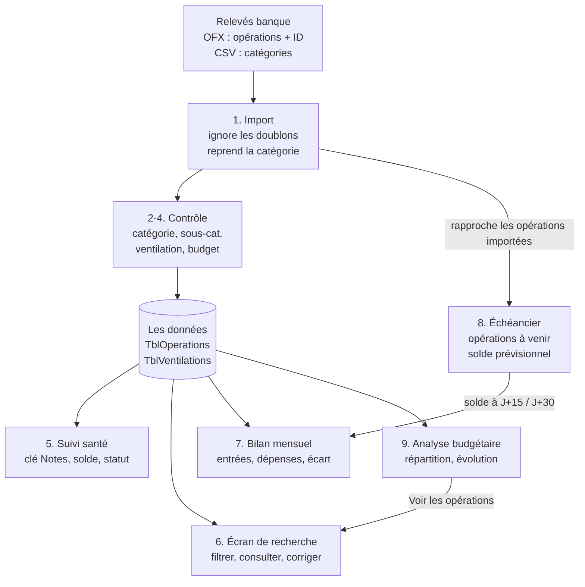
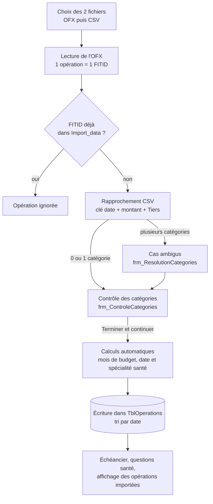
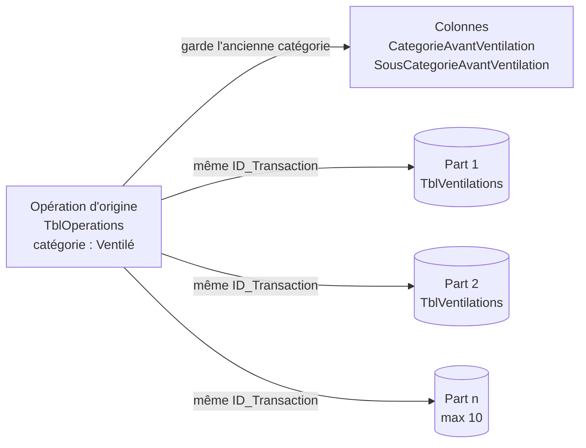
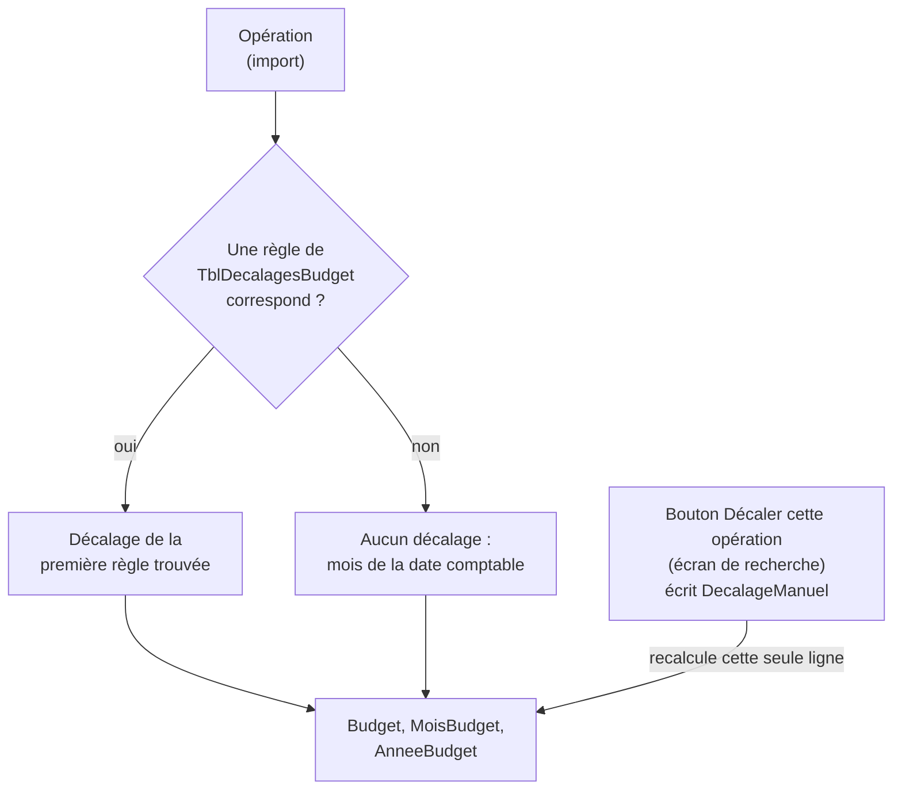
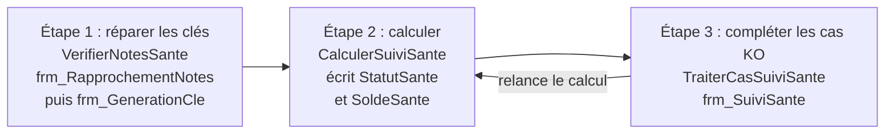
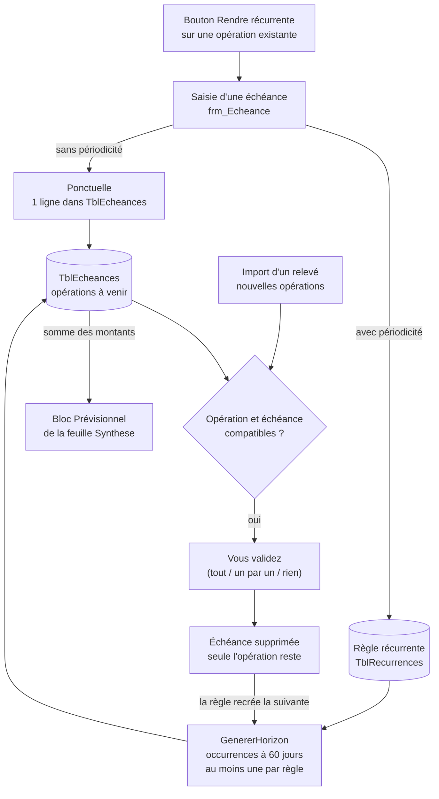
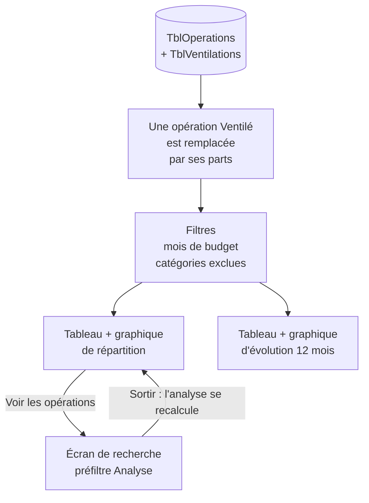
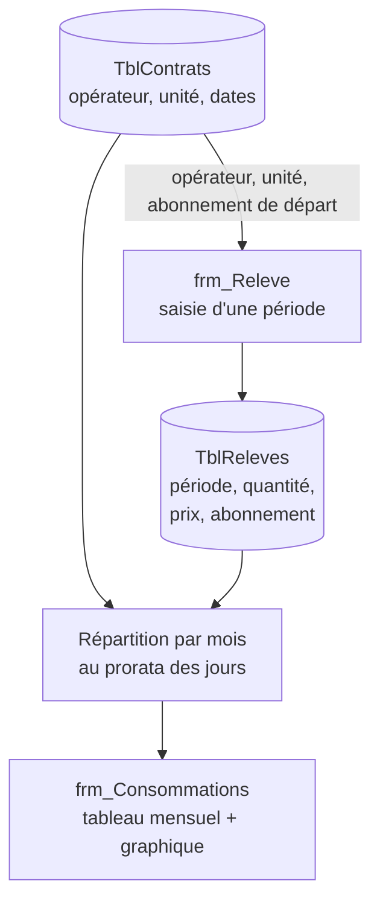

# Suivi Financier – Guide de fonctionnement

Oct 11, 2026 · @Alexandre

Ce guide explique ce que fait le classeur Excel de suivi des comptes : on importe les relevés de la banque, on range chaque opération dans une catégorie, on suit les remboursements de santé, on déclare les opérations à venir (échéancier), on analyse ses dépenses et on suit ses consommations d'eau, d'électricité et de gaz, puis on consulte et corrige depuis un écran de recherche. Il décrit le code de la branche Refonte\_recherche du dépôt Suivi\_Financier, dans son état du 11/10/2026 (dernier commit da794e7, « Analyse budgetaire »).

Ce document existe en deux formats, **toujours identiques** : `README.md` (lu sur GitHub, schémas Mermaid) et `README.html` (un seul fichier autonome, qui s'ouvre dans n'importe quel navigateur, sans connexion internet). Voir la section « Régénérer le guide HTML » en fin de document.

## Sommaire

- [En bref : le parcours d'une opération](#en-bref--le-parcours-dune-opération)
- [Les feuilles et tableaux du classeur](#les-feuilles-et-tableaux-du-classeur)
- [1. L'import des relevés (OFX + CSV)](#1-limport-des-relevés-ofx--csv)
- [2. Le contrôle des catégories](#2-le-contrôle-des-catégories)
- [3. La ventilation d'une opération](#3-la-ventilation-dune-opération)
- [4. Le mois de budget et les décalages](#4-le-mois-de-budget-et-les-décalages)
- [5. Le suivi santé](#5-le-suivi-santé)
- [6. L'écran de recherche des opérations](#6-lécran-de-recherche-des-opérations)
- [7. La feuille Synthese et les écrans de résultat](#7-la-feuille-synthese-et-les-écrans-de-résultat)
- [8. L'échéancier et le prévisionnel de trésorerie](#8-léchéancier-et-le-prévisionnel-de-trésorerie)
- [9. L'analyse budgétaire](#9-lanalyse-budgétaire)
- [10. Le suivi des consommations](#10-le-suivi-des-consommations)
- [11. Installation, maintenance et outils développeur](#11-installation-maintenance-et-outils-développeur)
- [12. Déploiement et sauvegardes](#12-déploiement-et-sauvegardes-synchronisation-avec-le-fichier-central)
- [Glossaire](#glossaire)
- [Points relevés à la lecture du code](#points-relevés-à-la-lecture-du-code)

## En bref : le parcours d'une opération



Une opération entre une seule fois, par l'import, et n'est écrite qu'après votre contrôle. Ensuite, le suivi santé, l'écran de recherche, le bilan mensuel et l'analyse budgétaire travaillent tous sur les deux mêmes tableaux. L'échéancier, lui, garde la liste de ce qui **va** arriver sur le compte et la compare aux opérations à chaque import. Les numéros renvoient aux sections de ce guide.

## Les feuilles et tableaux du classeur

Toutes les données vivent dans deux tableaux Excel : **TblOperations** (une ligne par opération bancaire) et **TblVentilations** (les « parts » d'une opération découpée). L'échéancier a ses deux propres tableaux (**TblEcheances** et **TblRecurrences**), et le suivi des consommations les siens (**TblReleves** et **TblContrats**). Les autres feuilles servent soit de réglages, soit d'écrans de saisie.

Un point de vocabulaire utile dès le départ : un **tableau Excel** (ou *ListObject*) est une plage mise en forme avec « Insérer > Tableau ». Le code retrouve toujours ses colonnes par leur **nom d'en-tête**, jamais par leur numéro : on peut donc déplacer une colonne sans rien casser, mais il ne faut **jamais la renommer**.

| Feuille | Tableau / contenu | Rôle pour l'utilisateur | Visible ? |
| --- | --- | --- | --- |
| Accueil | Bouton d'import | Lancer l'import des relevés | Oui |
| Synthese | Critères (année, mois, seuil…), bloc « Prévisionnel de trésorerie », boutons | Point de départ de toutes les consultations | Oui |
| Import\_data | **TblOperations** | La base : toutes les opérations importées | Oui |
| Ventilations | **TblVentilations** | Les parts des opérations ventilées | Oui |
| Param | **TblCategories** (K:N), **TblDecalagesBudget** (S:V), listes Spécialités, Praticiens, Bénéficiaires, Mois, Années | Réglages modifiables sans toucher au code | Masquée en temps normal |
| frm\_ResolutionCategories | Formulaire | Choisir une catégorie quand le CSV en propose plusieurs | Seulement pendant l'import |
| frm\_ControleCategories | Formulaire | Contrôler catégorie, sous-catégorie, Tiers et Notes | Pendant l'import ou à la demande |
| frm\_NouvelleCategorie | Formulaire | Créer une catégorie ou sous-catégorie | Ouvert depuis le contrôle ou l'échéancier |
| frm\_Ventilation | Formulaire | Découper une opération en plusieurs parts | À la demande |
| frm\_RapprochementNotes | Formulaire | Retrouver la clé santé d'une opération | Suivi santé |
| frm\_GenerationCle | Formulaire | Créer une nouvelle clé santé | Suivi santé |
| frm\_SuiviSante | Formulaire | Compléter bénéficiaire, franchise, dépassement | Suivi santé |
| frm\_RechercheOperations | **TblRechercheOperations** | Écran central de consultation et de correction | À la demande |
| frm\_Resultat | Zone de résultats | Bilan mensuel | À la demande |
| frm\_Echeancier | **TblEcheances** | Liste des opérations à venir | À la demande |
| frm\_Recurrences | **TblRecurrences** | Liste des règles de récurrence | À la demande |
| frm\_Echeance | Formulaire | Saisir une échéance ou une règle | À la demande |
| frm\_Analyse | 2 tableaux + 2 graphiques | Analyse budgétaire | À la demande |
| frm\_Consommations | Tableau mensuel + graphique | Évolution des consommations d'eau, d'électricité et de gaz | À la demande |
| frm\_Releves | **TblReleves** | Liste des périodes de consommation (quantité, prix, abonnement) | À la demande |
| frm\_Releve | Formulaire | Saisir une période de consommation | À la demande |
| frm\_Contrats | **TblContrats** | Liste des contrats (opérateurs) | À la demande |
| frm\_Contrat | Formulaire | Saisir un contrat ou changer d'opérateur | À la demande |
| TechDernierImport | Liste d'identifiants | Mémorise le dernier import | Très masquée (technique) |

**Pourquoi des « formulaires » en feuilles et pas de vraies fenêtres ?** Les fenêtres VBA classiques (*UserForm*) s'affichaient mal sur un poste à plusieurs écrans (problème d'échelle d'affichage, « DPI »). Chaque formulaire est donc une feuille cachée qui s'affiche le temps de la saisie. Tant qu'elle est ouverte, Excel vous empêche d'aller sur un autre onglet : c'est voulu, cela imite une fenêtre « modale ». On en sort uniquement par ses boutons (Terminer, Valider, Annuler, Sortir…).

**Charte commune des écrans.** Tous les écrans partagent la même présentation (définie une seule fois dans `mod_InstallCommun`) : une ligne de boutons en haut, un bloc « Instructions » juste dessous, puis le corps. Les couleurs sont toujours les mêmes : étiquette de champ en bleu foncé, **cellule grise = non modifiable**, **cellule jaune pâle = modifiable**. Dans le bloc Instructions, les noms de boutons sont en rouge gras, les noms de champs en vert gras. Quadrillage et en-têtes de lignes sont masqués.

## 1. L'import des relevés (OFX + CSV)

L'import ajoute à TblOperations les seules opérations **nouvelles**, avec leur catégorie, et ne réécrit jamais une opération déjà présente. On le lance avec le bouton de la feuille Accueil (macro `ImporterOperationsOFX`, module `mod_ImportOFX`).

**Pourquoi deux fichiers ?** Le fichier **OFX** de la banque contient les opérations avec un identifiant unique (le *FITID*) mais **sans catégorie**. Le fichier **CSV** exporté en même temps contient, lui, la **catégorie** choisie dans l'application de la banque. L'import lit les deux et les « recolle ».



Ce qui se passe, dans l'ordre :

1. **Choix des fichiers.** Excel vous demande d'abord l'OFX, puis le CSV. Annuler l'une des deux fenêtres arrête tout, sans rien modifier.
2. **Lecture de l'OFX.** Chaque opération (balise `STMTTRN`) donne : date comptable, date d'opération, type, Tiers (`NAME`), libellé (`MEMO`, rangé dans la colonne **Notes**), montant (négatif = dépense) et numéro de chèque.
3. **Anti-doublon.** Le FITID devient la colonne **ID\_Transaction**. Si cet identifiant existe déjà dans Import\_data, l'opération est ignorée. On peut donc réimporter un relevé qui chevauche le précédent sans créer de doublon.
4. **Rapprochement avec le CSV.** Pour retrouver la catégorie, le code fabrique une clé « date + montant + Tiers » des deux côtés (le CSV est attendu en UTF-16, séparé par des tabulations, avec les colonnes Date, Libellé, Catégorie, Montant). Trois cas :
    - la clé est trouvée avec une seule catégorie → elle est reprise ;
    - elle n'est pas trouvée → catégorie vide, l'opération sera à ranger à la main ;
    - elle est trouvée avec **plusieurs** catégories différentes (deux achats identiques le même jour) → cas « ambigu ».
5. **Cas ambigus.** S'il y en a, la feuille **frm\_ResolutionCategories** s'affiche : une ligne par cas, une liste déroulante avec les catégories possibles. Vous choisissez, puis « Terminer et appliquer ».
6. **Contrôle des catégories.** Le formulaire de contrôle s'ouvre (voir section 2). C'est ici que chaque opération reçoit sa catégorie **et** sa sous-catégorie. Si vous cliquez sur « Annuler l'import », **rien n'est écrit** : le classeur reste exactement comme avant.
7. **Calculs automatiques.** Pour chaque opération : le mois de budget (section 4) et, pour une dépense de santé, la date et la spécialité de consultation lues dans Notes (section 5).
8. **Écriture.** Les nouvelles lignes sont ajoutées en bas de TblOperations, l'identifiant forcé au format Texte (sinon Excel arrondirait les longs numéros). Puis la sous-catégorie et, si l'opération a été ventilée, sa catégorie d'origine sont écrites, et le tableau est trié par date comptable, la plus récente en haut.
9. **Mémorisation du dernier import.** La liste des identifiants ajoutés est notée dans la feuille technique TechDernierImport. C'est elle qui alimente le bouton « Dernier import ».
10. **Échéancier (automatique, sans question préalable).** Les occurrences des règles de récurrence sont complétées, puis, si des opérations ont été ajoutées, l'import compare ces opérations aux échéances à venir et vous propose les rapprochements (voir section 8). Sans effet si l'échéancier n'est pas installé.
11. **Trois questions finales**, toutes facultatives :
    - « Traiter/revoir les catégories des opérations affectées à Santé ? » → lance la vérification des clés santé ;
    - si oui, « Réaliser le rapprochement des opérations de santé ? » → lance le formulaire de suivi santé ;
    - « Afficher les opérations importées ? » → ouvre l'écran de recherche sur le dernier import. C'est aussi l'endroit idéal pour déclarer une opération comme récurrente (bouton « Rendre récurrente », section 8).
12. **Bilan.** Un message résume : opérations lues, déjà présentes, ajoutées, sans correspondance CSV, ambiguës, et rappelle la suppression des fichiers sources (voir ci-dessous). Si vous n'avez demandé aucun écran, vous revenez sur Synthese.

**Suppression des fichiers sources (sécurité).** Une fois les données écrites dans Import\_data (étape 8), le fichier OFX et le fichier CSV sont **écrasés avec des zéros puis supprimés** (sans passer par la corbeille), pour ne pas laisser de données bancaires en clair sur le disque. Cela vaut aussi quand aucune nouvelle ligne n'a été ajoutée (tout était déjà présent). **Rien n'est supprimé** si l'import s'arrête avant l'écriture (fichier illisible, CSV de structure invalide, « Annuler l'import ») : vous pouvez recommencer avec les mêmes fichiers. Si un fichier ne peut pas être supprimé (verrouillé, en lecture seule sur un partage), le bilan l'indique avec son chemin : supprimez-le vous-même. Sur un SSD l'écrasement n'est pas une garantie absolue ; le chiffrement du disque (BitLocker) reste la meilleure protection.

Répondre « Non » aux questions santé n'est pas grave : tout peut être relancé plus tard avec le bouton « Traitement des données de santé » de Synthese.

## 2. Le contrôle des catégories

Chaque opération est rangée sur **deux niveaux** : une **Catégorie** (ex. « Santé, prévoyance ») et une **Sous-catégorie** (ex. « Frais, remb santé »). La banque n'en fournit qu'un seul, la « catégorie source » : un tableau de correspondance fait le lien.

### Le tableau de correspondance TblCategories (feuille Param, colonnes K à N)

| Colonne | Contenu | Exemple |
| --- | --- | --- |
| K – CategorieSource | Le texte exact envoyé par la banque (ne pas modifier) | Frais, remb santé |
| L – Categorie | La catégorie de rangement | Santé, prévoyance |
| M – SousCategorie | La sous-catégorie (peut rester vide) | Frais, remb santé |
| N – Verifie | « Oui » quand vous avez contrôlé la ligne | Oui |

Quand une opération arrive avec la catégorie source « X », le formulaire lui propose automatiquement la Catégorie et la Sous-catégorie de la ligne « X ». Les listes déroulantes de tout le classeur (y compris celles de l'échéancier et de l'analyse) sont alimentées par ce tableau.

### Le formulaire frm\_ControleCategories

Au début, une question : **« Les catégories ont-elles été correctement renseignées dans la source ? »**

- **Oui** → les propositions sont gardées telles quelles. Seules les opérations **sans** correspondance (catégorie source vide ou inconnue) vous sont présentées, car on ne saurait pas où les ranger.
- **Non** → toutes les opérations vous sont présentées, une par une.
- **Annuler** → l'import s'arrête, rien n'est écrit.

Pour chaque opération affichée, vous voyez la date, le montant, le Tiers, le libellé/Notes et la catégorie source, puis :

- **Catégorie** puis **Sous-catégorie** (listes déroulantes ; la seconde se met à jour selon la première) ;
- **Tiers** et **Notes** modifiables, pour corriger un libellé bancaire peu lisible. Exception : pour une opération en « Frais, remb santé », ces deux champs sont **grisés et verrouillés**, parce que Notes contient la clé de consultation utilisée par le suivi santé (section 5) ;
- les boutons **< Précédent** / **Suivant >** pour naviguer ;
- **+ Nouvelle catégorie** pour créer une catégorie absente (voir ci-dessous) ;
- **Ventiler...** pour découper l'opération (section 3) ;
- **Terminer et continuer** pour valider l'ensemble ; **Annuler l'import** pour tout abandonner.

Vos choix ne sont pris en compte qu'au clic sur « Terminer et continuer ». Deux garde-fous à ce moment :

- s'il reste des opérations **sans catégorie**, impossible de terminer. Le message propose **OK** (aller à la première opération à corriger) ou **Annuler** (rester où vous êtes) ;
- si certaines opérations n'ont **jamais été affichées**, le message demande confirmation : elles garderont la catégorie proposée.

### Créer une catégorie (frm\_NouvelleCategorie)

Le bouton « + Nouvelle catégorie » ouvre un petit formulaire par-dessus le contrôle. Vous choisissez une catégorie existante ou en tapez une nouvelle, puis la sous-catégorie. À la validation, la paire est ajoutée à TblCategories et vous revenez au contrôle avec la nouvelle valeur déjà sélectionnée. Le même formulaire est réutilisé par les boutons « + » du formulaire de ventilation et du formulaire d'échéance.

Un **garde-fou orthographique** évite les quasi-doublons : si ce que vous tapez ressemble à une valeur existante à 2 lettres près (ex. « Alimentaton » pour « Alimentation »), le formulaire vous le signale avant de créer. La comparaison ignore aussi les accents, les majuscules et les espaces en trop.

### Corriger plus tard

Depuis l'écran de recherche (section 6), un **double-clic sur une cellule Categorie ou SousCategorie** rouvre ce même formulaire pour cette seule opération, prérempli avec ses valeurs actuelles. La catégorie et la sous-catégorie se modifient toujours ensemble. À la validation, l'opération est mise à jour, les statuts santé sont recalculés sans message, et l'écran se recharge avec le même filtre qu'avant. Une opération ventilée ne se corrige pas ainsi : un message vous renvoie vers la colonne Ventile.

## 3. La ventilation d'une opération

Ventiler, c'est découper **une** opération bancaire en plusieurs **parts**, chacune avec sa propre catégorie. Exemple : un ticket de pharmacie de 45 € dont 30 € de médicaments remboursés (« Frais, remb santé ») et 15 € d'hygiène (autre sous-catégorie).

**Où la déclencher :** bouton « Ventiler... » du contrôle des catégories pendant l'import, ou double-clic sur la colonne **Ventile** de l'écran de recherche (cellule vide = nouvelle ventilation, cellule « Oui » = revoir une ventilation existante).

**Le formulaire frm\_Ventilation** se lit en deux zones :

- **en haut**, l'en-tête de l'opération (date, Tiers, montant à ventiler) et la liste des parts déjà ajoutées (10 au maximum), avec un bouton **Éditer** en face de chacune ;
- **en bas**, une zone de saisie : Catégorie (avec son bouton « + »), Sous-catégorie, Montant, Notes, puis **Ajouter la ligne** ou **Effacer la saisie**.

Règles à connaître :

1. Le montant d'une part se saisit **toujours en positif**. Le signe (dépense ou entrée) est repris de l'opération d'origine au moment de l'enregistrement.
2. **Éditer** retire immédiatement la part de la liste et la recharge dans la zone de saisie. Si vous ne cliquez pas ensuite sur « Ajouter la ligne », la part reste supprimée : c'est aujourd'hui le seul moyen de supprimer une part.
3. **Terminer** n'est accepté que si la somme des parts est **exactement égale** au montant de l'opération (au centime près). Sinon un message indique l'écart.
4. **Annuler** abandonne la saisie en cours sans rien enregistrer.
5. **Supprimer cette ventilation** (visible seulement si elle existait déjà) efface toutes ses parts et rend à l'opération sa catégorie d'avant la ventilation.



**Ce que cela change dans les données :**

- l'opération d'origine reste dans TblOperations avec la catégorie **« Ventilé »** ; sa catégorie précédente est gardée dans les colonnes CategorieAvantVentilation / SousCategorieAvantVentilation ;
- chaque part devient une ligne de **TblVentilations**, reliée à l'opération par le même ID\_Transaction. Elle porte aussi toutes les colonnes du suivi santé : une part « Frais, remb santé » est suivie exactement comme une opération normale.

**Qui compte quoi.** Le bilan mensuel (section 7) ne lit que TblOperations : une opération ventilée y compte une fois, pour son montant total. L'analyse budgétaire (section 9) fait l'inverse : elle **remplace** l'opération « Ventilé » par ses parts.

**Attention :** rouvrir une ventilation et cliquer sur Terminer réécrit toutes ses parts. Si l'une d'elles avait déjà été rapprochée dans le suivi santé, ce rapprochement est perdu et sera à refaire (un avertissement s'affiche avant une suppression).

## 4. Le mois de budget et les décalages

Chaque opération est rattachée à un **mois de budget** (colonnes Budget, MoisBudget, AnneeBudget), qui est par défaut le mois de sa date comptable. C'est ce mois que lisent le bilan mensuel, le filtre « Opérations du mois » et l'analyse budgétaire.

Certaines opérations doivent compter pour un autre mois. Exemple typique : le salaire versé le 28 septembre sert à vivre en octobre, on le décale donc de +1 mois. Deux moyens existent.



**1. Une règle générale – tableau TblDecalagesBudget (feuille Param, colonnes S à V)**

| Tiers | Categorie | SousCategorie | Decalage |
| --- | --- | --- | --- |
| DRFIP OCCITANIE ET HTE | Revenus | Salaire/Revenus d'activite | 1 |

- Une case **laissée vide** veut dire « n'importe quelle valeur » (un joker).
- Le décalage est un nombre entier de mois : 1, -1, 2…
- La comparaison ignore les majuscules. Si plusieurs lignes conviennent, c'est **la première du tableau** qui s'applique : placez les règles les plus précises en haut.
- La règle s'applique **aux prochains imports**. Elle ne recalcule pas les opérations déjà présentes.

On peut remplir ce tableau à la main, ou depuis l'écran de recherche : sélectionner une ligne, puis bouton **« Ajouter un décalage »** (il reprend le Tiers, la catégorie et la sous-catégorie de la ligne et demande le nombre de mois).

**2. Une seule opération – bouton « Décaler cette opération »** (écran de recherche)

Il recalcule le mois de budget de la ligne sélectionnée uniquement, entre -24 et +24 mois, et note la valeur dans la colonne **DecalageManuel**. Cette colonne sert de marque : un choix manuel doit toujours primer sur les règles générales.

## 5. Le suivi santé

Le suivi santé vérifie, pour chaque consultation payée, que la Sécurité sociale et la mutuelle ont bien remboursé ce qu'elles devaient. Il ne concerne que les opérations dont la **Sous-catégorie** vaut **« Frais, remb santé »**, qu'elles soient dans TblOperations ou dans TblVentilations.

### L'idée clé : la « clé Notes »

Pour relier une dépense à ses remboursements, toutes les lignes d'une même consultation portent **exactement le même texte** dans la colonne Notes, au format :

`aaaammjj;spécialité;bénéficiaire;montant`

Exemple : `20260915;Généraliste;Alexandre;30`. On saisit normalement ce texte dans l'application de la banque, qui le renvoie dans l'OFX. À l'import, le code lit la date (1er morceau) et la spécialité (2e morceau) pour remplir **Date\_consult** et **Spe\_Consult**. Une spécialité absente de la liste « Specialites » (Param) est rangée dans CommentaireSante au lieu de Spe\_Consult.

Si la date ne peut pas être lue (Notes vide ou mal écrit), Date\_consult reçoit la valeur **02/01/1900**. C'est une « sentinelle » : une fausse date volontaire qui signifie « clé à réparer ».

Un **groupe** = toutes les lignes qui partagent la même clé Notes :

| Date | Tiers | Montant (€) | Notes | Rôle |
| --- | --- | --- | --- | --- |
| 15/09/2026 | DR MARTIN | -30,00 | 20260915;Généraliste;Alexandre;30 | Dépense |
| 22/09/2026 | CPAM | 20,00 | 20260915;Généraliste;Alexandre;30 | Remboursement 1 |
| 25/09/2026 | MUTUELLE | 9,00 | 20260915;Généraliste;Alexandre;30 | Remboursement 2 |

*(Valeurs fictives, pour l'illustration.)*

### Le calcul : solde et statut

Pour chaque groupe, le module `mod_SuiviSante` calcule :

```latex
\text{SoldeSante} = \text{dépenses} - \text{remboursements} - \text{Franchise}
```

Dans l'exemple, avec une franchise de 1 € : 30 − (20 + 9) − 1 = 0. Un solde nul (à un demi-centime près) donne **StatutSante = OK**, sinon **KO**. Le statut est écrit sur toutes les lignes du groupe, le solde sur la ligne de dépense. Un groupe sans dépense (remboursement « orphelin ») reste KO.

Un groupe n'est **plus jamais recalculé** quand sa dépense est OK, ou KO avec « Dépassement d'honoraires = Oui » (on accepte alors qu'il reste un reste à charge). Cela évite de reposer les mêmes questions à chaque import.

### Les trois étapes, dans l'ordre



On les lance après l'import (questions finales) ou à tout moment avec le bouton **« Traitement des données de santé »** de Synthese (macro `RetraiterSuiviSante`).

1. **Réparer les clés manquantes** (`VerifierNotesSante`). Chaque ligne santé dont Date\_consult vaut la sentinelle vous est présentée dans **frm\_RapprochementNotes**. Vous retrouvez la bonne clé parmi celles déjà connues, avec des filtres en cascade : Date (la plus récente d'abord) → Spécialité → Bénéficiaire → Montant. Trois boutons :
    - **Valider** : la clé est écrite dans Notes, et Date\_consult, Spe\_Consult, Bénéficiaire sont remplis aussitôt. La ligne ne sera plus reproposée ;
    - **Pas de correspondance** : ouvre **frm\_GenerationCle** pour créer une clé neuve (date, spécialité, bénéficiaire, montant, boutons « + » pour enrichir les listes), puis Générer et Valider ;
    - **Passer** : rien n'est modifié, la ligne reviendra au prochain lancement.
2. **Calculer** (`CalculerSuiviSante`) : solde et statut de tous les groupes, comme décrit plus haut.
3. **Compléter les cas non soldés** (`TraiterCasSuiviSante`). Chaque dépense KO, sans dépassement déclaré, s'affiche dans **frm\_SuiviSante** avec ses remboursements (2 au plus) et le solde actuel. Vous renseignez :
    - le **Bénéficiaire** (obligatoire) ;
    - le **Tiers corrigé**, obligatoire seulement si le Tiers importé n'est pas dans la liste « Praticiens » (le champ est alors jaune). Pour une part ventilée, la correction s'écrit sur l'opération d'origine ;
    - la **Franchise** retenue (0 si aucune) : le solde se recalcule sous vos yeux ;
    - **Dépassement d'honoraires ?** Oui/Non ;
    - un **Commentaire** libre.

    « Valider ce cas » enregistre, relance le calcul et passe au suivant ; « Cas suivant » passe sans rien changer.

**Cas particulier :** une clé dont la spécialité vaut « non reprise historique » passe directement en OK. Elle sert à neutraliser les anciennes opérations qu'on ne veut pas rapprocher.

### Consulter et corriger : l'écran « Suivi santé »

Le bouton de suivi santé de Synthese (macro `Synthese_Care`, module `Mod_SyntheseCare`) ouvre l'écran de recherche (section 6) avec le préfiltre **SuiviSante**. Il remplace l'ancien écran frm\_Resultat, qui ne trouvait plus aucune ligne depuis le passage aux deux niveaux de catégorie.

Ce qui s'affiche :

- toutes les lignes en sous-catégorie **« Frais, remb santé »** ;
- **et** toutes les lignes de catégorie **« Santé, prévoyance »**, quelle que soit leur sous-catégorie. C'est ce qui permet de repérer une dépense de santé rangée dans la mauvaise sous-catégorie ;
- les parts ventilées concernées, avec la date de l'opération d'origine (au lieu d'une date vide) et leurs propres colonnes santé ;
- les colonnes StatutSante, SoldeSante, Date\_consult et Spe\_Consult, qui restent masquées dans les autres préfiltres.

La ligne au-dessus du tableau résume la situation, par exemple :

« Suivi santé (catégorie Santé, prévoyance) -- 7 ligne(s) dont 1 part(s) ventilée(s) : 3 OK, 2 KO -- écart cumulé des dépenses KO : 45,00 €. »

Comment la lire :

- les lignes « Santé, prévoyance » d'une autre sous-catégorie n'ont pas de statut santé. Elles ne comptent ni en OK ni en KO : ici, 7 − 3 − 2 = 2 lignes sont à vérifier ;
- l'écart cumulé additionne le SoldeSante des seules **dépenses** KO. Le solde n'étant écrit que sur la ligne de dépense d'un groupe, il n'est jamais compté deux fois ;
- le montant d'une ligne KO est en **gras** : rouge pour une dépense, vert pour un remboursement (la règle « positif = vert » est conservée).

**Corriger une sous-catégorie depuis cet écran** :

1. Repérez la ligne mal rangée (par exemple « Santé, prévoyance » avec une sous-catégorie autre que « Frais, remb santé », et sans statut).
2. Double-cliquez sur sa cellule **Categorie** ou **SousCategorie** : le formulaire de contrôle des catégories s'ouvre pour cette seule opération.
3. Choisissez la bonne catégorie et la bonne sous-catégorie, puis « Terminer et continuer ».
4. Les statuts santé sont recalculés sans message et l'écran se recharge, toujours en Suivi santé : la ligne a maintenant son statut OK ou KO.
5. Si sa clé Notes n'a pas encore été vérifiée, lancez ensuite « Traitement des données de santé » pour la rapprocher.

Une part ventilée ne se corrige pas par double-clic sur Categorie : on passe par la colonne Ventile (section 3).

## 6. L'écran de recherche des opérations

**frm\_RechercheOperations** est l'écran central : il affiche les opérations de TblOperations **et** les parts de TblVentilations dans un seul tableau, filtrable avec les flèches natives d'Excel, et permet de corriger sans ouvrir Import\_data.

### Comment l'ouvrir : sept entrées, sept « préfiltres »

| Bouton (feuille) | Préfiltre | Ce qui s'affiche |
| --- | --- | --- |
| Recherche globale (Synthese ou l'écran lui-même) | aucun | Toutes les opérations et toutes les parts |
| Dernier import (Synthese, ou question en fin d'import) | DernierImport | Les opérations ajoutées par le dernier import |
| Opérations du mois (Synthese) | OperationsDuMois | Le mois de budget choisi sur Synthese, au-dessus du seuil de montant |
| Suivi santé (Synthese, macro Synthese\_Care) | SuiviSante | Les lignes « Frais, remb santé » et toutes celles de catégorie « Santé, prévoyance », parts ventilées comprises, avec leurs colonnes santé (détail en section 5) |
| Erreurs santé (Synthese) | ErreursSante | Les lignes dont Date\_consult vaut la sentinelle 02/01/1900 |
| Voir le détail des entrées / dépenses (bilan mensuel) | DetailTotal | Les entrées (ou les dépenses) du mois du bilan |
| Voir les opérations (analyse budgétaire) | Analyse | Les opérations et parts qui forment le chiffre sélectionné dans l'analyse (section 9) |

Une ligne de texte au-dessus du tableau rappelle le filtre actif et le nombre de lignes. Les montants suivent la règle de couleur commune du classeur : vert pour une entrée d'argent, noir pour une dépense, gras pour une ligne « en alerte » (rouge si c'est une dépense). Sont en alerte les plus grosses dépenses en « Opérations du mois » (leur nombre se règle sur Synthese) et les lignes KO en « Suivi santé ». Si vous aviez posé un filtre de colonne, il est remis à l'identique après chaque rechargement.

### Les colonnes

| Colonne | Signification | Modifiable ? |
| --- | --- | --- |
| Valider | Tapez « Oui » pour marquer une ligne à enregistrer | Oui |
| Date, Tiers, Montant | Données de l'opération | Non |
| Categorie, SousCategorie | Rangement | Par double-clic sur Categorie ou SousCategorie |
| Notes | Libellé ou clé santé | Oui, sauf une clé santé déjà valide (cellule grisée) |
| Ventile | « Oui » sur une part de ventilation | Par double-clic |
| Budget, StatutSante, SoldeSante, Date\_consult, Spe\_Consult | Informations calculées | Non |

Les colonnes techniques (identifiant, source O/V, numéro de ligne de ventilation) sont masquées. Une opération ventilée se retrouve donc de deux façons : par sa ligne d'origine (catégorie « Ventilé ») ou par chacune de ses parts (Ventile = Oui).

### Les actions

La barre de boutons de l'écran contient : Recherche globale, Appliquer les lignes marquées, Ajouter un décalage, Décaler cette opération, Rendre récurrente et Sortir.

- **Corriger des Notes en lot** : modifiez les cellules Notes, mettez « Oui » dans Valider, puis cliquez sur **« Appliquer les lignes marquées »**. Les Notes sont écrites dans la bonne table, la marque « Oui » est effacée, puis la vérification et le calcul santé sont relancés.
- **Double-clic sur Categorie ou SousCategorie** : ouvre le formulaire de contrôle des catégories pour cette seule opération, prérempli avec ses valeurs actuelles. À la validation, l'enregistrement est immédiat (sans passer par Valider), les statuts santé sont recalculés sans message et l'écran se recharge avec le même préfiltre. Sur une opération ventilée, un message vous renvoie vers la colonne Ventile.
- **Double-clic sur Ventile** : démarre ou revoit une ventilation (section 3).
- **Ajouter un décalage** / **Décaler cette opération** : voir section 4.
- **Rendre récurrente** : ouvre le formulaire d'échéance prérempli avec la ligne sélectionnée (voir section 8). Disponible dans tous les préfiltres, donc aussi juste après un import.
- **Sortir** : referme l'écran et revient sur Synthese. Quand l'écran a été ouvert depuis l'analyse budgétaire, « Sortir » revient sur l'analyse, qui est recalculée.

Modifier directement une cellule Date, Tiers ou Montant de cet écran ne change **rien** dans les données : c'est un affichage, reconstruit à chaque recherche.

## 7. La feuille Synthese et les écrans de résultat

La feuille **Synthese** est le tableau de bord : vous y choisissez une période et des réglages, puis un bouton. Elle contient aussi le bloc « Prévisionnel de trésorerie » (section 8) et les boutons « Analyse budgétaire » (section 9) et « Consommations » (section 10).

| Cellule nommée | Sens | Utilisée par |
| --- | --- | --- |
| critAnnee | Année de budget | Bilan mensuel, Opérations du mois, Détail des totaux, ouverture de l'analyse |
| critMois | Mois de budget | Idem |
| critNbLigne | Nombre de grosses dépenses à surligner | Écran de recherche |
| critValMin | Seuil de montant (en valeur absolue : -300 compte comme 300) | Opérations du mois, Détail des totaux |
| critTriChamp, critTri | Champ et ordre de tri | Plus utilisés : on trie avec les flèches de filtre |
| soldeRefMontant, soldeRefDate | Solde de référence et sa date | Bloc prévisionnel (section 8) |

**Bilan mensuel** (`Budget_Bilan_Mensuel`) : calcule, pour le mois de budget choisi, le total des entrées, le total des dépenses et la différence. Le résultat s'affiche dans la feuille frm\_Resultat, avec deux boutons « Voir le détail des entrées » et « Voir le détail des dépenses » qui ouvrent l'écran de recherche. Ce bilan ne lit que TblOperations : une opération ventilée compte une fois, pour son montant total.

**Suivi santé** (`Synthese_Care`) : ouvre l'écran de recherche avec le préfiltre « Suivi santé », décrit en section 5. L'ancienne synthèse affichée dans frm\_Resultat a été abandonnée le 07/10/2026.

Tous ces écrans masquent Synthese pendant leur affichage ; le bouton **Sortir** la réaffiche.

## 8. L'échéancier et le prévisionnel de trésorerie

L'échéancier garde la liste de ce qui **va** arriver sur le compte (loyer, abonnement, prêt, facture ponctuelle…) et en déduit un **solde prévisionnel** à 15 et 30 jours. Il est écrit dans `mod_Echeancier` (logique) et `mod_InstallEcheancier` (construction des feuilles). Il est **optionnel** : tant qu'il n'est pas installé, l'import et le reste du classeur fonctionnent comme avant.

### Les principes (validés le 09/10/2026)

- **Deux tableaux.** **TblRecurrences** contient les *règles* (« loyer, tous les mois, le 5 »). **TblEcheances** contient les *occurrences à venir*, générées par les règles, ou saisies directement quand l'opération est ponctuelle.
- **Aucun historique.** Quand une opération importée est rapprochée d'une échéance et que vous validez, l'échéance est **supprimée**. Seule l'opération reste, dans TblOperations. Si l'échéance venait d'une règle, la règle continue de produire les suivantes.
- **Une échéance non rapprochée reste** dans la liste, reste comptée dans le solde prévisionnel, jusqu'à ce que vous la supprimiez vous-même.
- **Reconnaissance souple.** Le rapprochement n'exige pas le Tiers : la Catégorie ou la Sous-catégorie peuvent suffire (achat dont on ne connaît pas le commerçant). La date peut être imprécise (précision « Mois »).
- **Le solde de départ est saisi par vous**, car les exports OFX ne contiennent pas de solde.



### Installer l'échéancier

Une seule macro, `InstallerEcheancier`, à lancer une fois depuis la fenêtre Exécution d'Excel (détails en section 11). Elle crée les trois feuilles masquées (frm\_Echeancier, frm\_Recurrences, frm\_Echeance), le bloc « Prévisionnel de trésorerie » sur Synthese (avec ses deux boutons) et le bouton « Rendre récurrente » de l'écran de recherche. **Une étape manuelle est indispensable** : coller dans le module de la feuille frm\_Echeance le contenu de `CodeBehind_frm_Echeance.txt` (deux petits événements). La réinstallation est possible : si les listes contiennent des données, une confirmation est demandée avant de les reconstruire, car elles seraient **perdues**.

### Déclarer une échéance : le formulaire frm\_Echeance

Bouton « Saisir une échéance » (Synthese ou listes). Les champs :

| Champ | Rôle |
| --- | --- |
| Libellé | Nom affiché dans les listes. Facultatif : à défaut, on prend le Tiers, sinon la sous-catégorie, sinon la catégorie |
| Tiers | À choisir parmi les Tiers déjà connus dans TblOperations, ou à taper librement. Il est **cherché dans le Tiers de l'opération importée**, sans tenir compte des majuscules : un mot-clé suffit (ex. EDF) |
| Catégorie / Sous-catégorie | Listes déroulantes (la seconde dépend de la première). Choisir une sous-catégorie qui n'appartient qu'à une catégorie renseigne celle-ci. Boutons « + » pour en créer une |
| Montant | **Négatif** pour une dépense, **positif** pour une entrée. Obligatoire, non nul. Une opération de signe contraire n'est jamais rapprochée |
| Périodicité | Vide ou Ponctuelle = opération unique. Hebdomadaire, Mensuelle, Trimestrielle, Annuelle = crée une règle |
| Date prévue | Date de l'opération, ou de la première pour une règle |
| Date de fin | Facultative, réservée aux règles. Vide = la règle ne s'arrête jamais |
| Précision de la date | **Jour** ou **Mois** (voir ci-dessous) |
| Tolérance | Écart de montant accepté en % du montant prévu (10 par défaut ; 0 = montant exact) |

Contrôles à la validation : il faut au moins le Tiers ou la Catégorie (sinon rien ne permettrait de reconnaître l'opération), une sous-catégorie suppose une catégorie, la catégorie et la sous-catégorie doivent exister dans les listes, la date de fin ne peut pas précéder la date prévue, la tolérance est comprise entre 0 et 100. En cas d'erreur, un message s'affiche sous le formulaire et rien n'est enregistré. **Valider** enregistre et referme ; **Annuler** demande confirmation.

**Le jour d'ancrage.** Pour une règle mensuelle, le jour du mois est conservé d'une occurrence à l'autre : un 31 devient le 28 en février, puis redevient 31 en mars (le jour ne « dérive » pas). Pour la précision « Mois », la date est ramenée au 1er du mois.

**Rendre récurrente une opération existante.** Dans l'écran de recherche (y compris juste après un import), sélectionnez une ligne puis « Rendre récurrente » : le formulaire s'ouvre prérempli (Tiers, catégorie, montant, périodicité mensuelle). La prochaine date est calculée sur le même jour du mois suivant, puis avancée jusqu'à une date future ; tout reste modifiable avant de valider.

### Les règles produisent seules les occurrences

`GenererHorizon` complète TblEcheances pour chaque règle **active** : occurrences jusqu'à **60 jours** dans le futur, et **toujours au moins une**, même plus lointaine. La colonne DateProchaine de la règle mémorise la prochaine date à créer : une occurrence supprimée ou rapprochée n'est donc **jamais recréée** par erreur. Une règle dont la date de fin est atteinte et qui n'a plus aucune échéance est retirée de la liste. La génération se déclenche : à l'ouverture du classeur, à chaque import, à l'ouverture des listes, et après chaque saisie.

### Le rapprochement après l'import

Pour chaque opération qui vient d'être importée, une échéance est **candidate** si :

1. le montant a le **même signe** et l'écart reste dans la tolérance de l'échéance ;
2. la **date** est dans la fenêtre : précision Jour = de 5 jours avant à 10 jours après la date prévue (règle hebdomadaire : ±3 jours) ; précision Mois = n'importe quel jour du mois prévu ;
3. le **Tiers** de l'opération contient le Tiers de l'échéance (si renseigné) ;
4. la **Catégorie / Sous-catégorie** sont égales (si renseignées).

Chaque opération et chaque échéance ne servent qu'une fois : on retient d'abord les paires les plus proches (écart de date, puis de montant). Un message liste les rapprochements proposés (12 au maximum affichés) :

- **Oui** : tout valider (les échéances rapprochées disparaissent de la liste) ;
- **Non** : examiner un par un ;
- **Annuler** : ne rien rapprocher, les échéances restent à venir.

### Les deux listes

- **frm\_Echeancier** (échéances à venir) : on peut corriger les cellules directement ; modifier une échéance ne modifie pas sa règle. Boutons : *Ajouter une échéance*, *Supprimer la sélection*, *Voir les règles*, *Sortir*.
  - Supprimer une échéance issue d'une règle ouvre un choix : **Oui** = supprimer seulement ces échéances (la règle continue, et recrée aussitôt la suivante si la liste de la règle est vide) ; **Non** = **arrêter la récurrence** à partir de la première échéance sélectionnée (la règle reçoit une date de fin et ses occurrences suivantes disparaissent : cas d'un remboursement anticipé) ; **Annuler** = ne rien faire.
- **frm\_Recurrences** (règles) : colonnes ID\_Recurrence, Libelle, Tiers, Categorie, SousCategorie, Montant, Periodicite, DateProchaine, DateFin, PrecisionDate, JourAncre, TolerancePct, **Actif** (Oui/Non : Non = règle en pause). Boutons : *Ajouter une échéance*, *Actualiser les occurrences*, *Supprimer la règle*, *Voir les échéances*, *Sortir*.
  - Modifier une règle ne s'applique qu'aux échéances créées ensuite. **Actualiser les occurrences** supprime les échéances actuellement dans la liste (même non rapprochées) puis les recrée avec les valeurs de la règle, en repartant de la plus ancienne. Une règle en pause perd ainsi ses échéances.
  - *Supprimer la règle* supprime aussi ses échéances à venir. Pour arrêter à une date précise, renseignez plutôt DateFin puis Actualiser.

### Le bloc « Prévisionnel de trésorerie » de Synthese

Ce bloc est fait de **formules Excel** : il se recalcule seul après chaque import ou saisie.

| Ligne | Contenu |
| --- | --- |
| Solde de réf. | **Saisi par vous** : le solde du compte relevé à une date donnée |
| Date du solde | **Saisie par vous** : la date de ce solde |
| Solde actuel | Solde de réf. + somme des opérations postérieures à la date du solde (« à renseigner » tant que les deux cases sont vides) |
| Solde à J+15 | Solde actuel + somme des échéances dont la date prévue est ≤ aujourd'hui + 15 jours |
| Solde à J+30 | Idem à 30 jours |
| Éch. en retard | **Nombre** d'échéances dont la date prévue est passée (pour une précision Mois, une fois le mois écoulé) : c'est à vous de les supprimer ou de les faire rapprocher |

Les boutons du bloc : **Saisir une échéance** et **Voir l'échéancier**. Les échéances en retard sont comptées dans les soldes prévisionnels tant qu'elles ne sont pas supprimées.

## 9. L'analyse budgétaire

L'écran **frm\_Analyse** répond à trois questions : *où va mon argent ?* (répartition par catégorie), *comment évolue-t-il mois après mois ?* (évolution sur 12 mois) et *quelles opérations forment ce chiffre ?* (lien avec l'écran de recherche). Il est écrit dans `mod_Analyse` (calculs) et `mod_InstallAnalyse` (construction de la feuille). **État au 11/10/2026 : première version écrite, non encore testée dans Excel** (voir `TODO_SuiviBudgetaire.md`).



### Ouvrir et régler l'écran

Bouton **« Analyse budgétaire »** de la feuille Synthese : l'écran s'ouvre avec l'année et le mois choisis sur Synthese, et calcule aussitôt.

| Paramètre | Valeurs | Effet |
| --- | --- | --- |
| Période | **Mois** / **Année** / **12 derniers mois** | Mois = le mois de budget choisi ; Année = janvier à décembre de l'année choisie ; 12 derniers mois = les 12 mois se terminant au mois choisi |
| Année de budget, Mois de budget | listes déroulantes | Période de référence |
| Catégorie à détailler | « (toutes) » ou une catégorie | Toutes = vue par catégorie ; une catégorie = vue par ses sous-catégories |
| Graphique de répartition | Barres / Anneau | Type du graphique de gauche |
| Graphique d'évolution | Barres empilées / Courbes | Type du graphique du bas |
| Catégories exclues | 6 emplacements | Ces catégories ne sont **jamais comptées** (par défaut : « Virements internes » et « Revenus ») |

Après un changement, cliquer sur **Actualiser**.

### Les règles de calcul

- **Source** : TblOperations + TblVentilations. Une opération « Ventilé » est **remplacée par ses parts** (sinon double comptage). Une part prend le **mois de budget** de l'opération d'origine ; les décalages de budget sont donc respectés.
- **Net par catégorie** : pour chaque catégorie on additionne dépenses et remboursements sur la période. **Seules les catégories dont le net est une dépense** sont affichées : les revenus n'apparaissent pas. Les montants sont affichés en positif.
- **Répartition** : tableau Catégorie (ou sous-catégorie) / Dépenses (€) / % du total / Nombre d'opérations, trié de la plus grosse à la plus petite, sur 30 lignes au plus (la dernière ligne regroupe le reste sous « Autres »), avec une ligne Total. Le graphique est en barres triées ou en anneau (8 premières catégories + « Autres »). Une phrase au-dessus résume : total, nombre de lignes, période.
- **Évolution** : tableau des 8 plus grosses catégories (ou sous-catégories si une catégorie est détaillée) + « Autres », en colonnes sur 12 mois, avec totaux ; graphique en barres empilées ou en courbes.

### Les boutons

- **Actualiser** : recalcule tout.
- **Détailler la sélection** : cliquez d'abord sur une ligne du tableau de répartition ; la catégorie devient le filtre et le tableau et les graphiques passent à ses sous-catégories. Impossible sur « Autres » ou « (sans catégorie) » (ces lignes regroupent plusieurs valeurs), et une seule catégorie peut être détaillée à la fois.
- **Toutes les catégories** : revient à la vue générale.
- **Voir les opérations** : ouvre l'écran de recherche en préfiltre **Analyse** sur les opérations et parts de la ligne sélectionnée (ou, sans sélection, de tout le périmètre affiché). On y retrouve toutes les fonctions habituelles : recatégoriser, ventiler, décaler le budget… En quittant la recherche avec **Sortir**, l'analyse se réaffiche et **se recalcule** (une recatégorisation ou un décalage change les chiffres).
- **Sortir** : revient sur Synthese.

### Analyse ou bilan mensuel : pourquoi deux chiffres ?

Le bilan mensuel (section 7) lit seulement TblOperations et compte une opération ventilée une fois. L'analyse remplace cette opération par ses parts, exclut des catégories, et ne retient que les catégories dont le net est une dépense. Les totaux peuvent donc différer légèrement : c'est normal, à ventilations et exclusions près.

## 10. Le suivi des consommations

L'écran **frm\_Consommations** répond à une question : *combien consomme-t-on d'eau, d'électricité et de gaz, à quel prix, et comment cela évolue-t-il mois après mois ?* Il est écrit dans `mod_Consommations` (logique) et `mod_InstallConsommations` (construction des feuilles). **État au 11/10/2026 : première version écrite, non encore testée dans Excel** (voir `TODO_SuiviConsommations.md`). Le suivi est **optionnel** et **indépendant des opérations bancaires** : il a ses propres tableaux et ne lit ni TblOperations ni TblVentilations.



### Les principes (décidés le 11/10/2026)

- **Quatre types de consommation** : Adduction eau, Recyclage eau, Fourniture élec, Fourniture gaz. Chacun a une unité par défaut (m³ pour l'eau, kWh pour l'électricité et le gaz), modifiable dans le contrat.
- **Un contrat = un type chez un opérateur, entre deux dates.** Changer d'opérateur, c'est ajouter un nouveau contrat : le contrat en cours est clôturé la veille. L'historique reste complet, et chaque relevé retrouve son opérateur grâce à ses dates.
- **Le prix de l'unité et l'abonnement sont portés par chaque relevé**, pas par le contrat. Un tarif qui change en cours de contrat (ou un abonnement qui évolue) est donc historisé. Le contrat ne sert que de valeur de départ pour l'abonnement ; le formulaire propose le dernier prix et le dernier abonnement connus, et vous pouvez les ajuster.
- **Les périodes sont libres** (début et fin saisis, fin incluse). Quand le prix de l'unité change plusieurs fois au cours d'une même facture, on saisit **un relevé par prix**, avec le même numéro de facture.
- **Pas de rapprochement bancaire** dans cette version : les relevés sont saisis à la main d'après les factures.

### Installer le suivi

Une seule macro, `InstallerConsommations`, à lancer une fois (détails en section 11). Elle crée les cinq feuilles masquées (frm\_Consommations, frm\_Releves, frm\_Releve, frm\_Contrats, frm\_Contrat) et le bouton **« Consommations »** de Synthese (sous le bouton d'analyse, déplaçable à la main). **Une étape manuelle est indispensable** : coller dans le module de la feuille frm\_Releve le contenu de `CodeBehind_frm_Releve.txt`, et dans celui de frm\_Contrat le contenu de `CodeBehind_frm_Contrat.txt` (deux petits événements chacun). La réinstallation est possible : si les listes contiennent des données, une confirmation est demandée avant de les reconstruire, car elles seraient **perdues**.

### Déclarer un contrat

Bouton **Contrats** de l'écran, puis **Ajouter un contrat** (formulaire frm\_Contrat) :

| Champ | Rôle |
| --- | --- |
| Type de consommation | Un des quatre types (liste) |
| Opérateur (fournisseur) | Texte libre : il sert de légende au graphique |
| Unité de mesure | Proposée selon le type, modifiable |
| Début du contrat / Fin du contrat | La fin est facultative : vide = contrat en cours |
| Abonnement mensuel | Valeur de départ proposée dans les relevés |
| Référence / N° de compteur | Facultatif |

**Changement d'opérateur.** Il suffit de créer le nouveau contrat avec sa date de début. S'il existe un contrat en cours du même type qui commence avant, le programme propose de le clôturer **la veille** du nouveau. Si vous refusez, un message demande de fixer une date de fin : un seul contrat peut être en cours pour un type. Deux contrats d'un même type ne peuvent pas se chevaucher. Les relevés déjà saisis gardent leur ancien opérateur.

### Saisir un relevé

Bouton **Saisir un relevé** (formulaire frm\_Releve). Dès que le type est choisi, l'opérateur et l'unité s'affichent d'après le contrat en vigueur à la date de début, et le formulaire propose la date de début (le lendemain du dernier relevé du type), le dernier prix et le dernier abonnement connus pour ce contrat.

| Champ | Rôle |
| --- | --- |
| Début / Fin de la période (incluse) | Dates libres |
| Quantité consommée | En unités du contrat |
| Prix de l'unité | Hors abonnement, en euros par unité ; 0 accepté (eau recyclée par exemple) |
| Abonnement mensuel | Par mois ; modifiable à chaque relevé |
| N° de facture, Commentaire | Facultatifs |

Trois montants se calculent **en direct** en bas du formulaire : consommation (quantité × prix), abonnement de la période, et total. Le formulaire refuse un relevé dont la période chevauche un autre relevé du même type, déborde de son contrat, ou n'a pas de contrat à sa date de début.

**Une facture dont le prix change.** Exemple fictif : une facture d'électricité couvre tout le mois de juin, mais le prix du kWh change le 16. On saisit un premier relevé du 01/06 au 15/06 (sa quantité, son prix), puis on clique sur **Valider + suivant** : le formulaire se rouvre sur la période du 16/06, avec les mêmes prix et le même numéro de facture, prêt pour la seconde quantité et le nouveau prix.

### Les deux listes

- **frm\_Releves** (tableau TblReleves) : tous les relevés. Les cellules jaunes se corrigent directement ; les colonnes grises sont calculées : `Operateur` (contrat en vigueur à la date de début), `NbMois`, `Abonnement` et `Montant`. Boutons : Ajouter un relevé, Supprimer la sélection, Contrats, Retour.
- **frm\_Contrats** (tableau TblContrats) : tous les contrats. Supprimer un contrat ne supprime pas ses relevés : ils apparaissent alors avec l'opérateur « (sans contrat) ».

Attention : une correction faite **directement dans la liste** n'est pas contrôlée (chevauchement, contrat) ; seul le formulaire fait ces vérifications.

### L'écran frm\_Consommations

Bouton **« Consommations »** de la feuille Synthese. Il affiche un tableau mensuel (mois, quantité, prix unitaire, abonnement, montant, opérateur) avec une ligne de total, et un graphique. Après un changement de paramètre, cliquer sur **Actualiser**.

| Paramètre | Valeurs | Effet |
| --- | --- | --- |
| Type | (tous) ou un des quatre types | Un type : une série par opérateur. (tous) : une série par type |
| Indicateur | Quantité / Prix unitaire / Abonnement / Montant total | Ce que montre le graphique. Pour (tous), seuls l'abonnement et le montant sont comparables (les unités diffèrent) : le montant est alors affiché |
| Période | 12 / 36 / 60 / 120 derniers mois / Année | Les mois se terminant au mois choisi, ou l'année civile entière |
| Année, Mois (fin de période) | listes déroulantes | Période de référence |
| Forme du graphique | Barres / Courbes / Barres + courbe du prix | Barres empilées par série ; la forme mixte (un type choisi) montre l'indicateur en barres et le prix unitaire en courbe sur l'axe de droite, pour distinguer « je consomme plus » de « le tarif a monté » |
| Répartition des relevés | Au prorata des jours / Mois de fin du relevé | Voir ci-dessous |

### Les règles de calcul

- **Nombre de mois d'une période.** Pour chaque mois touché, on compte les jours couverts divisés par les jours du mois, puis on additionne. Un mois complet vaut donc exactement 1, quelle que soit sa longueur, et plusieurs relevés qui se partagent un même mois totalisent exactement 1.
- **Abonnement d'un relevé** = abonnement mensuel × nombre de mois. **Montant d'un relevé** = quantité × prix de l'unité + abonnement.
- **Répartition « Au prorata des jours »** (par défaut) : chaque relevé est étalé sur les mois qu'il couvre. La quantité et la consommation facturée suivent les jours couverts ; l'abonnement suit la part de chaque mois couverte. L'autre choix impute tout le relevé au mois de sa date de fin ; il montre les factures « telles que reçues », avec des pics pour les relevés longs.
- **Prix unitaire d'un mois** = moyenne pondérée par les quantités (quantité × prix, divisé par la quantité), abonnement exclu. Un mois sans consommation n'a pas de prix.
- **Séries du graphique** : six au plus ; au-delà, les suivantes sont regroupées sous « Autres ».

### Ce qui n'est pas encore fait

Voir `TODO_SuiviConsommations.md` : comparaison avec l'année précédente (N-1), économie réalisée par le recyclage de l'eau (volume recyclé × prix de l'adduction), total annuel et variation, rapprochement avec les opérations bancaires, et la génération des fichiers `…_structure.txt` des nouvelles feuilles.

## 11. Installation, maintenance et outils développeur

### Comment le code est organisé

Le classeur contient du code VBA (Alt+F11), versionné dans ce dépôt sous forme de fichiers `.bas`. Quelques règles de fonctionnement :

- **`mod_VarGlobales`** : les noms de feuilles, de tableaux et les constantes partagées (un seul endroit à modifier si un nom change).
- **`mod_InstallCommun`** : la boîte à outils de construction de tous les écrans (couleurs, hauteurs de lignes, boutons, étiquettes, bloc Instructions).
- **`mod_Install…`** : un module de construction par écran (voir tableau ci-dessous). Ils ne servent qu'à *créer* les feuilles ; l'usage courant n'en a pas besoin.
- **`mod_Display.FR()`** : tous les textes affichés passent par cette fonction, qui remplace des balises (`{e2}` pour é, `{a2}` pour à, `{e1}` pour è, `{ea}` pour ê, `{o2}` pour ô, `{i2}` pour î…) par les vrais accents. Cela évite tout problème d'encodage lors de l'import des fichiers dans l'éditeur VBA. Les commentaires, eux, sont en UTF-8.
- **`mod_DataStructure`** : conversions « sécurisées » des cellules (`CellText`, `ToDouble`, `ToLong`) : une valeur inattendue ou une erreur Excel donne une valeur neutre au lieu d'un plantage.
- **`mod_Criteres`, `mod_DonneesTable`, `mod_Rapports`, `mod_Actions`** : lecture des critères de Synthese, accès brut à TblOperations, surlignage des grosses dépenses, boutons génériques (dont Sortir).
- **`ThisWorkbook`** : événements du classeur. À l'ouverture, `Workbook_Open` complète les occurrences de l'échéancier ; un double-clic est intercepté **uniquement** sur l'écran de recherche, colonnes Ventile, Categorie et SousCategorie (partout ailleurs Excel garde son comportement normal).

### Les macros d'installation

| Écran / fonction | Macro à lancer (Ctrl+G dans l'éditeur VBA) | Remarques |
| --- | --- | --- |
| Contrôle des catégories | `CreerFeuilleControleCategories` | Code d'événements à coller (voir `CodeBehind_frm_ControleCategories.txt`) |
| Nouvelle catégorie | `CreerFeuilleNouvelleCategorie` | `CodeBehind_frm_NouvelleCategorie.txt` |
| Ventilation | `PreparerPhase4Ventilation`, `CreerFeuilleVentilation` | Prépare aussi TblVentilations et les colonnes d'annulation ; `CodeBehind_frm_Ventilation.txt` |
| Résolution des catégories | `CreerFeuilleResolutionCategories` | `CodeBehind_frm_ResolutionCategories.txt` (le fichier `frmResolutionCategories.frm` est l'ancienne version, en fenêtre VBA classique) |
| Rapprochement et génération de clé santé | `CreerFeuilleRapprochementNotes`, `CreerFeuilleGenerationCle` | Formulaires du suivi santé |
| Suivi santé (cas non soldés) | `CreerFeuilleSuiviSante` | |
| Écran de recherche | `CreerFeuilleRechercheOperations` | Construit l'en-tête et les colonnes ; les lignes sont remplies à chaque ouverture |
| Décalages de budget | `AjouterColonneDecalageManuel` | Ajoute la colonne technique DecalageManuel à TblOperations |
| Échéancier | `InstallerEcheancier` | Coller `CodeBehind_frm_Echeance.txt` dans la feuille frm\_Echeance |
| Analyse budgétaire | `InstallerAnalyse` | Aucun code à coller |
| Suivi des consommations | `InstallerConsommations` | Coller `CodeBehind_frm_Releve.txt` dans frm\_Releve et `CodeBehind_frm_Contrat.txt` dans frm\_Contrat (ne pas les confondre avec les listes frm\_Releves et frm\_Contrats) |

Pour **modifier à la main** l'aspect d'un écran masqué : `AfficherFeuille…PourEdition` le rend visible, `MasquerFeuille…ApresEdition` le remasque (par exemple `AfficherFeuilleAnalysePourEdition`, `AfficherFormulaireEcheancePourEdition`, `AfficherFeuilleConsommationsPourEdition`). **Attention :** relancer la macro de création d'un écran le reconstruit (par exemple, pour l'analyse, les paramètres et la liste des catégories exclues reviennent aux valeurs par défaut).

**Pourquoi du code à coller dans certaines feuilles ?** Les événements d'une feuille (`Worksheet_Change`, `Worksheet_Deactivate`…) doivent obligatoirement être écrits dans le module de **cette feuille**. Les fichiers `CodeBehind_*.txt` contiennent ces quelques lignes, qui ne font qu'appeler le module principal. Procédure : Alt+F11 → repérer la feuille par son CodeName dans l'explorateur de projet (Ctrl+R) → double-clic → coller. **Ne jamais coller ce code dans une autre feuille.**

### Les outils pour développeur

- **`mod_ExportStructure`** (macros `ExporterUneFeuille`, `ExporterToutesLesFeuilles`, `ExporterStructureFeuille`) : « photographie » la structure réelle d'une feuille (largeurs, hauteurs, cellules fusionnées, tableaux, listes déroulantes, mises en forme conditionnelles, boutons, noms définis, réglages de fenêtre) dans un fichier texte `…_structure.txt`. Utile parce que les écrans sont construits par code puis souvent retouchés à la main : le fichier permet de remettre le code en accord avec la réalité. Il **ne modifie rien** et n'exporte **jamais le contenu** des tableaux (le dépôt est public : aucune opération bancaire ne doit s'y retrouver).
- **`ImportUTF8`** (macro `ImportUTF8ConvertAndReplace`) : choisit un fichier `.bas` en UTF-8, le convertit en ANSI (fins de ligne normalisées), l'enregistre dans le dossier Téléchargements (`module_converti.bas`) et remplace le contenu du module VBA du même nom. Pratique pour mettre à jour un module depuis le dépôt.
- **`TODO_SuiviBudgetaire.md`** : benchmark, décisions de conception et liste des tâches du module d'analyse (phases 0 à 5).
- **`TODO_SuiviConsommations.md`** : décisions de conception et liste des tâches du suivi des consommations.

### Régénérer le guide HTML

`README.md` est la **source** ; `README.html` en est la conversion. Après toute modification du `.md`, lancer :

```bash
python build_docs.py
```

Le script (Python 3 et le paquet `markdown`, installable avec `pip install markdown`) produit un fichier HTML **autonome** : styles, schémas (dessinés en SVG à partir des blocs Mermaid du `.md`) et sommaire sont inclus, sans aucune dépendance en ligne.

## 12. Déploiement et sauvegardes (synchronisation avec le fichier central)

Pour ne pas être bloqué par les règles de sécurité de Windows (macros d'un fichier placé sur un partage réseau), chaque opérateur travaille sur une **copie locale** du classeur (sur son bureau). Une copie **centrale** est conservée sur le réseau, et le module `mod_Synchro` garde les deux copies **identiques du point de vue des données**.

### Ce qui se passe

- **À l'ouverture** : le classeur compare ses données à celles du fichier central. Si le réseau est plus récent, les données sont récupérées et un **résumé** s'affiche (par tableau : nombre de lignes, lignes nouvelles ou modifiées, lignes retirées). Si rien n'a changé, un simple message dans la barre d'état.
- **À la fermeture** : si vous avez modifié des données, le fichier central est remplacé par une copie complète de votre classeur, puis le classeur local est enregistré.
- **Premier usage** : à la première fermeture (ou si le fichier central est introuvable), le classeur demande où il se trouve : désigner un fichier existant, ou en créer un nouveau (copie du classeur). L'emplacement est mémorisé dans le registre Windows de l'opérateur, **pas dans le classeur** : il ne fait donc jamais partie des données synchronisées. Préférer un chemin UNC (`\serveur\partage\...`) à une lettre de lecteur.
- **Un seul central par poste.** Ce chemin est enregistré **par poste**, pas par classeur : toutes les copies du classeur ouvertes sur ce poste (y compris une copie renommée ou chiffrée, créée pour des tests) utilisent le même central. Pour changer de central, lancer la macro `DefinirFichierCentral` (Alt+F8) : « Non » crée un nouveau fichier central (copie du classeur), « Oui » en désigne un existant. Une copie dont les données sont identiques à celles du central n'envoie rien à la fermeture, sans message : un nouveau fichier central ne se crée donc que par `DefinirFichierCentral`.

### Comment le code décide (comparaison à trois voies)

Une **empreinte** (calculée sur toutes les données synchronisées) est comparée pour le local (L), le central (N) et la dernière synchronisation réussie (B, mémorisée dans le classeur).

| Situation | Action |
| --- | --- |
| L = N | Rien à faire |
| Seul le réseau a changé (L = B) | Les données du central sont **récupérées** dans le classeur local |
| Seul le local a changé (N = B) | Le central est **remplacé** par le classeur local |
| Les deux ont changé (ou première synchronisation avec des données différentes) | **Conflit** : l'opérateur choisit la version à garder |

Après chaque récupération ou envoi, les empreintes sont recalculées : si les deux fichiers ne sont pas strictement identiques, les éléments en écart sont listés.

### Ce qui est synchronisé

- les tableaux **TblOperations, TblVentilations, TblEcheances, TblRecurrences, TblReleves, TblContrats, TblCategories, TblDecalagesBudget** (colonnes retrouvées par leur nom ; les colonnes calculées par formule sont ignorées) ;
- les feuilles **Param** (hors tableaux : listes Spécialités, Praticiens...) et **TechDernierImport** ;
- les cellules nommées **soldeRefMontant** et **soldeRefDate**.

Ne sont **pas** synchronisés : les écrans de résultat (recherche, analyse, consommations), qui se recalculent, et les choix d'affichage de chaque opérateur (critères de Synthese, réglages des écrans). Pour ajouter un élément au périmètre, l'ajouter dans les fonctions `ListeTables`, `ListeFeuilles` ou `ListeNoms` de `mod_Synchro`.

### Protection du classeur par passphrase

Le classeur peut être protégé par un **mot de passe d'ouverture** (Fichier > Informations > Protéger le classeur > Chiffrer avec mot de passe), qui chiffre tout le fichier (AES-256). C'est la seule protection réelle : le verrouillage du projet VBA ou la protection de feuille se contournent facilement et ne servent qu'à éviter les fausses manipulations. Choisir une passphrase longue (plusieurs mots) ; Excel ne sait pas la récupérer si elle est perdue, donc la conserver dans un gestionnaire de mots de passe.

**Règles pour que la synchronisation fonctionne :**

- **la même passphrase** pour le fichier central et pour toutes les copies locales ; l'enregistrement du classeur depuis Excel est nécessaire pour que le chiffrement soit pris en compte ;
- à l'ouverture, Excel demande d'abord la passphrase du classeur local (boîte masquée). Puis, au premier accès au central, `mod_Synchro` détecte que le central est chiffré et la **demande une seule fois** (boîte de saisie). Elle est gardée **en mémoire** pour la session Excel et réutilisée à la fermeture ; elle n'est **jamais écrite** sur disque, dans le registre ni dans le classeur ;
- passphrase refusée : elle est redemandée (3 essais), puis la synchronisation échoue avec le message habituel. Annuler la saisie a le même effet ;
- l'envoi vers le central et les sauvegardes (`Sauvegardes_Synchro`) conservent le chiffrement du classeur local : tout reste chiffré. Un central existant **non chiffré** ne le devient que lors d'un **envoi** (données locales modifiées) : chiffrer un classeur sans changer ses données ne chiffre donc pas le central. Pour migrer vers un central chiffré, créer un nouveau central depuis le classeur chiffré avec `DefinirFichierCentral` (choix « Non ») ;
- **`AfficherEtatSynchro`** indique si le classeur local et le fichier central sont chiffrés (« oui » / « NON ») et si la passphrase est déjà connue pour la session : à lancer pour vérifier que tout est protégé ;
- le fonctionnement de la comparaison (empreintes, conflits, verrou) ne change pas : les empreintes portent sur les données, pas sur les octets du fichier.

Limite : la boîte de saisie de la passphrase est une `InputBox`, qui n'offre pas de saisie masquée (la passphrase est visible pendant la frappe).

### Sécurités et macros utiles

- avant d'écraser le central, il est sauvegardé dans `Sauvegardes_Synchro` (à côté du fichier central, 10 sauvegardes conservées) ; en cas de conflit résolu en faveur du réseau, c'est le classeur local qui est sauvegardé ;
- un fichier `.verrou` évite deux synchronisations simultanées ;
- si la structure diffère (colonne ajoutée après une mise à jour du classeur), la récupération est impossible : le code propose de remplacer le central par une copie complète du classeur local ;
- macros : `SynchroniserMaintenant`, `DefinirFichierCentral` (changer ou créer le fichier central), `AfficherEtatSynchro`.
- **Installation** : importer `mod_Synchro.bas` (ImportUTF8) et remplacer le contenu du module `ThisWorkbook` par `ThisWorkbook.bas` (nouveaux événements `Workbook_Open` et `Workbook_BeforeClose`). Pour activer la passphrase, chiffrer ensuite le classeur et le central comme décrit ci-dessus ; la suppression des fichiers OFX/CSV est dans `mod_ImportOFX.bas` (à importer aussi).

## Glossaire

| Terme | Définition |
| --- | --- |
| OFX | Format de fichier bancaire standard ; donne les opérations et leur identifiant, pas la catégorie. |
| FITID / ID\_Transaction | Identifiant unique d'une opération donné par la banque ; sert d'anti-doublon et relie une opération à ses parts ventilées. |
| Catégorie source | La catégorie telle que la banque l'envoie dans le CSV. |
| Catégorie / Sous-catégorie | Le rangement à deux niveaux utilisé dans le classeur. |
| Ventilation / part | Découpage d'une opération en plusieurs montants de catégories différentes ; chaque morceau est une part (TblVentilations). |
| « Ventilé » | Catégorie technique donnée à l'opération d'origine une fois ventilée. |
| Mois de budget | Le mois auquel une opération est comptabilisée (souvent celui de la date comptable, parfois décalé). |
| DecalageManuel | Marque qui indique qu'un décalage de budget a été choisi à la main et doit primer sur les règles. |
| Clé Notes | Texte `aaaammjj;spécialité;bénéficiaire;montant` partagé par une dépense de santé et ses remboursements. |
| Sentinelle (02/01/1900) | Fausse date volontaire dans Date\_consult qui signale une clé santé illisible. |
| Groupe santé | Ensemble des lignes partageant la même clé Notes. |
| StatutSante | OK si le groupe est soldé, KO sinon. |
| SoldeSante | Dépenses − remboursements − franchise, sur la ligne de dépense. |
| Franchise | Part retenue par l'assurance, saisie par vous ; jamais calculée par le code. |
| Dépassement d'honoraires | « Oui » = le reste à charge est accepté, le groupe n'est plus reproposé. |
| Formulaire-feuille | Feuille cachée qui sert de fenêtre de saisie et bloque la navigation tant qu'elle est ouverte. |
| Préfiltre | Le critère avec lequel l'écran de recherche est chargé (dernier import, mois, erreurs santé, analyse…). |
| Échéance | Opération à venir (une occurrence), ponctuelle ou issue d'une règle. |
| Règle de récurrence | Modèle qui produit seul des échéances (hebdomadaire, mensuelle, trimestrielle, annuelle). |
| Précision de la date | Jour = date attendue à quelques jours près ; Mois = n'importe quel jour du mois prévu. |
| Tolérance | Écart de montant accepté (en %) pour rapprocher une opération d'une échéance. |
| Jour d'ancrage | Jour du mois conservé d'une occurrence à l'autre d'une règle mensuelle. |
| Rapprochement | Association d'une opération importée à une échéance (échéancier) ou à une clé santé (suivi santé) : deux mécanismes distincts. |
| Solde prévisionnel | Solde actuel augmenté des échéances jusqu'à J+15 ou J+30. |
| Net (analyse) | Dépenses moins remboursements d'une catégorie sur la période ; seules les catégories à net négatif sont analysées. |
| Catégories exclues | Liste (modifiable sur l'écran d'analyse) des catégories jamais comptées, par défaut Virements internes et Revenus. |
| Contrat (consommation) | Un type de consommation chez un opérateur entre deux dates ; en créer un nouveau clôture l'ancien : c'est ainsi qu'on change d'opérateur. |
| Relevé (consommation) | Une période libre avec sa quantité, son prix d'unité et son abonnement mensuel ; une facture à plusieurs prix donne plusieurs relevés. |
| Nombre de mois (NbMois) | Somme, sur les mois touchés par une période, des jours couverts divisés par les jours du mois ; un mois complet vaut 1. |
| Répartition au prorata | Étalement d'un relevé sur les mois qu'il couvre, selon les jours couverts, pour le graphique des consommations. |
| Passphrase | Mot de passe d'ouverture du classeur (chiffrement du fichier), commun à toutes les copies ; saisi une fois par session pour le fichier central. |
| CodeName | Nom interne d'une feuille dans l'éditeur VBA, utile pour y coller un code d'événements. |

## Points relevés à la lecture du code

Ces constats sont apparus en rédigeant le guide. **Aucun n'a été corrigé** : ils sont listés pour décision.

1. **Synthèse santé vide — traité le 07-08/10/2026.** `Synthese_Care` ouvre désormais l'écran de recherche en préfiltre SuiviSante, qui teste la sous-catégorie et inclut les parts ventilées (section 5).
2. **Constantes encore dupliquées.** `NOM_FEUILLE_RAPPROCHEMENT`, `NOM_FEUILLE_GENERATION`, `NOM_FEUILLE_RESOLUTION` et `NOM_FEUILLE_SUIVI_SANTE` sont déclarées à la fois dans mod\_VarGlobales et dans leur module d'installation. `VEN_FEUILLE` / `VEN_TABLE` sont aussi recopiées dans mod\_SuiviSante, mod\_RechercheOperations et mod\_Analyse. `mod_Echeancier` utilise encore les textes littéraux `"Import_data"` / `"TblOperations"` au lieu des constantes.
3. **Libellés santé encore codés en dur.** mod\_ImportOFX, mod\_ControleCategories et mod\_RechercheOperations utilisent les constantes `SOUS_CATEGORIE_SANTE` et `CATEGORIE_SANTE`. Les modules mod\_SuiviSante (1 endroit), mod\_FormulairesNotes (4), mod\_SuiviSanteFormulaire (5), mod\_Ventilation (1) et mod\_Categories (1, plus `CategorieSanteNouvelle()` qui double `CATEGORIE_SANTE`) reconstruisent encore ces textes chacun de leur côté.
4. **Deux points de la liste de suivi semblent déjà traités dans le code**, à confirmer par un test :
    - « Montant des parts toujours positif » : mod\_Ventilation écrit désormais le montant avec le signe de l'opération d'origine (ajout du 01/10) ;
    - « Ventiler une nouvelle opération depuis la recherche » : un double-clic sur une cellule Ventile vide démarre maintenant une ventilation.
5. **Nettoyage à prévoir après la mise en production.** Plusieurs en-têtes de modules (dont mod\_SuiviSanteFormulaire et mod\_FormulairesNotes) décrivent encore un fichier « 100 % ASCII » ou un suivi santé lancé automatiquement à chaque import. Le type `mod_Rapports.TOperation` n'est plus utilisé depuis la refonte de Synthese\_Care.
6. **Règles de décalage non rétroactives.** Une règle ajoutée dans TblDecalagesBudget ne s'applique qu'aux imports suivants ; il n'existe pas de bouton pour recalculer le budget des opérations déjà présentes. C'est peut-être voulu, mais c'est à savoir.
7. **Analyse budgétaire non testée.** Les phases 1 à 3 sont codées mais aucune case de test du TODO n'est cochée (total de l'analyse = bilan mensuel, nombre de lignes de la recherche = nombre d'opérations du tableau, recalcul après recatégorisation). Restent à faire : moyenne glissante 3 mois, clic sur un mois, comparaison N-1, top hausses/baisses, budget cible (`TblBudgets`), et la génération de `frm_Analyse_structure.txt`.
8. **Échéancier : installation en deux temps.** Le code d'événements de `frm_Echeance` doit être collé à la main (comme pour les autres formulaires) ; sans lui, la liste des sous-catégories ne suit pas la catégorie choisie et la feuille n'est pas verrouillée.
9. **Échéances en retard comptées dans les soldes.** Les soldes à J+15 et J+30 incluent toutes les échéances dont la date prévue est avant l'horizon, **y compris celles déjà passées et jamais rapprochées**. C'est cohérent avec le principe « c'est à vous de les supprimer », mais un oubli de nettoyage fausse le prévisionnel (d'où le compteur « Éch. en retard »).
10. **Suivi des consommations non testé.** Tout le code est écrit mais n'a jamais tourné dans Excel (aucune case de test du TODO n'est cochée). Les outils de lecture de tableau (`ObtenirTable`, `TableVide`, `LireColonne`…) sont **recopiés** de `mod_Echeancier` dans `mod_Consommations`, où ils sont privés : une factorisation est possible. La colonne `Operateur` de TblReleves est une formule (`LOOKUP`) qui dépend de TblContrats : si elle reste vide, le suivi fonctionne quand même, car le graphique retrouve l'opérateur par le code.
